<!-- PADRAO-LISA -->

  

<h1 align="center">AnnaLisa – Plataforma Operacional</h1>

<b>Portal AnnaLisa</b> · Lisa Logística Integrada Sulamericana

[⬅ Voltar ao índice](../README.md)

---

## Sumário

- [1. Objetivo](#1-objetivo)
  - [1.1 Objetivo deste manual](#11-objetivo-deste-manual)
  - [1.2 O que é o AnnaLisa](#12-o-que-é-o-annalisa)
  - [1.3 Requisitos de acesso](#13-requisitos-de-acesso)
- [2. Parâmetros de Configuração](#2-parâmetros-de-configuração)
- [3. Acesso à plataforma](#3-acesso-à-plataforma)
  - [3.1 Login](#31-login)
  - [3.2 Sessão, inatividade e saída](#32-sessão-inatividade-e-saída)
  - [3.3 Acesso negado](#33-acesso-negado)
- [4. Navegação geral](#4-navegação-geral)
  - [4.1 Dashboard (tela inicial)](#41-dashboard-tela-inicial)
  - [4.2 Troca de plataforma (AnnaLisa × Tickets)](#42-troca-de-plataforma-annalisa--tickets)
  - [4.3 Seleção de Manutenção](#43-seleção-de-manutenção)
  - [4.4 Recursos comuns às telas](#44-recursos-comuns-às-telas)
- [5. Separação](#5-separação)
  - [5.1 Monitor de Separação](#51-monitor-de-separação)
  - [5.2 Gestão de Ondas](#52-gestão-de-ondas)
  - [5.3 Painel por Hora](#53-painel-por-hora)
  - [5.4 Tempos de Separação](#54-tempos-de-separação)
  - [5.5 Pedidos Similares](#55-pedidos-similares)
- [6. Entrada](#6-entrada)
  - [6.1 Monitor de Veículos](#61-monitor-de-veículos)
  - [6.2 Monitor de Recebimentos](#62-monitor-de-recebimentos)
  - [6.3 Monitor de Endereçamento](#63-monitor-de-endereçamento)
- [7. Saída](#7-saída)
  - [7.1 Monitor de Expedição](#71-monitor-de-expedição)
  - [7.2 Monitor de Romaneios](#72-monitor-de-romaneios)
- [8. Estoque – Ressuprimento](#8-estoque--ressuprimento)
- [9. Consultas – Consultar Pedidos](#9-consultas--consultar-pedidos)
- [10. Integrações](#10-integrações)
- [11. Administração (gestores e T.I.)](#11-administração-gestores-e-ti)
- [12. Glossário de status](#12-glossário-de-status)
  - [12.1 Status do pedido](#121-status-do-pedido)
  - [12.2 Sub-status e alertas](#122-sub-status-e-alertas)
- [13. Validações e dúvidas frequentes](#13-validações-e-dúvidas-frequentes)
- [14. Mensagens](#14-mensagens)
- [15. Resumo das Regras](#15-resumo-das-regras)
- [16. Regras de Negócio – Resumo](#16-regras-de-negócio--resumo)

---

## 1. Objetivo

### 1.1 Objetivo deste manual

Este manual orienta os usuários da Lisa Logística Integrada Sulamericana no uso do **AnnaLisa**, a plataforma web de monitoramento operacional integrada ao TOTVS Protheus. O AnnaLisa passa a ser a ferramenta oficial de acompanhamento da operação e substitui o antigo Monitor de Pedidos.

O conteúdo está separado por tópicos, seguindo o menu da plataforma: acesso, navegação, módulos de Separação, Entrada, Saída, Estoque, Consultas, Integrações, e a Administração. O portal de Tickets da T.I. tem manual próprio.

### 1.2 O que é o AnnaLisa

O AnnaLisa mostra, em tempo real, todo o processo logístico do armazém — do recebimento da nota fiscal de entrada até a expedição do pedido. Os dados vêm direto do Protheus, por isso não é preciso recarregar a página: cada tela se atualiza sozinha em intervalos configurados.

A plataforma não substitui as rotinas de execução do Protheus (separação, conferência, endereçamento etc.). Ela é uma ferramenta de **acompanhamento, consulta e apoio à decisão**. As poucas ações que alteram dados (como Baixar Apanhe) aparecem só para quem tem permissão e sempre pedem confirmação.

### 1.3 Requisitos de acesso

- Navegador atualizado (Google Chrome ou Microsoft Edge).
- Endereço: **https://annalisadashboard.netlify.app**
- Usuário e senha do Protheus (o mesmo login usado no TOTVS).
- Cadastro liberado no AnnaLisa pela T.I. — os módulos, filiais e clientes que cada pessoa enxerga são definidos na Administração.

> As telas deste manual foram capturadas com um usuário administrador. Dependendo do seu perfil, alguns menus, botões ou filiais podem não aparecer para você.

**Fonte (back-end):** `LISWS002.tlpp` (serviço REST `ANNALISADASHBOARD`) e classes `AnnaLisa.Dashboard.*`; `LISWS003.tlpp` e classes `LISA.API.Consultas.*` (consultas para clientes); `LISA.API.AccessController` e `LISA.User.Controller` (controle de acesso).

**Acesso:** `https://annalisadashboard.netlify.app` › menu lateral do AnnaLisa.

**Login:** o mesmo usuário e senha do Protheus.

---

## 2. Parâmetros de Configuração

| Parâmetro | Conteúdo | Descrição |
|---|---|---|
| `ES_ANLDIA` | Numérico | Limite de dias retroativos das consultas de Recebimento, Conferência Embarque e sub-status da Separação. Padrão: `180`. |
| `ES_DFINMP` | Numérico | Dias de pedidos **Finalizados** exibidos na Separação e na Expedição. Padrão do fonte: `2`. |
| `ES_DCANMP` | Numérico | Dias de pedidos **Cancelados** exibidos na Separação. Padrão do fonte: `2`. |
| `ES_NDSZ8X` | Numérico | Dias considerados na Fila de Pedidos do Painel por Hora (conta a partir do dia anterior). Padrão: `1`. |
| `ES_PAR758` | Numérico | Dias retroativos padrão da consulta do Monitor de Romaneios. Padrão: `31`. |
| `MV_XMONPOR` | Numérico | Tempo (em horas) de permanência no pátio para o alerta do Monitor de Veículos. Padrão: `0,5`. |
| `ES_HSANNAU` | URL | Endereço do AnnaLisa, de onde vêm o perfil, as permissões e as filiais de cada usuário. |
| `ES_AUTVLS` | Lógico | Ativa a validação de autenticação no controle de acesso das APIs. Padrão: `.F.` |

O cadastro de usuários, módulos liberados, filtros (clientes, filiais, grupos, status) e janelas de consulta por tela fica na **Administração** do AnnaLisa (capítulo 11).

---

## 3. Acesso à plataforma

### 3.1 Login

Abra o endereço do AnnaLisa no navegador. A tela de login mostra também o status dos servidores TOTVS no canto inferior esquerdo.

  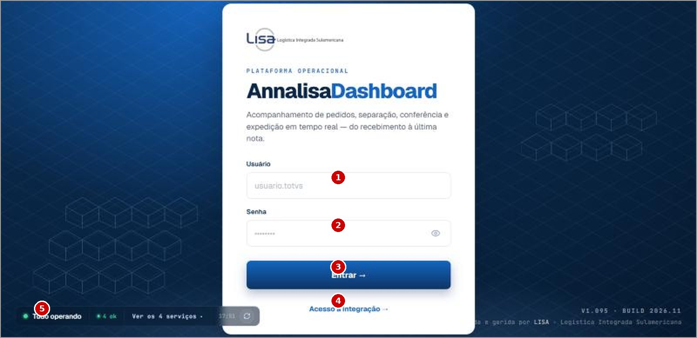 
  <b>Figura 1</b> — Tela de login

Os números em vermelho identificam cada item da tela. Nas tabelas a seguir, a coluna **Nº** indica o número correspondente.

| Nº | Item | Descrição |
|---|---|---|
| 1 | **Usuário** | Informe o seu usuário do Protheus. |
| 2 | **Senha** | A mesma senha do Protheus. O ícone de olho mostra a senha digitada. |
| 3 | **Entrar** | Acessa a plataforma. |
| 4 | **Acesso à integração** | Entrada para clientes/convidados que só consultam a documentação das APIs (não usam login do Protheus). |
| 5 | **Status dos serviços** | Indica se os servidores TOTVS estão respondendo (“Tudo operando”). Clique em “Ver os serviços” para detalhes. |

### 3.2 Sessão, inatividade e saída

- A sessão expira após o tempo de inatividade definido no seu cadastro (padrão de 120 minutos). Depois disso é preciso entrar de novo.
- Use sempre o botão **Encerrar sessão** (rodapé do menu lateral) para sair.
- **Fechar o navegador sem sair bloqueia a sessão por 5 minutos.** Nesse período não é possível entrar de novo com o mesmo usuário em outra máquina.
- O número de sessões simultâneas também é limitado por usuário.

### 3.3 Acesso negado

Se você abrir um módulo que não está liberado no seu cadastro (por exemplo, por um link enviado por um colega), a plataforma mostra a mensagem abaixo. Para pedir liberação, abra um ticket para a T.I. (veja o Manual do Tickets).

  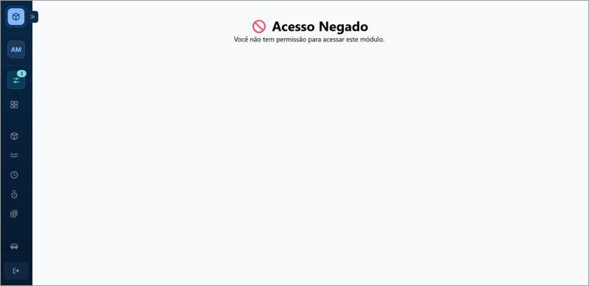 
  <b>Figura 2</b> — Módulo sem permissão para o usuário

---

## 4. Navegação geral

### 4.1 Dashboard (tela inicial)

Depois do login, abre o Dashboard com boas-vindas, um resumo da plataforma e os cartões de todos os módulos liberados, agrupados por área.

  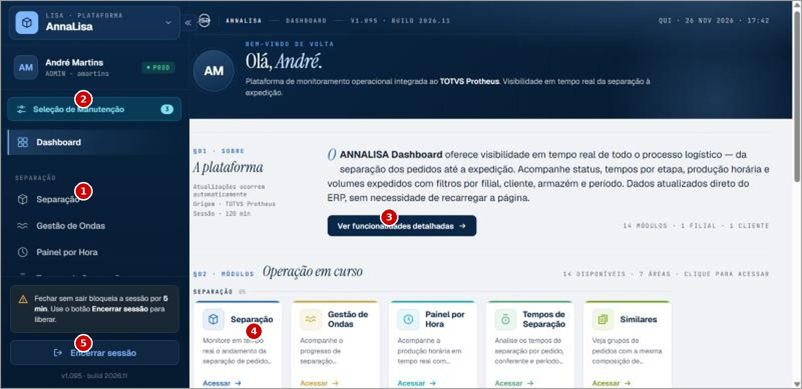 
  <b>Figura 3</b> — Dashboard – tela inicial

| Nº | Item | Descrição |
|---|---|---|
| 1 | **Menu lateral** | Acesso a todos os módulos, agrupados em Separação, Entrada, Saída, Estoque, Consultas e Relatórios, Integrações e Gestão. O botão « no topo recolhe o menu para ganhar espaço. |
| 2 | **Seleção de Manutenção** | Recorte de cliente, filial e grupo que vale para todas as telas (ver item 4.3). |
| 3 | **Ver funcionalidades detalhadas** | Abre a página “Sobre a Plataforma”, com a descrição de cada módulo. |
| 4 | **Cartões de módulos** | Clique em **Acessar** para abrir o módulo. |
| 5 | **Encerrar sessão** | Sai da plataforma e libera a sessão. |

Mais abaixo, o Dashboard mostra os dados da sua sessão e o status dos serviços TOTVS.

  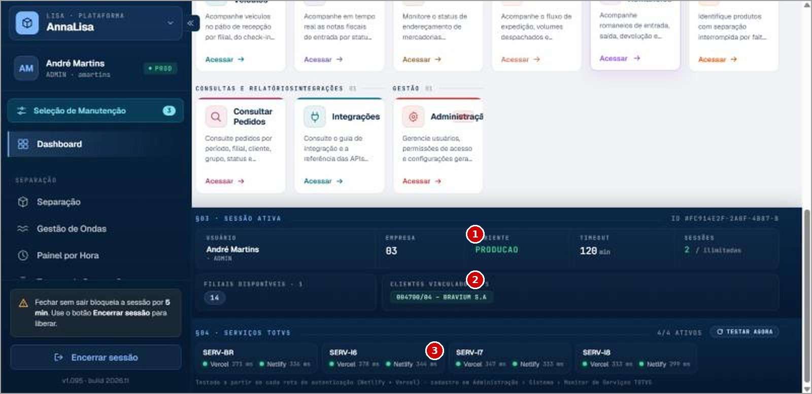 
  <b>Figura 4</b> — Dashboard – sessão ativa e serviços TOTVS

| Nº | Item | Descrição |
|---|---|---|
| 1 | **Sessão ativa** | Usuário, empresa, ambiente (Produção/Homologação), tempo de timeout e quantidade de sessões abertas. |
| 2 | **Filiais disponíveis e clientes vinculados** | O que o seu cadastro permite enxergar. |
| 3 | **Serviços TOTVS** | Tempo de resposta de cada servidor. O botão **Testar agora** refaz o teste. |

### 4.2 Troca de plataforma (AnnaLisa × Tickets)

O ícone no topo do menu lateral alterna entre as plataformas que o seu usuário pode acessar.

  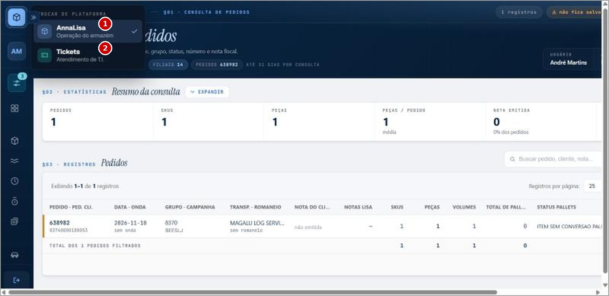 
  <b>Figura 5</b> — Seletor de plataforma

| Nº | Item | Descrição |
|---|---|---|
| 1 | **AnnaLisa** | Operação do armazém (monitores e consultas). |
| 2 | **Tickets** | Atendimento da T.I. (abertura e acompanhamento de chamados). O uso do portal está descrito no **Manual do Tickets**, à parte. |

### 4.3 Seleção de Manutenção

Disponível para administradores e usuários com permissão. Restringe os dados carregados em **todas** as telas a um recorte de cliente, filial e grupo. Ela nunca amplia o acesso: só é possível escolher dentro do que o seu cadastro já permite. O número no ícone indica quantas opções estão ativas.

  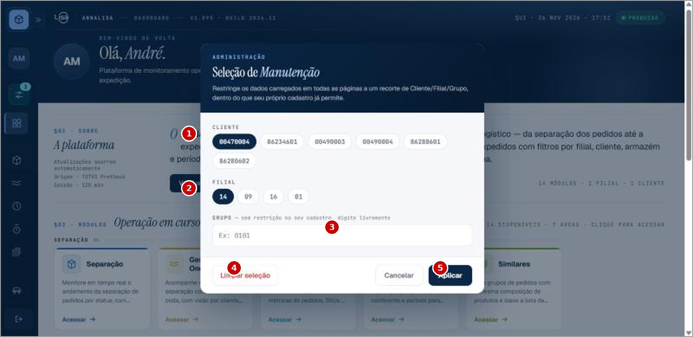 
  <b>Figura 6</b> — Seleção de Manutenção

| Nº | Item | Descrição |
|---|---|---|
| 1 | **Cliente** | Selecione um ou mais clientes do seu cadastro. |
| 2 | **Filial** | Selecione as filiais. |
| 3 | **Grupo** | Código de grupo de produtos (opcional). |
| 4 | **Limpar seleção** | Remove o recorte. |
| 5 | **Aplicar** | Aplica o recorte em todas as telas. |

### 4.4 Recursos comuns às telas

Os monitores seguem o mesmo padrão visual. Conhecendo estes recursos, fica fácil usar qualquer módulo:

| Recurso | Como funciona |
|---|---|
| Atualização automática | O canto superior direito mostra “Próxima atualização em mm:ss”. O botão ↻ força a atualização na hora. |
| Barra de carregamento | Mostra quantos registros já vieram do Protheus (ex.: 3.000 / 17.871). Os totais ficam completos ao chegar em 100%. |
| Cartões (indicadores) | Na maioria das telas, clicar em um cartão filtra a lista abaixo. |
| Filtros | Botão **Filtros** (topo) ou **Filtros avançados** (acima da lista). O número no botão indica filtros ativos. Alguns filtros recarregam os dados do Protheus; a busca em tela é instantânea. |
| Busca | Campo “Buscar…” pesquisa em todas as colunas já carregadas, sem nova consulta. |
| Ordenação | Seletor ao lado da busca (ex.: Status · Data · Hora · Cliente). |
| Exportar | Botão ⬇ / **Exportar**: baixa CSV ou JSON, conforme a sua permissão. |
| Detalhe (olho) | O ícone de olho no fim da linha abre o detalhe do registro. |
| Paginação | Registros por página (25, 100, 500…) e setas « ‹ › » no topo e no rodapé da lista. |

### Regra

> Os limites de período (por exemplo, “Período máximo 90 ou 120 dias”) são definidos no cadastro de cada usuário. Se uma tela não aceitar o período desejado, peça ajuste à T.I.

---

## 5. Separação

### 5.1 Monitor de Separação

Visão completa e em tempo real de todos os pedidos no processo de separação, organizados por status. É a tela que substitui o antigo Monitor de Pedidos.

  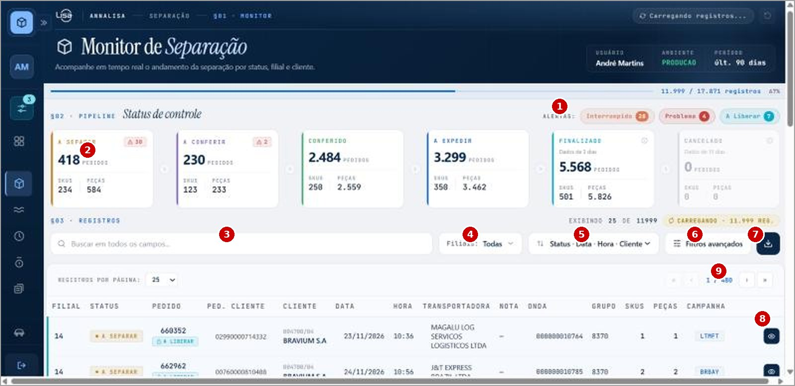 
  <b>Figura 7</b> — Monitor de Separação

| Nº | Item | Descrição |
|---|---|---|
| 1 | **Alertas** | Totais de pedidos **Interrompido** (separação parada por falta de saldo no picking), **Problema** e **A Liberar**. Clique para listar só esses pedidos. |
| 2 | **Status de controle** | Cartões A Separar, A Conferir, Conferido, A Expedir, Finalizado (últimos 3 dias) e Cancelado (últimos 15 dias), com pedidos, SKUs e peças. O selo vermelho no cartão indica quantos pedidos daquele status têm alerta. |
| 3 | **Busca** | Pesquisa por pedido, cliente, transportadora, nota, campanha etc. |
| 4 | **Filiais** | Escolhe as filiais exibidas. |
| 5 | **Ordenação** | Da lista. |
| 6 | **Filtros avançados** | Período e clientes (Figura 8). |
| 7 | **Exportar** | CSV resumo (com sub-status), JSON completo ou CSV com detalhe de produtos. |
| 8 | **Detalhe do pedido** | (olho). |
| 9 | **Paginação** | E quantidade de registros por página. |

Colunas da lista: Filial, Status, Pedido (com selo de sub-status, ex.: A LIBERAR), Pedido do cliente, Cliente, Data, Hora, Transportadora, Nota, Onda, Grupo, SKUs, Peças e Campanha.

  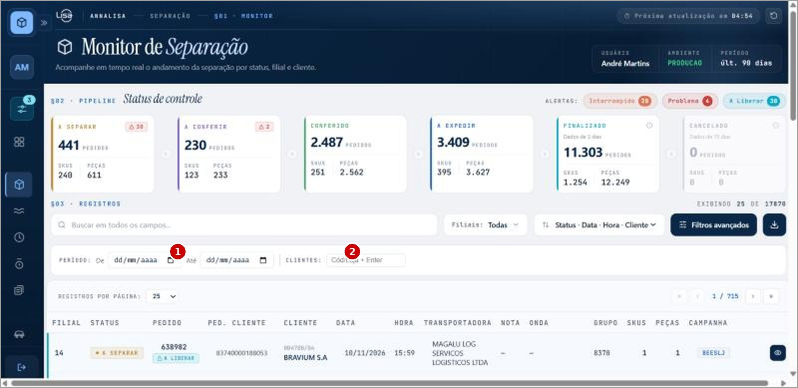 
  <b>Figura 8</b> — Monitor de Separação – filtros avançados

| Nº | Item | Descrição |
|---|---|---|
| 1 | **Período** | Data inicial e final dos pedidos. |
| 2 | **Clientes** | Digite Código/Loja e tecle Enter para adicionar. |

### Detalhe do pedido

Clique no olho de qualquer linha para abrir o detalhe completo do pedido.

  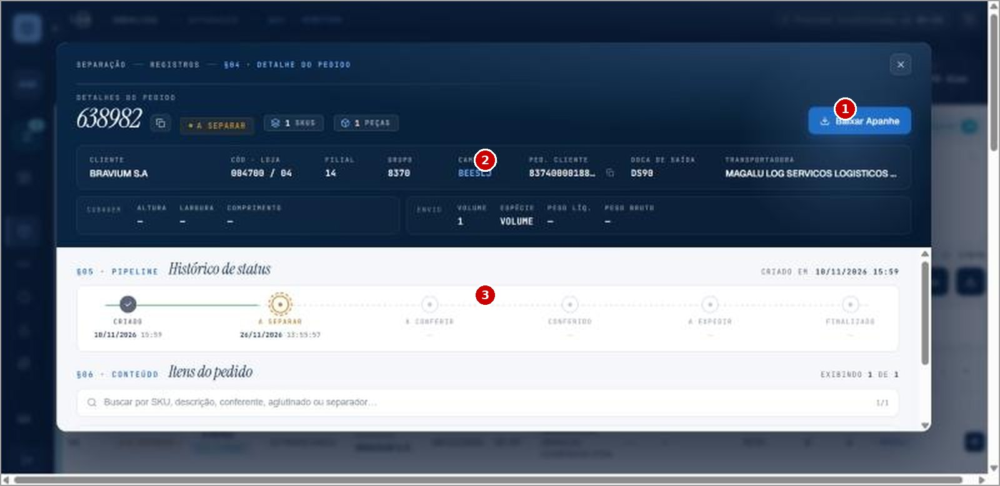 
  <b>Figura 9</b> — Detalhe do pedido – cabeçalho e histórico de status

| Nº | Item | Descrição |
|---|---|---|
| 1 | **Baixar Apanhe** | Executa a baixa do apanhe do pedido no Protheus. Aparece só para usuários com essa permissão e pede confirmação antes de executar. |
| 2 | **Dados do pedido** | Cliente, código/loja, filial, grupo, campanha, pedido do cliente, doca de saída, transportadora, cubagem e dados de envio (volume, espécie, pesos). |
| 3 | **Histórico de status** | Linha do tempo Criado → A Separar → A Conferir → Conferido → A Expedir → Finalizado, com data e hora de cada etapa. |

  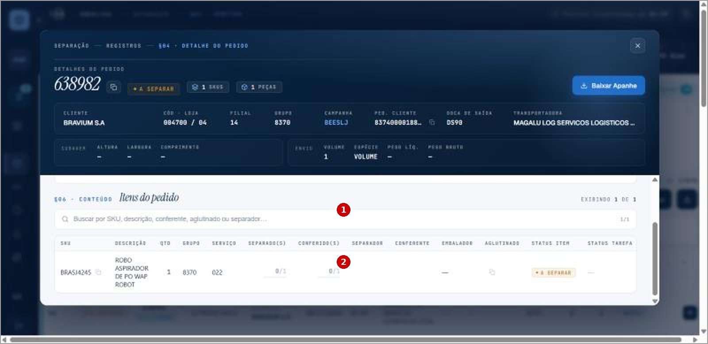 
  <b>Figura 10</b> — Detalhe do pedido – itens

| Nº | Item | Descrição |
|---|---|---|
| 1 | **Busca** | Por SKU, descrição, conferente, aglutinado ou separador. |
| 2 | **Itens do pedido** | SKU, descrição, quantidade, grupo, serviço, separado(s), conferido(s), separador, conferente, embalador, aglutinado, status do item e status da tarefa. |

> Em pedidos com separação **Interrompida**, há um atalho que leva direto ao Ressuprimento já filtrado naquele pedido (para quem tem acesso ao módulo).

### 5.2 Gestão de Ondas

Acompanha o progresso da separação consolidado por onda — pedidos agrupados pelo mesmo código de onda, do gerado ao concluído. A tela abre mostrando só as ondas em andamento.

  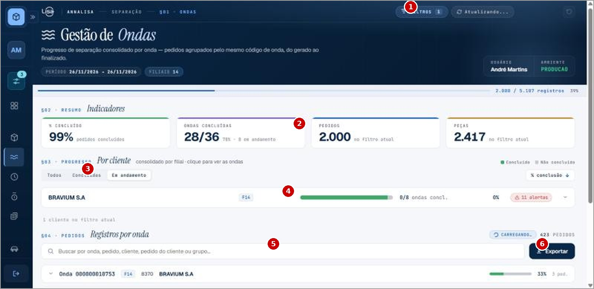 
  <b>Figura 11</b> — Gestão de Ondas

| Nº | Item | Descrição |
|---|---|---|
| 1 | **Filtros** | Período, onda específica, filiais, grupo e cliente (Figura 12). |
| 2 | **Indicadores** | % de pedidos concluídos, ondas concluídas/em andamento, pedidos e peças no filtro. |
| 3 | **Por cliente** | Alterna entre Todos, Concluídas e Em andamento. |
| 4 | **Progresso do cliente** | Barra de conclusão, ondas concluídas e alertas. Clique para ver as ondas dele. |
| 5 | **Busca** | Por onda, pedido, cliente, pedido do cliente ou grupo. |
| 6 | **Exportar** | Os pedidos filtrados para CSV (inclui separador e conferente). |

  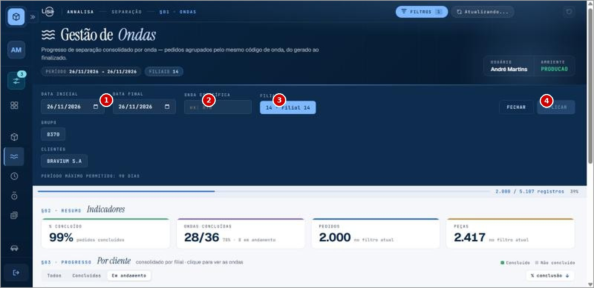 
  <b>Figura 12</b> — Gestão de Ondas – filtros

| Nº | Item | Descrição |
|---|---|---|
| 1 | **Data inicial / Data final** | (período máximo de 90 dias). |
| 2 | **Onda específica** | Número da onda. |
| 3 | **Filiais** | Disponíveis. |
| 4 | **Aplicar** | Os filtros (ou Fechar para descartar). |

Em **Registros por onda**, clique na seta de uma onda para expandi-la e ver os pedidos.

  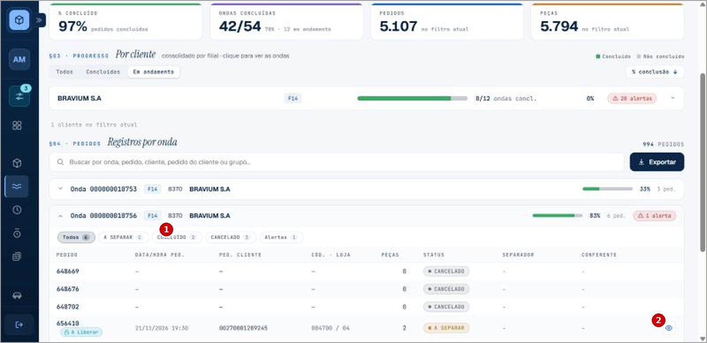 
  <b>Figura 13</b> — Gestão de Ondas – onda expandida

| Nº | Item | Descrição |
|---|---|---|
| 1 | **Chips de status** | Filtram os pedidos dentro da onda (Todos, A Separar, Concluído, Cancelado, Alertas). |
| 2 | **Detalhe do pedido** | (olho) — o mesmo detalhe do Monitor de Separação. |

Uma onda é considerada **concluída** quando todos os seus pedidos saíram do status A Separar.

### 5.3 Painel por Hora

Acompanha a produção ao longo do dia, hora a hora, com pedidos, SKUs e peças processadas.

  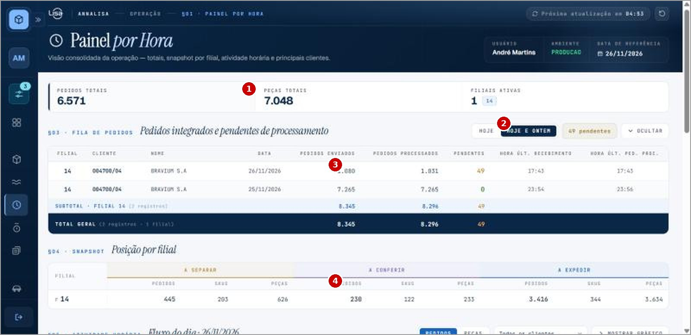 
  <b>Figura 14</b> — Painel por Hora – totais, fila e posição por filial

| Nº | Item | Descrição |
|---|---|---|
| 1 | **Totais do dia** | Pedidos, peças e filiais ativas. |
| 2 | **Hoje / Hoje e ontem** | Período da fila de pedidos. O botão **Ocultar** recolhe o painel. |
| 3 | **Fila de pedidos** | Pedidos enviados (integrados) × processados por filial/cliente, com destaque para os **pendentes** de processamento e o horário do último recebimento. |
| 4 | **Posição por filial (snapshot)** | Pedidos, SKUs e peças A Separar, A Conferir e A Expedir. |

  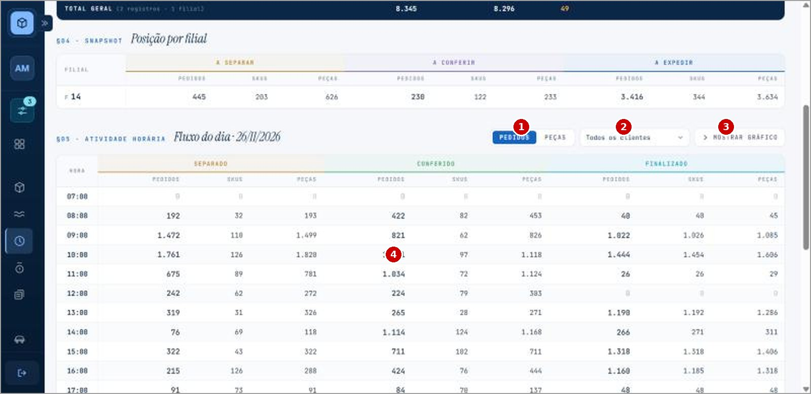 
  <b>Figura 15</b> — Painel por Hora – fluxo do dia

| Nº | Item | Descrição |
|---|---|---|
| 1 | **Pedidos / Peças** | Alterna a unidade da tabela. |
| 2 | **Cliente** | Filtra o fluxo por cliente. |
| 3 | **Mostrar gráfico** | Exibe o fluxo em gráfico. |
| 4 | **Tabela hora a hora** | Separado, conferido e finalizado em cada hora, com total do dia. |

Mais abaixo ficam os blocos **Pedidos a processar** (por filial e cliente) e **Produção por cliente** do dia.

### 5.4 Tempos de Separação

Mostra quanto tempo cada pedido leva em cada etapa do ciclo, do pedido à expedição. Valores menores indicam melhor desempenho.

| Etapa | O que mede |
|---|---|
| T1 | Pedido → início da separação (tempo até o armazém começar o pedido). |
| T2 | Início → fim da separação física dos itens. |
| T3 | Início → fim da conferência. |
| T4 | Fim da conferência → romaneio/nota fiscal. |
| T5 | Nota/fim da conferência → romaneio. |
| T6 | Romaneio → expedição (saída efetiva). |

  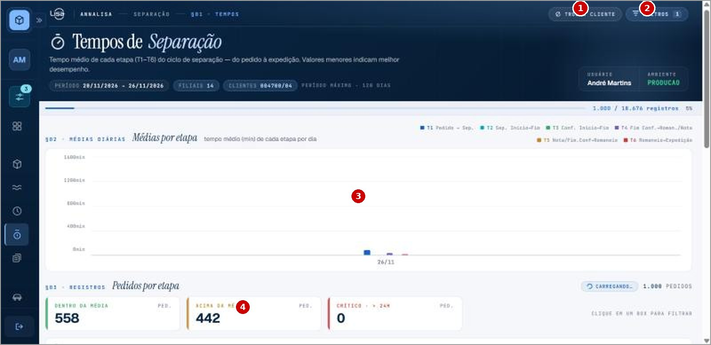 
  <b>Figura 16</b> — Tempos de Separação – médias por etapa

| Nº | Item | Descrição |
|---|---|---|
| 1 | **Trocar cliente** | Muda o cliente analisado. |
| 2 | **Filtros** | Período (máximo 120 dias), filiais e clientes. |
| 3 | **Médias por etapa** | Gráfico com o tempo médio (min) de cada etapa por dia. |
| 4 | **Pedidos por etapa** | Quantidade dentro da média, acima da média e crítico (mais de 24 h). |

  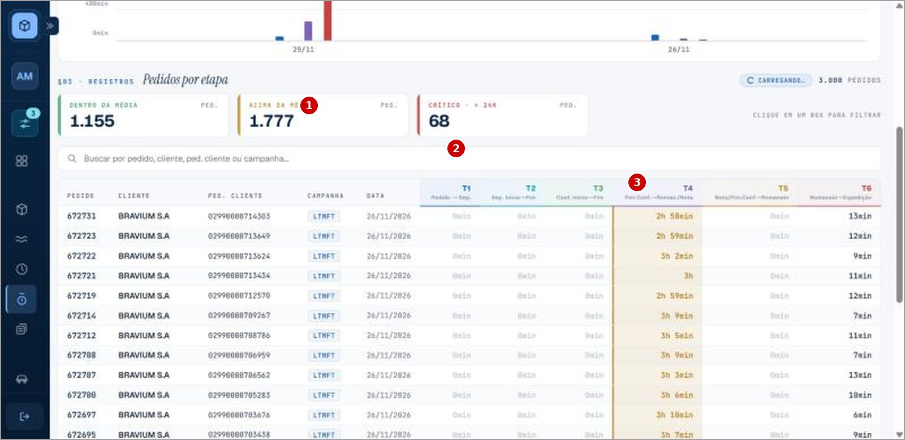 
  <b>Figura 17</b> — Tempos de Separação – lista de pedidos

| Nº | Item | Descrição |
|---|---|---|
| 1 | **Cartões** | Dentro da média / Acima da média / Crítico: clique para filtrar a lista. |
| 2 | **Busca** | Por pedido, cliente, pedido do cliente ou campanha. |
| 3 | **Colunas T1 a T6** | Tempo de cada etapa. Células destacadas indicam pedidos acima da média do período. |

### 5.5 Pedidos Similares

Encontra grupos de pedidos com exatamente a mesma composição de produtos (mesmos SKUs e quantidades) e gera a lista em TXT — útil para separar esses pedidos juntos.

  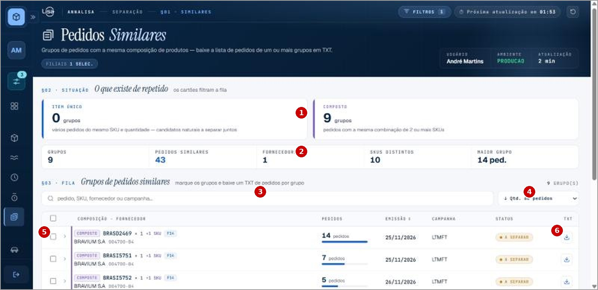 
  <b>Figura 18</b> — Pedidos Similares

| Nº | Item | Descrição |
|---|---|---|
| 1 | **Item único** | (vários pedidos do mesmo SKU e quantidade) e **Composto** (mesma combinação de 2 ou mais SKUs): clique para filtrar a fila. |
| 2 | **Resumo** | Grupos, pedidos similares, fornecedores, SKUs distintos e maior grupo. |
| 3 | **Busca** | Por pedido, SKU, fornecedor ou campanha. |
| 4 | **Ordenação** | Quantidade de pedidos, emissão mais antiga/recente ou SKU. |
| 5 | **Seleção** | Marque vários grupos para baixar tudo de uma vez pela barra de seleção. |
| 6 | **TXT** | Baixa a lista de pedidos do grupo (um pedido por linha, sem repetição). |

  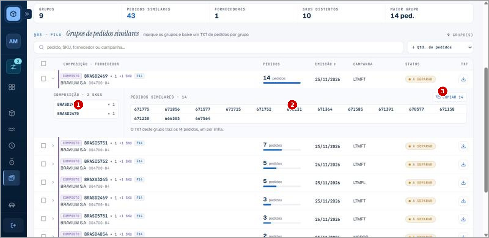 
  <b>Figura 19</b> — Pedidos Similares – grupo expandido

| Nº | Item | Descrição |
|---|---|---|
| 1 | **Composição** | Do grupo (SKUs e quantidades). |
| 2 | **Pedidos similares** | Todos os números de pedido do grupo. |
| 3 | **Copiar** | Copia os números de pedido para a área de transferência. |

---

## 6. Entrada

### 6.1 Monitor de Veículos

Acompanha os veículos no pátio de recepção, por filial, do check-in ao encerramento da operação.

  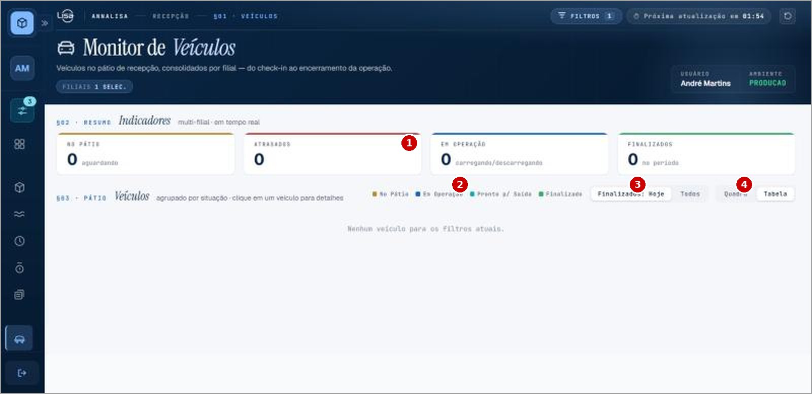 
  <b>Figura 20</b> — Monitor de Veículos

| Nº | Item | Descrição |
|---|---|---|
| 1 | **Indicadores** | No pátio (aguardando), Atrasados, Em operação (carregando/descarregando) e Finalizados. Clique em **Atrasados** para isolar os veículos sinalizados pelo TOTVS. |
| 2 | **Legenda das situações** | No Pátio, Em Operação, Pronto p/ Saída e Finalizado. |
| 3 | **Finalizados: Hoje / Todos** | . |
| 4 | **Quadro / Tabela** | Alterna entre o quadro (kanban por situação) e a tabela. A preferência fica salva. |

Clique em um veículo para ver transportadora, cliente, tipo de operação e horário de entrada. Situações exibidas: No pátio, Carregando, Descarregando, Carregado e Descarregado.

### 6.2 Monitor de Recebimentos

Acompanha as notas fiscais de entrada e o andamento da conferência e do endereçamento (últimos 90 dias por padrão).

  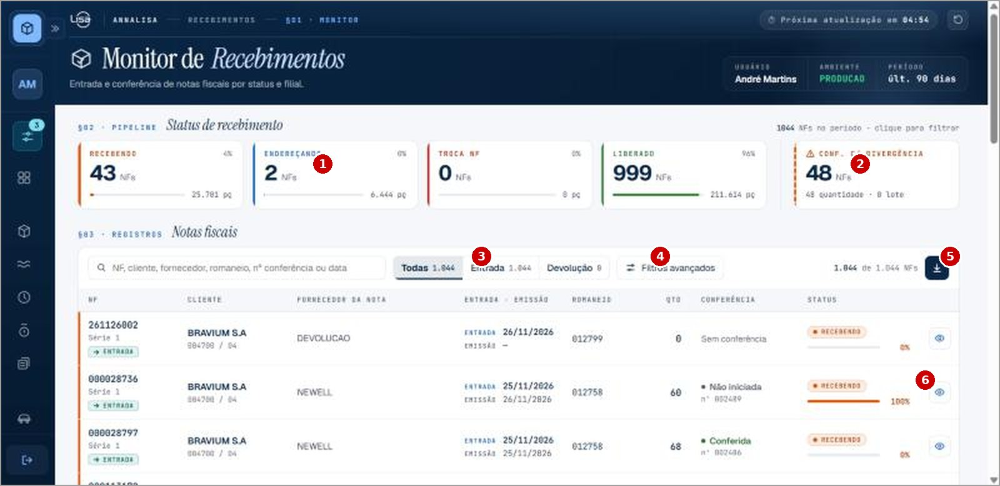 
  <b>Figura 21</b> — Monitor de Recebimentos

| Nº | Item | Descrição |
|---|---|---|
| 1 | **Status de recebimento** | Recebendo, Endereçando, Troca NF e Liberado, com quantidade de NFs, peças e percentual. Clique para filtrar. |
| 2 | **Conf. c/ divergência** | NFs cuja conferência teve diferença de quantidade ou lote. |
| 3 | **Todas / Entrada / Devolução** | Tipo de nota. |
| 4 | **Filtros avançados** | . |
| 5 | **Exportar** | . |
| 6 | **Detalhe da NF** | (olho). A barra na coluna Status mostra o progresso real da NF. |

| Status | Significado |
|---|---|
| RECEBENDO | Itens sendo contados/conferidos. |
| ENDEREÇANDO | Itens conferidos, aguardando posicionamento no armazém. |
| TROCA NF | Aguardando emissão da nota fiscal de troca. |
| LIBERADO | Processo concluído: saldo zerado ou produto sem controle de endereçamento. |

  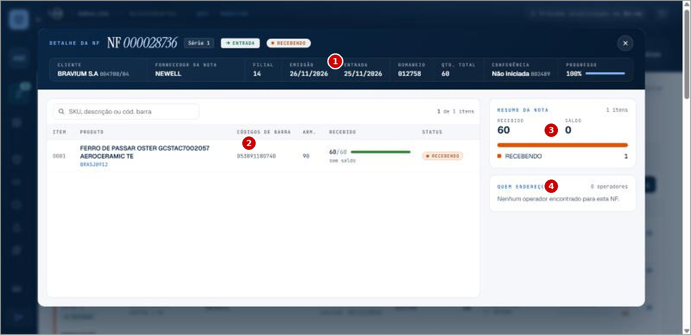 
  <b>Figura 22</b> — Detalhe da NF de entrada

| Nº | Item | Descrição |
|---|---|---|
| 1 | **Cabeçalho** | Cliente, fornecedor, filial, emissão, entrada, romaneio, quantidade total, conferência e progresso. |
| 2 | **Itens** | Produto, códigos de barra, armazém, recebido × total e status de cada item. Use a busca por SKU, descrição ou código de barras. |
| 3 | **Resumo da nota** | Total recebido e saldo. |
| 4 | **Quem endereçou** | Operadores que endereçaram a NF e quantidade de cada um. |

### 6.3 Monitor de Endereçamento

Monitora os saldos pendentes de endereçamento das mercadorias recebidas, em quatro abas.

  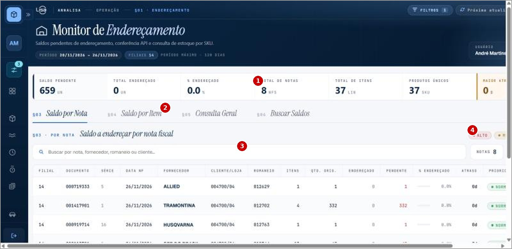 
  <b>Figura 23</b> — Endereçamento – Saldo por Nota

| Nº | Item | Descrição |
|---|---|---|
| 1 | **Indicadores** | Saldo pendente, total endereçado, % endereçado, notas, itens, produtos únicos e maior atraso (dias). |
| 2 | **Abas** | Saldo por Nota, Saldo por Item, Consulta Geral e Buscar Saldos. |
| 3 | **Busca** | Por nota, fornecedor, romaneio ou cliente. |
| 4 | **Prioridade** | Alto, Médio e Normal, conforme o atraso da nota. |

  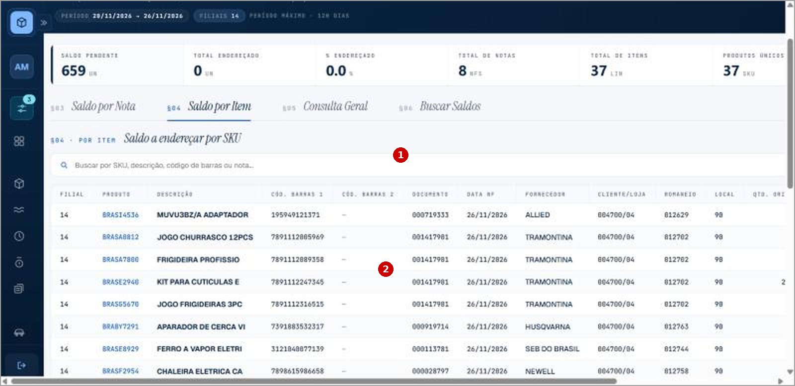 
  <b>Figura 24</b> — Endereçamento – Saldo por Item

| Nº | Item | Descrição |
|---|---|---|
| 1 | **Visão analítica** | Uma linha por SKU pendente. |
| 2 | **Colunas** | Produto, descrição, códigos de barras, documento, data NF, fornecedor, cliente/loja, romaneio, local, quantidade original, endereçado, pendente e % endereçado. |

  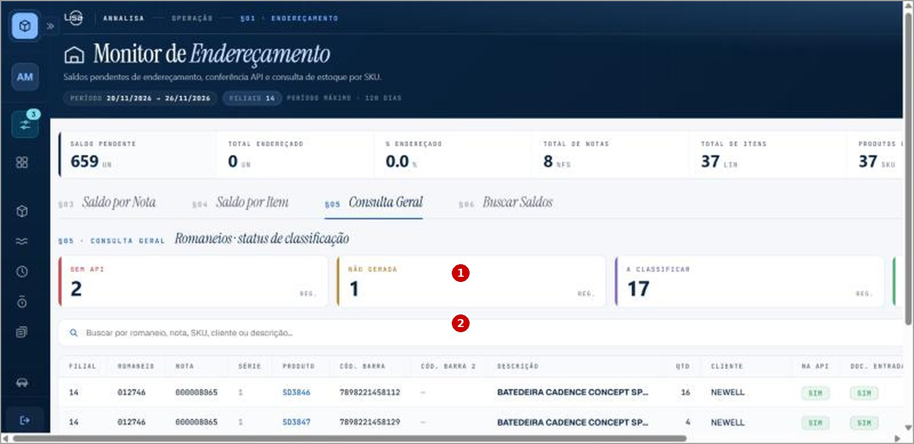 
  <b>Figura 25</b> — Endereçamento – Consulta Geral

| Nº | Item | Descrição |
|---|---|---|
| 1 | **Status de classificação dos romaneios** | Sem API, Não gerada, A classificar e Classificada (clique para filtrar). |
| 2 | **Busca** | Por romaneio, nota, SKU, cliente ou descrição. A lista mostra se o item está na API e se já tem documento de entrada. |

  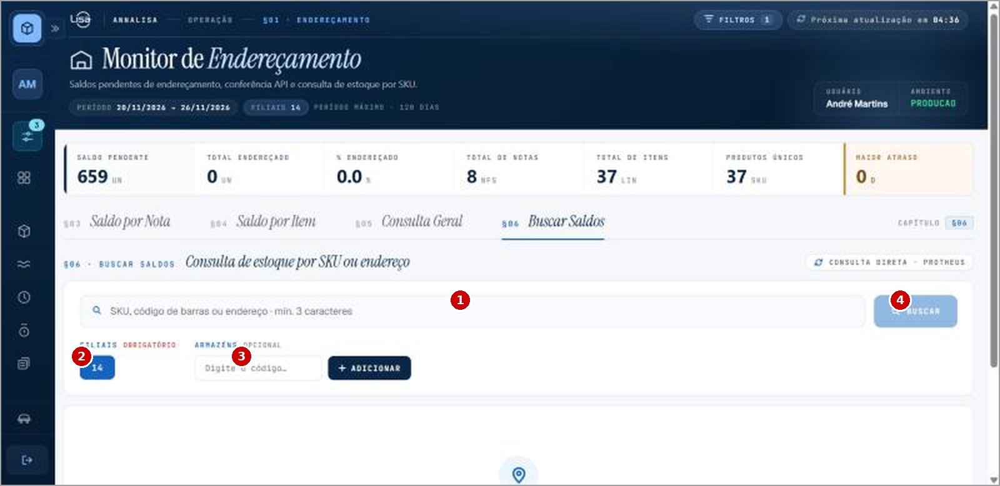 
  <b>Figura 26</b> — Endereçamento – Buscar Saldos

| Nº | Item | Descrição |
|---|---|---|
| 1 | **Busca** | SKU, código de barras ou endereço (mínimo de 3 caracteres). |
| 2 | **Filiais** | (obrigatório). |
| 3 | **Armazéns** | (opcional): digite o código e clique em Adicionar. |
| 4 | **Buscar** | Consulta direto no Protheus e lista filial, SKU, descrição, códigos de barra, endereço, quantidade e armazém. |

---

## 7. Saída

### 7.1 Monitor de Expedição

Acompanha os pedidos na etapa final do fluxo: Conferido, A Expedir e Finalizado.

  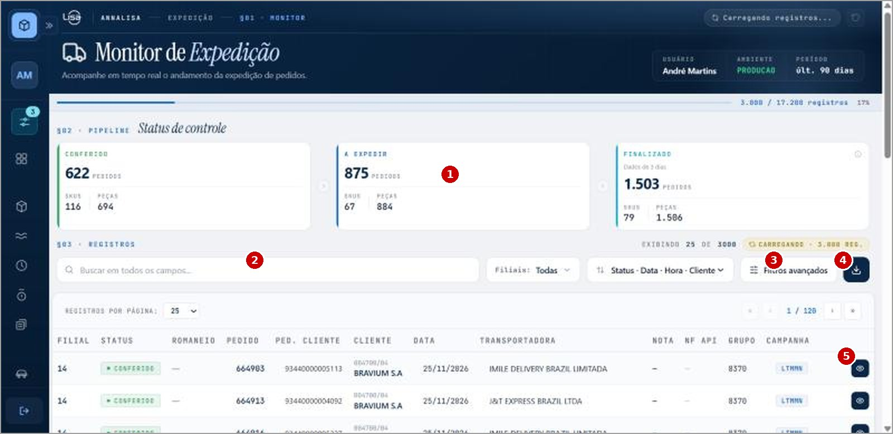 
  <b>Figura 27</b> — Monitor de Expedição

| Nº | Item | Descrição |
|---|---|---|
| 1 | **Status de controle** | Conferido, A Expedir e Finalizado (últimos 3 dias), com pedidos, SKUs e peças. |
| 2 | **Busca** | Por pedido, cliente, transportadora, nota ou campanha. |
| 3 | **Filtros avançados** | . |
| 4 | **Exportar** | (CSV ou JSON). |
| 5 | **Detalhe do pedido** | (olho): itens, histórico de status e Baixar Apanhe (com permissão). |

Colunas: Filial, Status, Romaneio, Pedido, Pedido do cliente, Cliente, Data, Transportadora, Nota, NF API, Grupo e Campanha.

### 7.2 Monitor de Romaneios

Acompanha os romaneios de entrada, saída, devolução e cancelamento. O que exige ação aparece primeiro.

  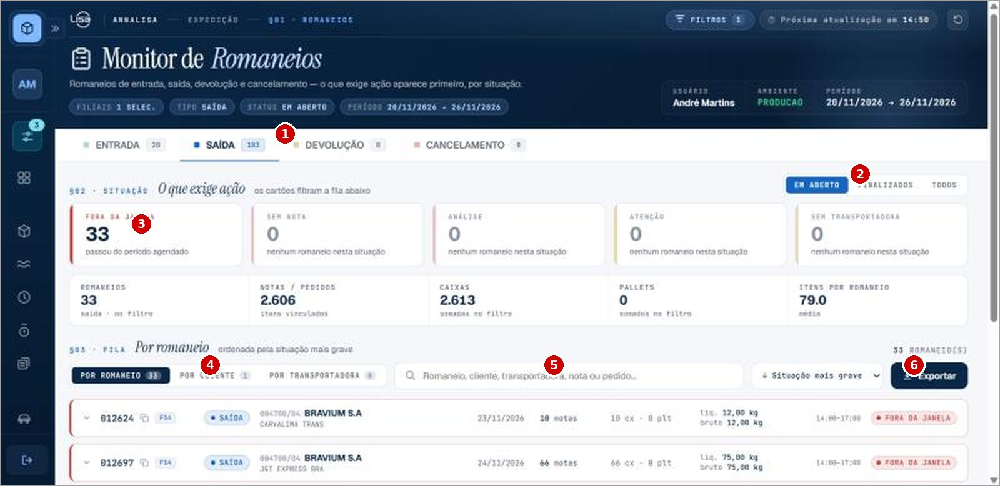 
  <b>Figura 28</b> — Monitor de Romaneios

| Nº | Item | Descrição |
|---|---|---|
| 1 | **Abas por tipo** | Entrada, Saída, Devolução e Cancelamento (com a quantidade de cada). |
| 2 | **Em aberto / Finalizados / Todos** | . |
| 3 | **Situação** | Fora da janela, Sem nota, Análise, Atenção e Sem transportadora. Clique para filtrar. |
| 4 | **Lentes** | Por romaneio, Por cliente ou Por transportadora. |
| 5 | **Busca** | Por romaneio, cliente, transportadora, nota ou pedido. |
| 6 | **Exportar** | Para CSV. |

  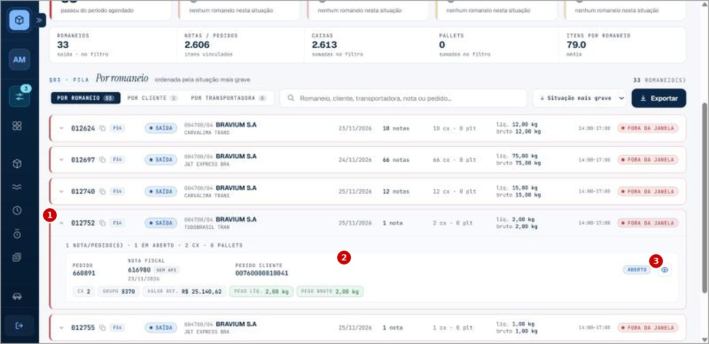 
  <b>Figura 29</b> — Monitor de Romaneios – romaneio expandido

| Nº | Item | Descrição |
|---|---|---|
| 1 | **Romaneio** | Clique na seta para expandir. A linha mostra cliente, transportadora, data, notas, caixas/paletes, pesos, janela de horário e situação. |
| 2 | **Notas e pedidos vinculados** | Pedido, nota fiscal, pedido do cliente, caixas, grupo, valor e pesos. |
| 3 | **Detalhe** | Do pedido/nota. Para romaneios de Saída e Devolução finalizados, também é possível abrir o PDF assinado. |

---

## 8. Estoque – Ressuprimento

Identifica os produtos com separação **interrompida** por falta de estoque no endereço de picking e mostra de quais pulmões transferir para retomar a separação. Gera o mapa de transferência em PDF.

  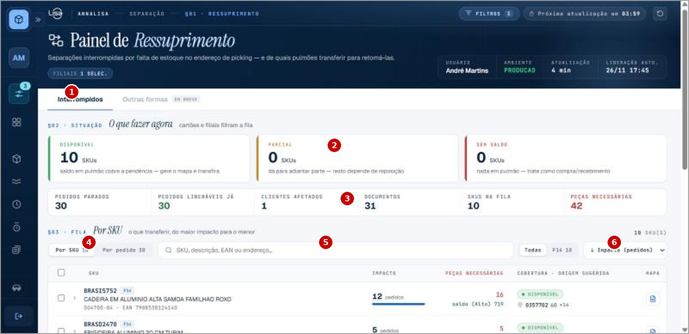 
  <b>Figura 30</b> — Painel de Ressuprimento

| Nº | Item | Descrição |
|---|---|---|
| 1 | **Interrompidos** | (aba atual). “Outras formas” estará disponível em breve. |
| 2 | **O que fazer agora** | Disponível (o saldo no pulmão cobre a pendência — gere o mapa e transfira), Parcial (dá para adiantar parte) e Sem saldo (tratar como compra/recebimento). Clique para filtrar. |
| 3 | **Indicadores** | Pedidos parados, pedidos liberáveis já, clientes afetados, documentos, SKUs na fila e peças necessárias. |
| 4 | **Por SKU / Por pedido** | As duas lentes da fila. |
| 5 | **Busca** | Por SKU, descrição, EAN, endereço, pedido ou cliente. |
| 6 | **Ordenação** | Impacto (pedidos), documentos, peças necessárias ou SKU. |

  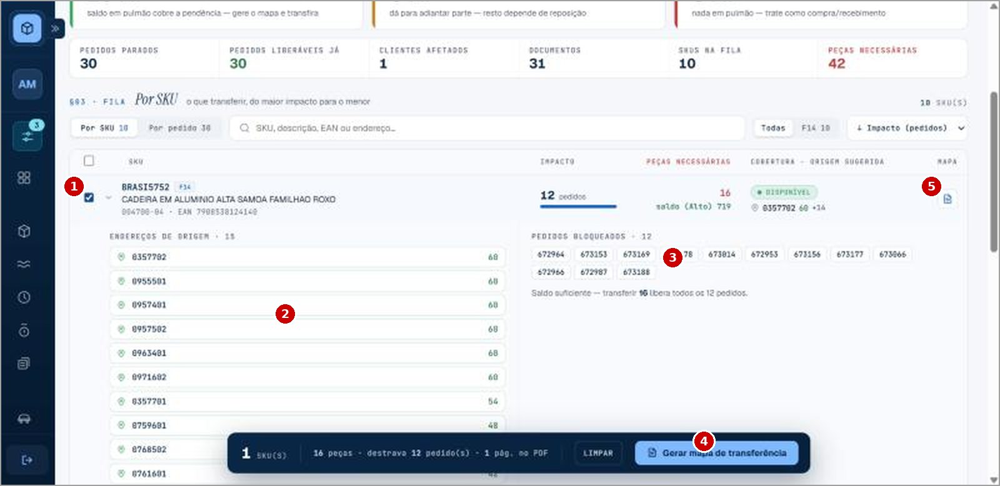 
  <b>Figura 31</b> — Ressuprimento – SKU expandido e geração do mapa

| Nº | Item | Descrição |
|---|---|---|
| 1 | **Seleção** | Marque um ou mais SKUs com cobertura Disponível ou Parcial. |
| 2 | **Endereços de origem** | Endereços de pulmão com saldo e a quantidade em cada um. |
| 3 | **Pedidos bloqueados** | Pedidos que serão liberados com a transferência. |
| 4 | **Gerar mapa de transferência** | Barra de seleção com SKUs, peças e pedidos destravados. Gera um PDF com código de barras do produto e dos endereços de origem. |
| 5 | **Mapa de um SKU** | Ícone para gerar o mapa só daquele produto. |

> O quadro **Liberação Auto.** (topo da tela) mostra quando rodou pela última vez o processo automático que libera os pedidos interrompidos depois que o produto é reabastecido. Depois de transferir, aguarde esse processo ou acompanhe pelo Monitor de Separação.

---

## 9. Consultas – Consultar Pedidos

Consulta pedidos por período, filial, cliente, grupo, status e número, para análise, auditoria e conferência com o cliente. Diferente dos monitores, esta tela **só consulta quando você pede**.

  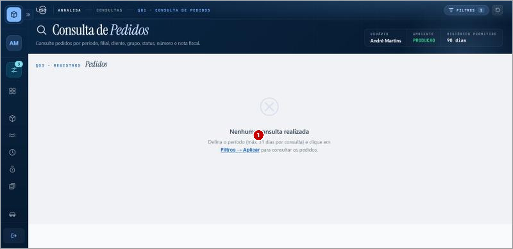 
  <b>Figura 32</b> — Consulta de Pedidos – tela inicial

| Nº | Item | Descrição |
|---|---|---|
| 1 | — | Defina o período (máximo de 31 dias por consulta) e clique em **Filtros → Aplicar**. |

  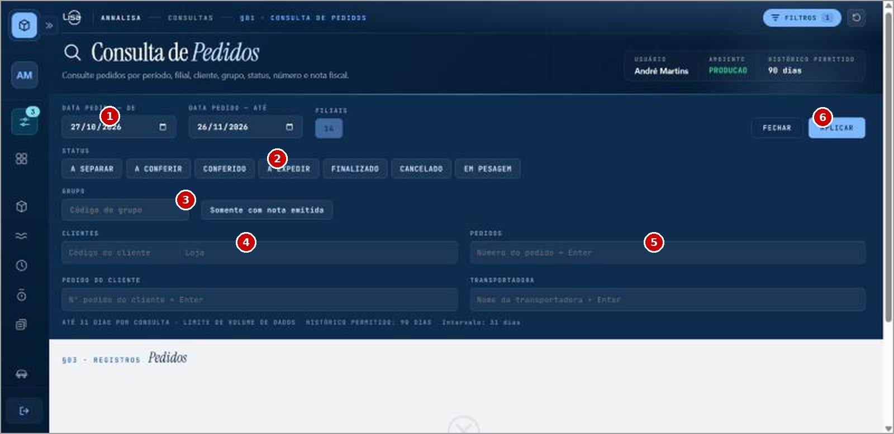 
  <b>Figura 33</b> — Consulta de Pedidos – filtros

| Nº | Item | Descrição |
|---|---|---|
| 1 | **Data do pedido – de / até** | (até 31 dias por consulta, dentro do histórico permitido de 90 dias). |
| 2 | **Status** | Um ou mais (A Separar, A Conferir, Conferido, A Expedir, Finalizado, Cancelado, Em Pesagem). |
| 3 | **Grupo** | E **Somente com nota emitida**. |
| 4 | **Clientes** | Código e loja. |
| 5 | **Pedidos** | Digite o número e tecle Enter (aceita vários). O mesmo vale para Pedido do cliente e Transportadora. |
| 6 | **Aplicar** | Executa a consulta. |

  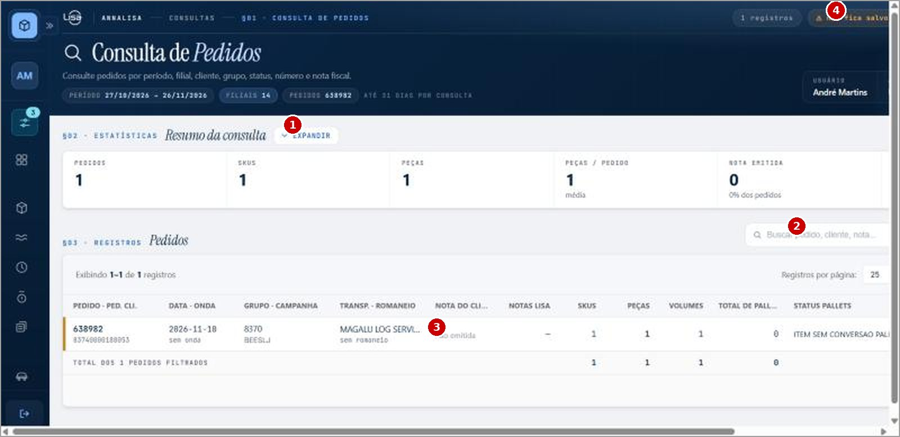 
  <b>Figura 34</b> — Consulta de Pedidos – resultado

| Nº | Item | Descrição |
|---|---|---|
| 1 | **Resumo da consulta** | Pedidos, SKUs, peças, peças por pedido, notas emitidas e clientes. **Expandir** mostra totais por status, filial, cliente, grupo, transportadora ou campanha. |
| 2 | **Busca** | Dentro do resultado. |
| 3 | **Lista de pedidos** | Com nota do cliente, notas Lisa, SKUs, peças, volumes, paletes e status. O olho abre o mesmo detalhe da Separação. |
| 4 | **Aviso “não fica salvo”** | O resultado não é guardado. Ao sair da tela ou recarregar, é preciso consultar de novo (os filtros, sim, ficam salvos). |

### Regra

> Se muitas consultas pesadas estiverem rodando ao mesmo tempo, a sua pode ser adiada para proteger o servidor. Nesse caso, aguarde alguns instantes e tente de novo.

---

## 10. Integrações

Guia de integração e referência das APIs do WMS da Lisa, para equipes de clientes e parceiros que conectam sistemas externos. Clientes sem usuário no Protheus acessam pelo link **Acesso à integração** da tela de login, com credencial de convidado.

  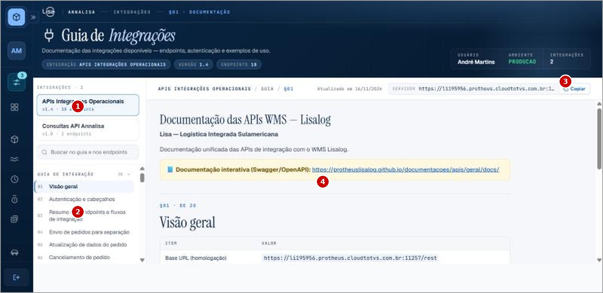 
  <b>Figura 35</b> — Guia de Integrações

| Nº | Item | Descrição |
|---|---|---|
| 1 | **Integrações disponíveis** | APIs Integrações Operacionais e Consultas API AnnaLisa (com versão e número de endpoints). |
| 2 | **Guia de integração** | Sumário das seções (visão geral, autenticação, fluxos, exemplos, glossário de códigos). Há também busca no guia e nos endpoints. |
| 3 | **Servidor** | URL base da API, com botão Copiar. |
| 4 | **Conteúdo** | Texto do guia, tabelas e exemplos (cURL e JSON copiáveis com um clique). |

### Regra

> Chave de acesso, senha, x-id-cliente e código da filial para uso das APIs são fornecidos pelo time de operações da Lisa. Nunca envie essas credenciais por canais abertos.

---

## 11. Administração (gestores e T.I.)

Área exclusiva para administradores. Controla quem acessa a plataforma, o que cada usuário vê e os parâmetros do sistema. Tem três abas: **Usuários**, **Sistema** (parâmetros por módulo) e **Segurança** (sessões abertas e tentativas de login).

  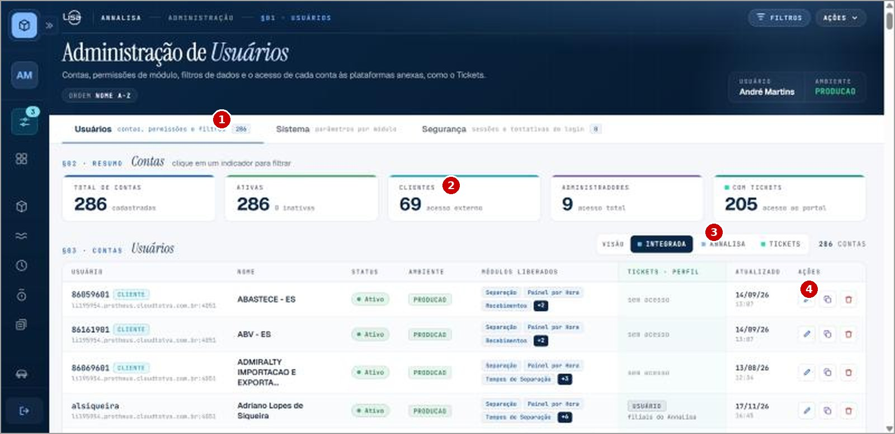 
  <b>Figura 36</b> — Administração de Usuários

| Nº | Item | Descrição |
|---|---|---|
| 1 | **Abas** | Usuários, Sistema e Segurança. |
| 2 | **Resumo das contas** | Total, ativas, clientes (acesso externo), administradores e com acesso ao Tickets. Clique para filtrar. |
| 3 | **Visão** | Integrada, só AnnaLisa ou só Tickets. |
| 4 | **Ações por conta** | Editar, copiar configurações para outro usuário e excluir. |

  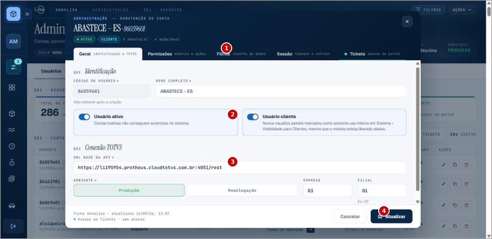 
  <b>Figura 37</b> — Manutenção de conta – Geral

| Nº | Item | Descrição |
|---|---|---|
| 1 | **Abas da conta** | Geral, Permissões, Filtros, Sessão e Tickets. |
| 2 | **Usuário ativo** | E **Usuário cliente** (cliente nunca vê painéis marcados como de uso interno). |
| 3 | **Conexão TOTVS** | URL da API, ambiente, empresa e filial. |
| 4 | **Atualizar** | Grava as alterações (Cancelar descarta). |

  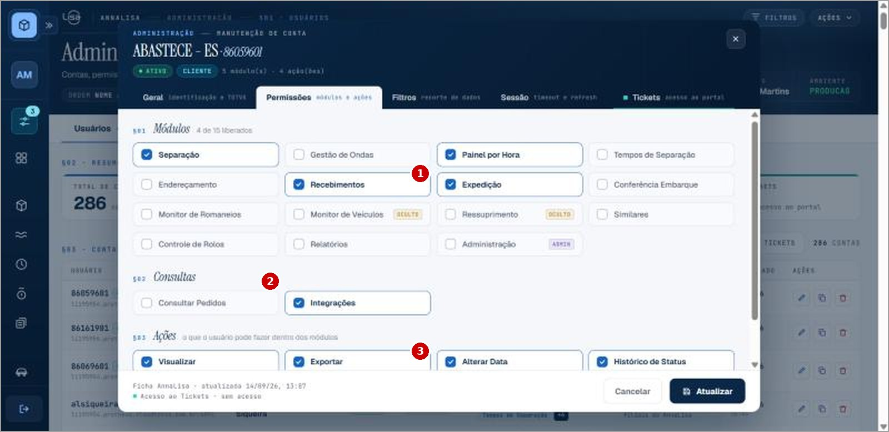 
  <b>Figura 38</b> — Manutenção de conta – Permissões

| Nº | Item | Descrição |
|---|---|---|
| 1 | **Módulos** | Liberados para o usuário. |
| 2 | **Consultas** | Consultar Pedidos e Integrações. |
| 3 | **Ações** | Dentro dos módulos: Visualizar, Exportar, Alterar Data, Histórico de Status, Baixar Apanhe e Seleção de Manutenção. |

Nas demais abas da conta:

- **Filtros**: clientes permitidos e negados, filiais para consulta, grupos de produtos, status permitidos e janelas de consulta (período máximo geral, limite do Recebimento, dos Romaneios e da Conferência Embarque).
- **Sessão**: timeout por inatividade, sessões simultâneas, **Modo Tela** (TV/painel sem logout automático — usar só em contas técnicas de visualização) e intervalos de auto-sincronização da Separação e da Expedição.
- **Tickets**: perfil de acesso ao portal de Tickets.

> Alterações em permissões e filtros têm efeito no próximo login do usuário. Use o recurso de **copiar configurações** para cadastrar colaboradores novos com o mesmo perfil de um colega.

---

## 12. Glossário de status

### 12.1 Status do pedido

| Status | Significado |
|---|---|
| A SEPARAR | Pedido liberado, aguardando ou em separação. |
| A CONFERIR | Separação concluída, aguardando conferência. |
| EM PESAGEM | Pedido na etapa de pesagem. |
| CONFERIDO | Conferência concluída. |
| A EXPEDIR | Pronto para expedição (aguardando romaneio/saída). |
| FINALIZADO | Pedido expedido. Os monitores mostram os últimos dias (ex.: 3 dias). |
| CANCELADO | Pedido cancelado. Não pode mais ter o status alterado. |

### 12.2 Sub-status e alertas

| Selo | Significado |
|---|---|
| INTERROMPIDO | Separação parada por falta de saldo no endereço de picking — tratar no Ressuprimento. |
| PROBLEMA | Pedido com problema apontado na operação; exige verificação. |
| A LIBERAR | Pedido ainda não liberado para a separação. |

---

## 13. Validações e dúvidas frequentes

| Situação | O que fazer |
|---|---|
| Não consigo entrar depois de fechar o navegador. | A sessão fica bloqueada por 5 minutos quando se fecha sem sair. Aguarde e tente de novo. Use sempre **Encerrar sessão**. |
| Aparece “Acesso Negado”. | O módulo não está liberado no seu cadastro. Abra um ticket para a T.I. pedindo a liberação. |
| Os números da tela estão diferentes do Protheus. | Verifique se a barra de carregamento chegou a 100% e se não há filtro, filial ou Seleção de Manutenção ativa. Use ↻ para forçar a atualização. |
| Não vejo uma filial ou cliente. | As filiais e clientes visíveis são definidos no seu cadastro. Peça ajuste à T.I. |
| A Consulta de Pedidos sumiu ao voltar para a tela. | O resultado não fica salvo. Clique em Filtros → Aplicar de novo (os filtros continuam preenchidos). |
| O período que preciso não é aceito. | Cada tela tem um período máximo (ex.: 31 dias na Consulta, 90/120 dias nos monitores). Divida a consulta ou peça ajuste à T.I. |
| Serviços TOTVS fora do ar. | Confira o status na tela de login ou no Dashboard. Se persistir, abra um ticket. |

### Módulos não exibidos neste manual

Os módulos **Conferência Embarque**, **Controle de Rolos** e **Relatórios** existem na plataforma, mas não estavam liberados para o perfil usado na captura das telas. Eles serão incluídos numa próxima versão deste manual.

---

## 14. Mensagens

| Mensagem | Causa |
|---|---|
| Acesso Negado – Você não tem permissão para acessar este módulo. | O módulo não está liberado no cadastro do usuário. |
| Fechar sem sair bloqueia a sessão por 5 min. | Aviso fixo do menu: usar **Encerrar sessão** ao terminar. |
| Carregando registros do TOTVS… | A tela está buscando os dados no Protheus; acompanhar a barra de carregamento. |
| Nenhuma consulta realizada | Consulta de Pedidos ainda sem filtros aplicados: usar **Filtros → Aplicar**. |
| não fica salvo | O resultado da Consulta de Pedidos não é guardado ao sair ou recarregar a tela. |
| Nenhum veículo para os filtros atuais. | Não há veículos no pátio para as filiais/filtros escolhidos. |
| Nenhuma posição encontrada. | A busca de saldos não achou o SKU/endereço nas filiais e armazéns informados. |
| Pedido cancelado não pode ser alterado. | Tentativa de mudar o status de um pedido já cancelado. |

---

## 15. Resumo das Regras

| Função / Campo | Finalidade |
|---|---|
| AnnaLisa (`annalisadashboard.netlify.app`) | Tela do usuário: monitores, consultas, integrações e administração. |
| `LISWS002` / `AnnaLisa.Dashboard.*` | API dos monitores: separação, ondas, painel por hora, tempos, similares, veículos, recebimento, endereçamento, expedição, romaneios, ressuprimento e consulta de pedidos. |
| `AnnaLisa.Dashboard.StatusPedidoController` | Grava e controla o status do pedido e do log de status. |
| `ZAH` | Status do pedido no monitor (`ZAH_STAPED`, `ZAH_SATSEP`) e log de alteração de status (`ZAH_LOGSTS`). |
| `SZ1` | Notas pendentes de classificação (Consulta Geral do Endereçamento). |
| `LISWS003` / `LISA.API.Consultas.*` | Consultas de recebimento para clientes (geral e simplificada). |
| `LISA.API.AccessController` / `LISA.User.Controller` | Controle de acesso e dados do usuário nas APIs. |
| `ES_ANLDIA` / `ES_DFINMP` / `ES_DCANMP` / `ES_PAR758` | Janelas de dias das consultas. |

---

## 16. Regras de Negócio – Resumo

1. O acesso é pelo AnnaLisa, com o usuário e a senha do Protheus e o cadastro feito na Administração.
2. Cada usuário vê só os módulos, filiais, clientes e status liberados no seu cadastro.
3. A **Seleção de Manutenção** restringe os dados de todas as telas e nunca amplia o acesso do usuário.
4. Os monitores se atualizam sozinhos; o botão ↻ força a atualização.
5. Os totais só estão completos quando a barra de carregamento chega a 100%.
6. **Baixar Apanhe** só aparece para quem tem a permissão e pede confirmação antes de executar.
7. Pedido **cancelado** não pode ter o status alterado.
8. Pedidos **Interrompidos** são tratados no Ressuprimento: transferir do pulmão para o picking pelo mapa de transferência.
9. A Consulta de Pedidos aceita até 31 dias por consulta, dentro do histórico permitido; o resultado não fica salvo.
10. Fechar o navegador sem **Encerrar sessão** bloqueia a sessão por 5 minutos.
11. O portal de Tickets tem manual próprio: [Painel de Tickets](../atendimento/ManualTickets/README.md).

---

[⬅ Voltar ao índice](../README.md)

   
  Lisa Logística Integrada Sulamericana · Tecnologia da Informação

