<!-- PADRAO-LISA -->

  

<h1 align="center">Módulo de Clientes</h1>

<b>Portal do Cliente</b> · Lisa Logística Integrada Sulamericana

[⬅ Voltar ao índice](../README.md)

---

> Portal de acesso dos clientes da Lisalog às informações de suas operações no armazém, no ERP Protheus (TOTVS).

## Sumário

- [Objetivo](#objetivo)
- [1. Acesso via URL + Arquivo de instalação do Smartclient de acesso ao portal](#1-acesso-via-url--arquivo-de-instalação-do-smartclient-de-acesso-ao-portal)
- [2. Menu atualizações](#2-menu-atualizações)
  - [2.1 Api Pedido](#21-api-pedido)
  - [2.2 Api Nota de Saída](#22-api-nota-de-saída)
  - [2.3 Api Entrada](#23-api-entrada)
  - [2.4 Agendamentos](#24-agendamentos)
  - [2.5 Produto por fornecedor](#25-produto-por-fornecedor)
- [3. Menu Consultas](#3-menu-consultas)
  - [Monitor Pedidos](#monitor-pedidos)
  - [Recebimento](#recebimento)
  - [Painel Por Hora](#painel-por-hora)
  - [Monitoramento](#monitoramento)
  - [Indicadores](#indicadores)
  - [Números de serie](#números-de-serie)
- [4. Relatórios](#4-relatórios)

## Objetivo

Disponibilizar acesso aos clientes da Lisalog as informações de suas operações no armazém e permitir enviarem dados de pedidos para separação ou entradas para armazenagem.

## 1. Acesso via URL + Arquivo de instalação do Smartclient de acesso ao portal

Acesse pelo navegador de internet o link abaixo e informe o código de usuário e senha:

**Links:**

- **Ambiente de TESTE:** <https://li195955.protheus.cloudtotvs.com.br:11303/webapp/?StartProg=SIGAESP&Env=CCFMH3_DEV>
- **Ambiente de PROD:** <https://li195954.protheus.cloudtotvs.com.br:4010/webapp/?Startprog=SIGAESP&Env=CCFMH3_PROD>

  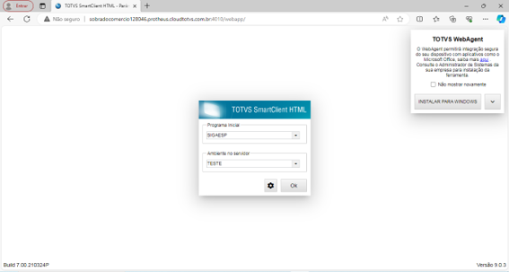

  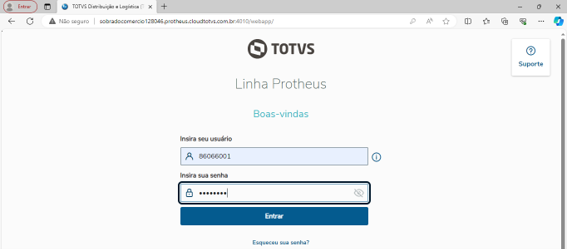 
  <b>Figura 1</b> — Acessando com o usuário e senha

Informe o código do grupo e filial que deseja acessar. (Essas informações já virão preenchidas, altere apenas se necessário)

  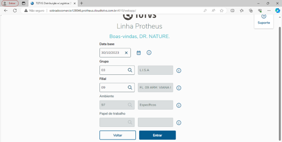 
  <b>Figura 2</b> — Informando filial Lisalog do acesso

## 2. Menu atualizações

Em Atualizações estão disponíveis as seguintes opções:

- **Api Pedido** — Enviar pedidos para separação, visualizar pedidos, consulta de informações de pedidos, cancelar pedidos, envio de notas fiscais de saída, controlar pedidos integrados sem saldo (1) e controlar pedidos parciais (2).

  > **Obs.:** Para habilitar o funcionamento das rotinas 1 e 2, é necessário ativar no cadastro do cliente o campo `INT PD S SLS - A1_XPEDSS` = SIM.

- **Api Nota Saída** — Enviar / Consultar notas fiscais de saída enviadas para os pedidos.
- **Api Entrada** — Envio, visualizar e exclusão de documentos de entrada para armazenagem.
- **Romaneio** — Consulta e download de Romaneios de saída, entrada ou devolução, e/ou consulta TFA de entrada.
- **Agendamentos** — Agendamento de entregas das entradas no armazém.
- **Produto Por Fornecedor** — Cadastro de produtos por fornecedor.
- **Api Documentos** — Enviar / Consultar documentos enviadas.
- **Download Ret Armazenagem** — Fazer o download da nota fiscal de retorno de remessa de armazenagem.
- **Pre Pedido Rolo** — Importar / enviar / visualizar / alterar / aprovar / cancelar e reprovar pre pedidos.
- **Rolo Armazenado** — Importar / visualizar / excluir paking list.
- **Atualiza Qtd. Mínima** — Atualizar a quantidade mínima via arquivo.
- **Lançamento Serviços** — Fazer o download e aprovar o demonstrativo de serviço.
- **Log de Integração** — Consultar log de integração dos pedidos
- **Integrações** — Executa a integra com outros sistemas já integrados com o Protheus

  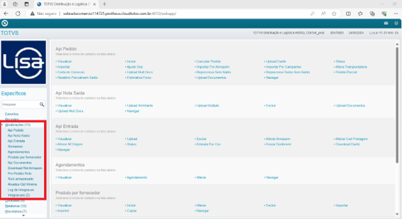 
  <b>Figura 3</b> — Opções Menu atualizações

### 2.1 Api Pedido

A rotina Api Pedido possui as seguintes opções:

  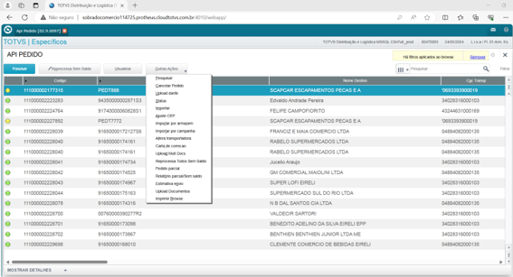 
  <b>Figura 4</b> — Opções Api Pedido

#### Incluir

Realizar a inclusão manual de pedido ou importar informações de um arquivo TXT/XML e DANFE.

  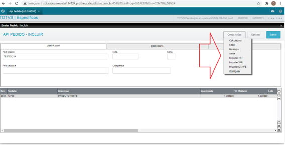 
  <b>Figura 5</b> — Outras ações Api Pedido

  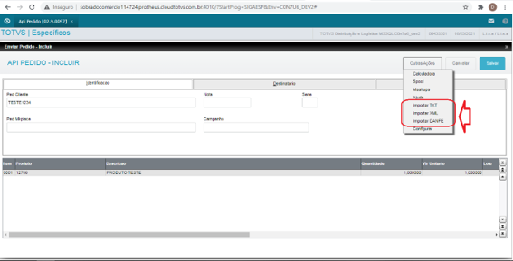 
  <b>Figura 6</b> — Importar TXT/XML ou Danfe Api Pedido

  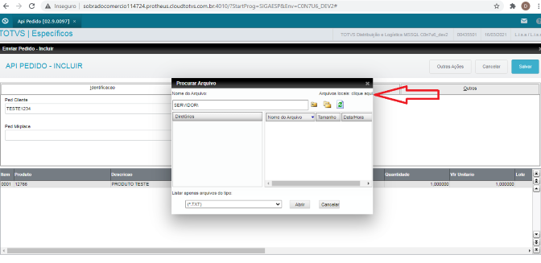 
  <b>Figura 7</b> — Indicando arquivos locais

  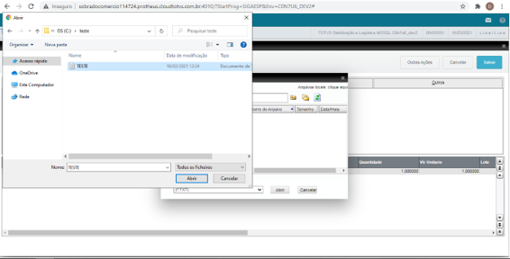 
  <b>Figura 8</b> — Selecionando o arquivo

  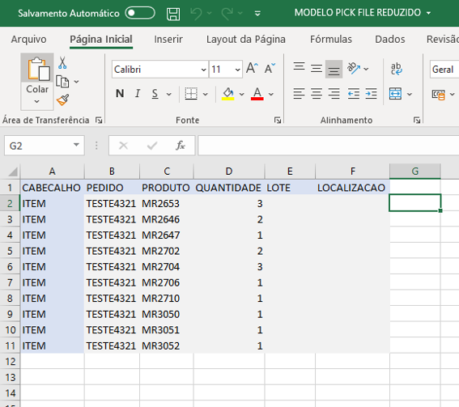 
  <b>Figura 9</b> — Layout de arquivo TXT no Excel

  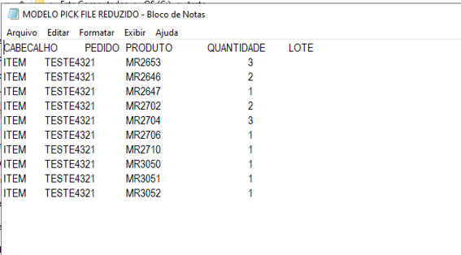 
  <b>Figura 10</b> — Conteúdo do arquivo TXT

#### Outras ações > Cancelar Pedido

Faz uma solicitação de cancelamento do pedido.

  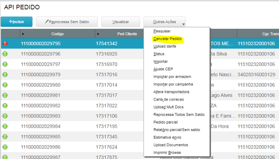 
  <b>Figura 11</b> — Solicitar cancelamento de pedido

#### Outras ações > Upload Danfe

Realizar o upload da nota fiscal de saída

  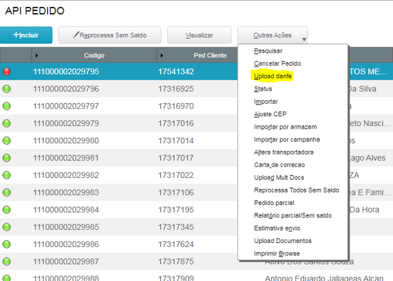 
  <b>Figura 12</b> — Enviar Danfe do pedido

  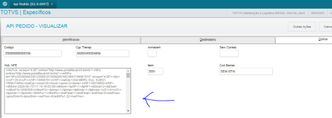 
  <b>Figura 13</b> — Campo preenchido com o XML

  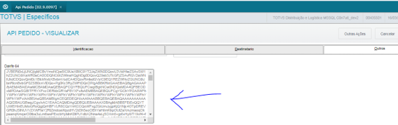 
  <b>Figura 14</b> — Campo preenchido com a DANFE

#### Outras ações > Status

Consulta o status do pedido.

  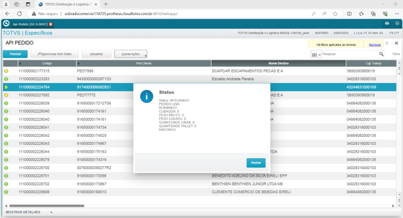 
  <b>Figura 15</b> — Consulta de status do pedido

#### Outras ações > Importar

Realiza a importação de múltiplos arquivos XML das notas fiscais ou arquivos TXT para geração de pedidos para separação.

  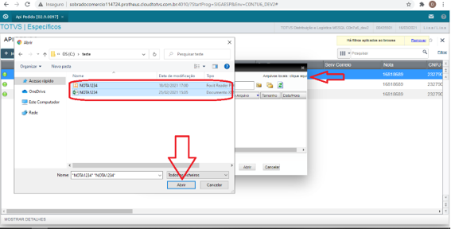 
  <b>Figura 16</b> — Importando múltiplos arquivos para geração de pedidos (xml)

  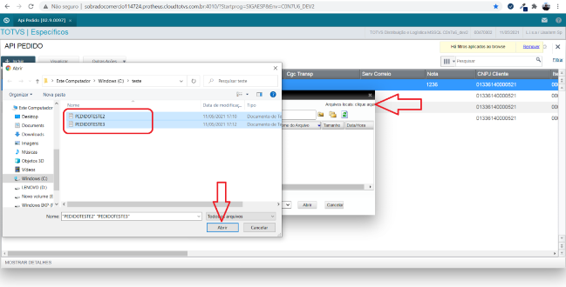 
  <b>Figura 17</b> — Importando múltiplos arquivos para geração de pedidos (txt)

  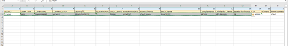 
  <b>Figura 18</b> — Criando arquivo TXT no layout completo

  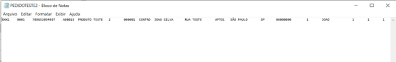 
  <b>Figura 19</b> — Salvando arquivo TXT

  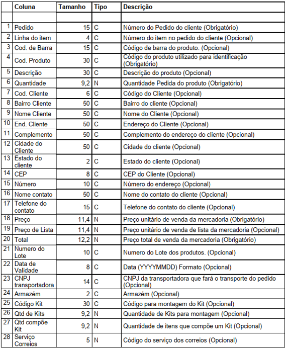 
  <b>Figura 20</b> — Layout do arquivo TXT

#### Outras ações > Ajuste CEP

Imprimir dados listados na tela atual.

  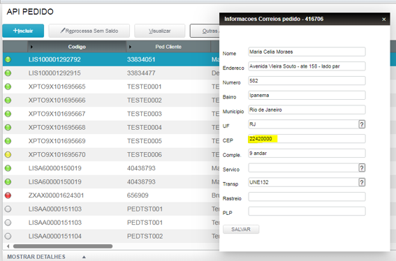

#### Outras ações > Importar por armazém

Integrar pedidos por armazém.

  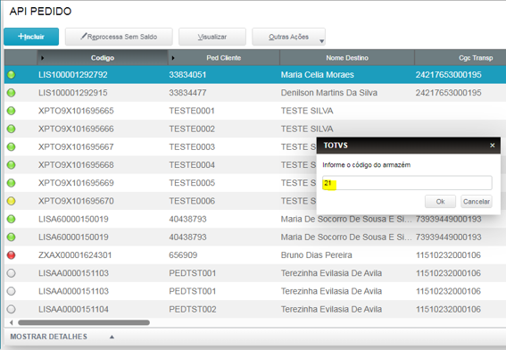

#### Outras ações > Importar por campanha

Integrar pedidos por campanha.

  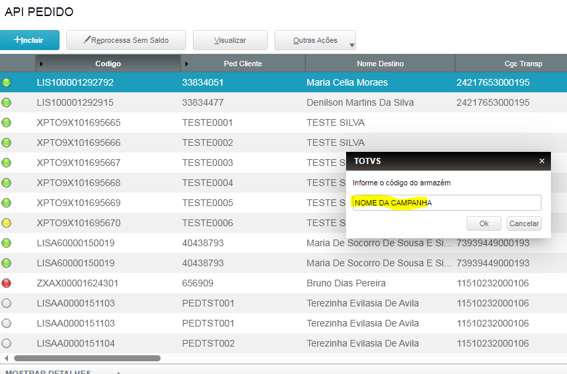

#### Outras ações > Transportadora

Incluir ou alterar transportadora dos pedidos.

  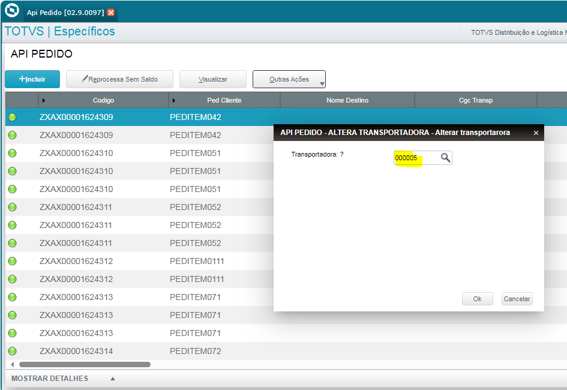

#### Outras ações > Carta de correção

Enviar carta de correção em (PDF).

  

#### Outras ações > Upload Mult Docs

Fazer o Upload de múltiplos documentos.

  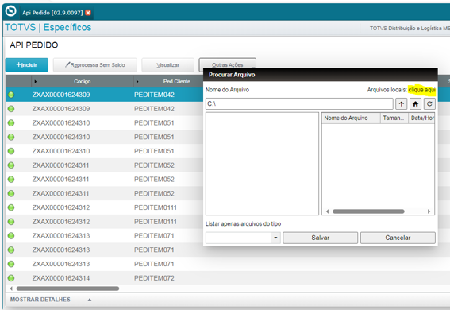

#### Outras ações > Reprocessa todos sem saldo

Reprocessa todos pedidos sem saldo.

  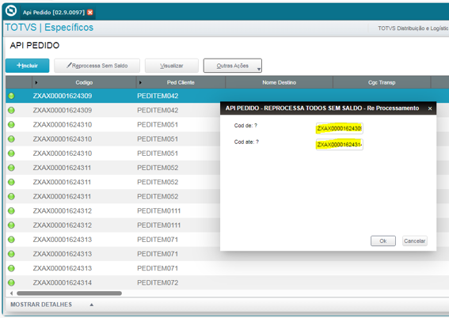

#### Outras ações > Pedido parcial

Acessa a tela dos pedidos parciais.

  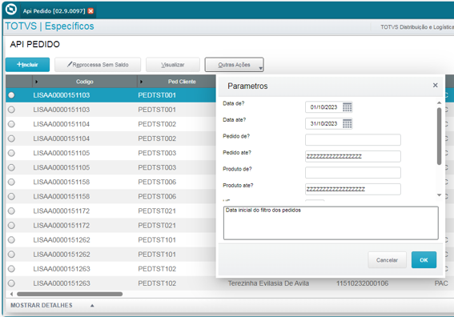

#### Outras ações > Relatório parcial / sem saldo

Imprimir relatório dos pedidos parciais e sem saldo.

  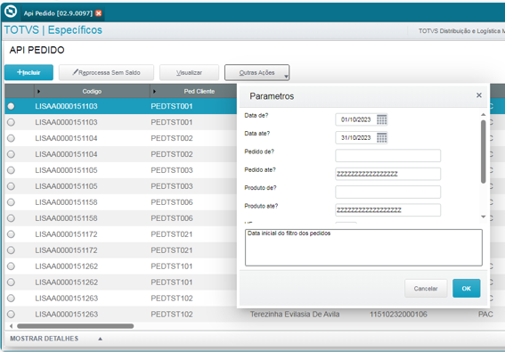

  

#### Outras ações > Estimativa envio

Altera a estimativa de envio dos pedidos (**Obs.:** rotina da integração da API infracommerce).

  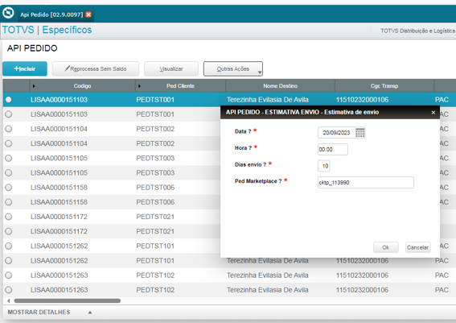

#### Outras ações > Upload documentos

Fazer upload de documento em PDF.

  

#### Outras ações > Imprimir browse

Imprimir dados listados na tela atual.

  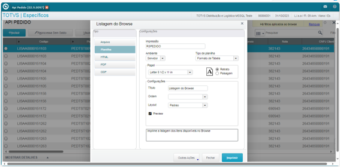

### 2.2 Api Nota de Saída

Disponível apenas para consultar notas de saída enviadas para os pedidos.

  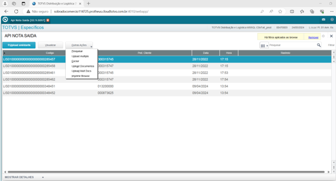 
  <b>Figura 21</b> — Dados Api Nota Saida

### 2.3 Api Entrada

Enviar entradas de armazenagem.

   
  <b>Figura 22</b> — API Entrada opções

#### Upload

Faz o upload das informações de entrada através do XML das notas fiscais.

  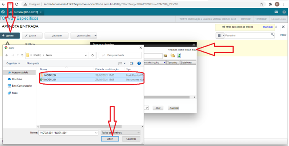 
  <b>Figura 23</b> — Upload de notas de entrada

#### Excluir

Exclui o registro da entrada.

#### Outras ações > Status

Consulta o status da entrada no armazém.

  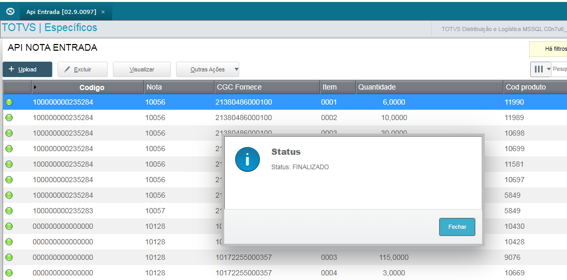 
  <b>Figura 24</b> — Consulta de status da entrada

#### Alterar Armazém

Permite alterar o armazém da nota fiscal integrada.

   
  <b>Figura 25</b> — Alterar Armazém

#### Alterar Cod Postagem

Permite alterar o código de postagem da nota fiscal integrada.

   
  <b>Figura 26</b> — Alterar Código de Postagem

#### Alterar Nf Origem

Permite alterar a nota fiscal de origem.

   
  <b>Figura 27</b> — Alterar NF de Origem

#### Status

Retorna o status atual da nota fiscal integrada.

  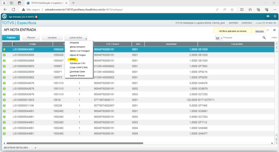 
  <b>Figura 28</b> — Status Nota Fiscal

#### Entrada por CSV

Permite enviar o código do produto diferente ao XML.

  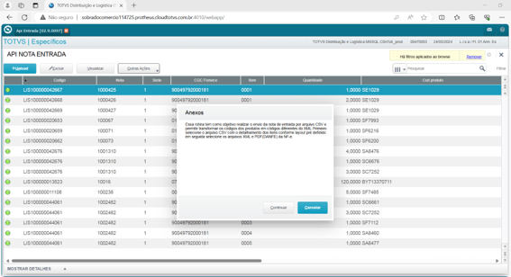 
  <b>Figura 29</b> — Entrada por CSV

#### Enviar DANFE/XML

Permite enviar a Danfe e o XML da nota fiscal.

  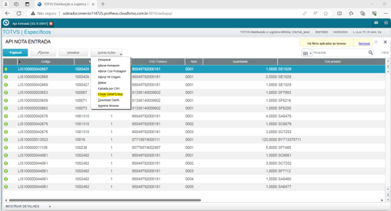 
  <b>Figura 30</b> — Enviar DANFE/XML

#### Download DANFE

Permite baixar a Danfe da nota fiscal.

   
  <b>Figura 31</b> — Download DANFE

### 2.4 Agendamentos

Consultar, incluir ou alterar agendamentos de entrada no armazém.

#### Agendamento

Apresenta agenda para inclusão de agendamento.

### 2.5 Produto por fornecedor

Incluir, alterar, visualizar ou excluir cadastro de produto por fornecedor.

  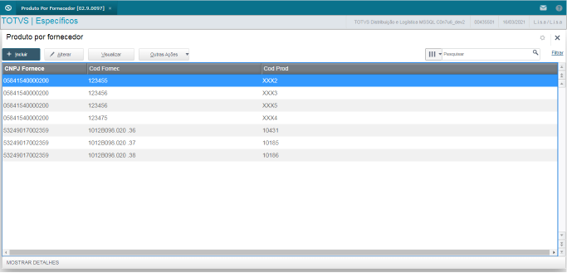 
  <b>Figura 32</b> — Cadastro de produtos por fornecedor

## 3. Menu Consultas

Disponíveis as seguintes opções:

### Monitor Pedidos

Apresenta os pedidos com status.

  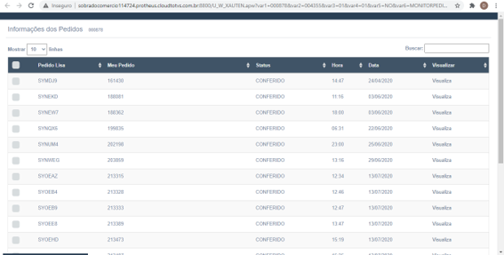 
  <b>Figura 33</b> — Monitor Pedidos

### Recebimento

Monitoramento dos recebimentos no armazém.

  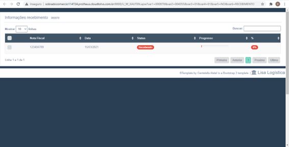 
  <b>Figura 34</b> — Consulta recebimento

### Painel Por Hora

Apresenta uma análise detalhada das separações realizadas na data escolhida.

  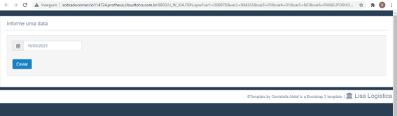 
  <b>Figura 35</b> — Informando data do painel por hora

  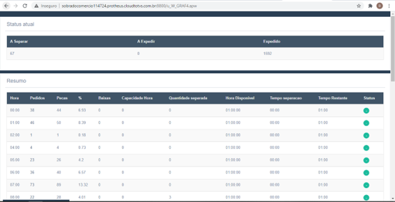 
  <b>Figura 36</b> — Painel por hora

### Monitoramento

Monitoramento da separação dos pedidos no armazém.

  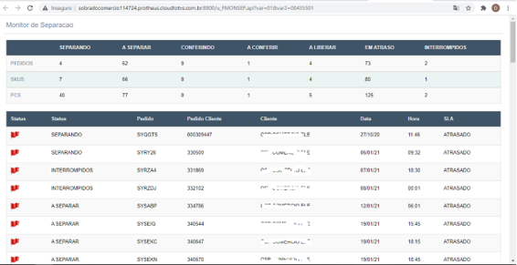 
  <b>Figura 37</b> — Monitor de separações

### Indicadores

Visão geral das operações no armazém.

  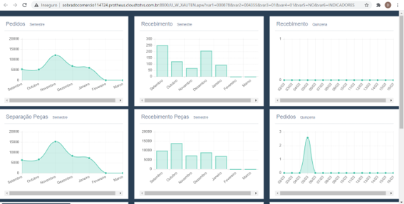 
  <b>Figura 38</b> — Indicadores

### Números de serie

Permite pesquisar, visualizar detalhes e importar por arquivo TXT.

  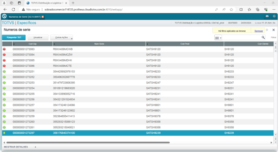 
  <b>Figura 39</b> — Números de serie

## 4. Relatórios

- **Monitor Pedido** — Informações diversas dos pedidos.
- **Estoque** — Arquivos com informações sobre o saldo dos produtos.
- **Lote/Endereço** — Arquivo com informações de saldo por lote/localização.
- **Reversa** — Informações sobre o processo de reversa.
- **Saldos Disponíveis** — Informações de saldos disponíveis para pedidos.
- **Entradas** — Informações do processo de recebimento dos produtos.
- **Entradas x Saídas** — Informações do processo de recebimento / saída dos produtos.
- **Kardex** — Informações da movimentação de entrada / saída dos produtos.
- **Kardex Lote** — Informações da movimentação de entrada / saída dos produtos por Lote.
- **Estoque mínimo** — Informações do estoque mínimo dos produtos.
- **Estoque Rolos** — Informações do estoque de Rolos.
- **Rel Posição Estoque** — Informações de estoque dos produtos.

---

[⬅ Voltar ao índice](../README.md)

   
  Lisa Logística Integrada Sulamericana · Tecnologia da Informação

