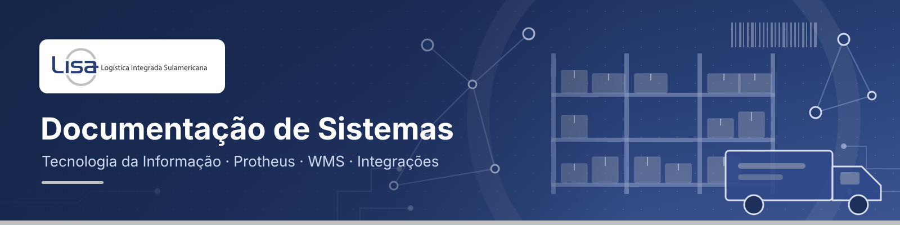

<!-- PADRAO-LISA -->

  

<h1 align="center">Documentação de Sistemas</h1>

<b>Tecnologia da Informação</b> · Lisa Logística Integrada Sulamericana

---

Bem-vindo à central de documentação da T.I. da Lisa. Aqui estão os manuais das rotinas do Protheus/WMS, das APIs de integração, do aplicativo Lisalog e dos processos de atendimento.

Use o sumário para ir direto à área desejada.

## Sumário

- [📦 1. WMS](#1-wms)
- [🗃️ 2. Estoque](#2-estoque)
- [🔌 3. APIs de Integração](#3-apis-de-integração)
- [📱 4. Aplicativo Lisalog](#4-aplicativo-lisalog)
- [🏢 5. Portal do Cliente](#5-portal-do-cliente)
- [🎧 6. Atendimento T.I.](#6-atendimento-ti)
- [📊 7. AnnaLisa](#7-annalisa)
- [🔎 Como encontrar uma informação](#como-encontrar-uma-informação)

---

## 1. WMS

Rotinas de armazenagem, separação, conferência e expedição.

| Manual | Descrição |
|---|---|
| [Conferência 1PN](wms/conferencia1pn/README.md) | Conferência de pedidos com mais de uma unidade ou produto. |
| [Conferência de embarque](wms/conferenciaembarque/README.md) | Conferência dos volumes no embarque pelo coletor. |
| [Pré-separação](wms/preseparacao/README.md) | Pré-separação de produtos para um endereço de destino e geração do pedido. |
| [Separação por Onda](wms/separacaoporonda/README.md) | Geração, consulta e importação de ondas de separação. |
| [Leitura de código de barras](wms/leiturabarras/README.md) | Regras de identificação do produto pela leitura (EAN, CLAC, DUN-14). |
| [Etiqueta de Palete (QR Code)](wms/EtiquetaQRCode/README.md) | Impressão da etiqueta de palete e leitura no inventário. |
| [Spool de Etiquetas – LISASPOOL](wms/LisaSpool/README.md) | Monitor de impressão de etiquetas configurado por filial e estação. |
| [Alteração de Transportadora (ACD)](wms/AltTransporte/README.md) | Troca da transportadora do pedido pelo coletor. |

---

## 2. Estoque

| Manual | Descrição |
|---|---|
| [Mestre de Inventário por Arquivo](estoque/mestreinv/README.md) | Criação dos mestres de inventário a partir de um arquivo CSV. |
| [Análise de Saldos](wms/AnaliseSaldos/README.md) | Comparação dos saldos de estoque com as movimentações. |

---

## 3. APIs de Integração

| Manual | Descrição |
|---|---|
| [Documentação das APIs WMS](apis/geral/README.md) | Endpoints, fluxos de entrada e expedição, exemplos de JSON e códigos de status. |

---

## 4. Aplicativo Lisalog

| Manual | Descrição |
|---|---|
| [Manual do App Lisalog](lisalogapp/README.md) | Cadastro, login, romaneios, mapa de separação, pedidos, expedição e veículos. |

---

## 5. Portal do Cliente

| Manual | Descrição |
|---|---|
| [Módulo de Clientes](ModuloClientes/README.md) | Portal de acesso dos clientes às informações de suas operações no armazém. |

---

## 6. Atendimento T.I.

| Manual | Descrição |
|---|---|
| [Manual de Atendimento – T.I.](atendimento/README.md) | Prioridades, canais, horários, plantões e escalonamento do suporte. |
| [Painel de Tickets](atendimento/ManualTickets/README.md) | Como abrir, acompanhar e responder tickets pelo AnnaLisa ou por e-mail. |

---

## 7. AnnaLisa

Portal operacional de monitoramento integrado ao Protheus.

| Manual | Descrição |
|---|---|
| [Manual do AnnaLisa](ManualAnnaLisa/README.md) | Monitores de separação, entrada, saída e estoque, consulta de pedidos, integrações e administração. |

---

## Como encontrar uma informação

| Procurando… | Vá para |
|---|---|
| Uma rotina do coletor ou do armazém | [WMS](#1-wms) |
| Inventário e mestres | [Estoque](#2-estoque) |
| Integração por API com clientes | [APIs de Integração](#3-apis-de-integração) |
| Uso do aplicativo no celular | [Aplicativo Lisalog](#4-aplicativo-lisalog) |
| Como abrir um chamado | [Atendimento T.I.](#6-atendimento-ti) |
| Acompanhar a operação no AnnaLisa | [AnnaLisa](#7-annalisa) |

---

   
  Lisa Logística Integrada Sulamericana · Tecnologia da Informação

