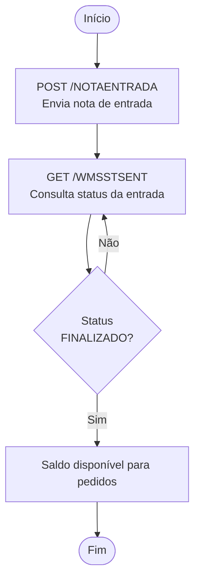
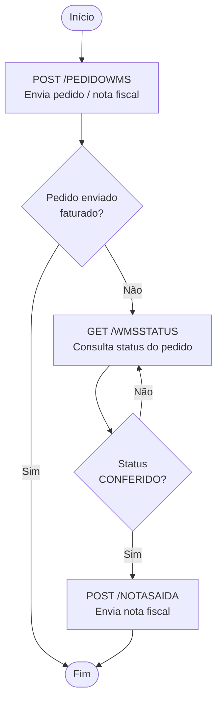

# Documentação das APIs WMS — Lisalog

**Lisa — Logística Integrada Sulamericana**

Documentação unificada das APIs de integração com o WMS Lisalog.

> 📘 **Documentação interativa (Swagger/OpenAPI):** [https://protheuslisalog.github.io/documentacoes/apis/geral/docs/](https://protheuslisalog.github.io/documentacoes/apis/geral/docs/)

## Sumário

1. [Visão geral](#1-visão-geral)
2. [Autenticação e cabeçalhos](#2-autenticação-e-cabeçalhos)
3. [Resumo dos endpoints e fluxos de integração](#3-resumo-dos-endpoints-e-fluxos-de-integração)
4. [Envio de pedidos para separação](#4-envio-de-pedidos-para-separação) — `POST /PEDIDOWMS`
5. [Atualização de dados do pedido](#5-atualização-de-dados-do-pedido) — `PUT /PEDIDOWMS`
6. [Cancelamento de pedido](#6-cancelamento-de-pedido) — `PUT /PEDIDOWMS`
7. [Consulta de status do pedido](#7-consulta-de-status-do-pedido) — `GET /WMSSTATUS`
8. [Consulta de status de pedidos por data](#8-consulta-de-status-de-pedidos-por-data) — `GET /RSSTSPG`
9. [Consulta de pedidos por status (quantidades)](#9-consulta-de-pedidos-por-status-quantidades) — `GET /wms/v2/pedidosPorStatus/query`
10. [Consulta de pedidos WMS (lista paginada)](#10-consulta-de-pedidos-wms-lista-paginada) — `GET /wms/v2/pedidoWms/query`
11. [Consulta de romaneio de saída](#11-consulta-de-romaneio-de-saída) — `GET /wms/v2/consultaRomaneioSaida`
12. [Envio de nota de saída](#12-envio-de-nota-de-saída) — `POST /NOTASAIDA`
13. [Consulta de dados da nota de saída](#13-consulta-de-dados-da-nota-de-saída) — `GET /WMSSF2`
14. [Envio e exclusão de notas de entrada](#14-envio-e-exclusão-de-notas-de-entrada) — `POST` / `DELETE /NOTAENTRADA`
15. [Consulta de status da nota de entrada](#15-consulta-de-status-da-nota-de-entrada) — `GET /WMSSTSENT`
16. [Consulta de saldo em estoque](#16-consulta-de-saldo-em-estoque) — `GET /WMSESTOQUE` e `GET /RSESTPG`
17. [Envio de documentos](#17-envio-de-documentos) — `POST /DOCUMENTOS`
18. [Transferência entre armazéns](#18-transferência-entre-armazéns) — `POST` / `GET /TRANSFERENCIA`
19. [Glossário de status e códigos](#19-glossário-de-status-e-códigos)
20. [Pontos de atenção nos documentos originais](#20-pontos-de-atenção-nos-documentos-originais)

---

## 1. Visão geral

| Item | Valor |
|---|---|
| Base URL (homologação) | `https://li195956.protheus.cloudtotvs.com.br:11257/rest` |
| Formato | JSON (`Content-Type: application/json`) |
| Chave de acesso | Chave de acesso para utilizar as Apis |
| Ambiente de produção | Deve ser solicitado à Lisalog: IP, porta, chave de acesso, usuário e senha |

A integração convive com duas famílias de endpoints:

| Família | Caminho | Características |
|---|---|---|
| **Clássica** | `/rest/<NOME>` (ex.: `/PEDIDOWMS`, `/WMSSTATUS`) | Credenciais de consulta (`CHAVE`, `SENHA`, `FILIALLISA`, `CGC`) em parâmetros de query em maiúsculas; header com a chave de acesso `x-id-cliente`; respostas com campos prefixados (`C…`, `N…`, `A…`) |
| **v2** | `/rest/wms/v2/<recurso>/...` | Basic Auth + header `tenantId` e `x-id-cliente`; credenciais `chave`/`senha` em query; paginação por `page`/`pageSize`/`hasNext` |

Para utilização das APIs, os dados de **chave**, **senha**, **x-id-cliente** e **código da filial** devem ser solicitados ao time de operações da Lisalog.

## 2. Autenticação e cabeçalhos

Todas as APIs utilizam **Basic Authorization**:

```http
Authorization: Basic <base64(usuario:senha)>
Content-Type: application/json
x-id-cliente: {{chaveDeAcesso}}
```
### 2.1 Header `tenantId` (APIs v2)

As APIs `/wms/v2/...` exigem o header com a empresa e a filial:

```http
tenantId: {{empresa}},{{filial}}
```

- `{{empresa}}`: código da empresa — utilizar `03`.
- `{{filial}}`: código da filial Lisalog (ver [item 19.5](#195-filiais-lisalog)).

### 2.2 Variáveis usadas nos exemplos

| Variável | Descrição |
|---|---|
| `{{empresa}}` | Código da empresa (utilizar `03`) |
| `{{filial}}` | Código da filial Lisalog |
| `{{host}}` | Endereço host do servidor |
| `{{senha}}` | Senha de acesso ao endpoint |
| `{{chave}}` | Chave de acesso ao endpoint |
| `{{senhaAutenticacao}}` | Senha de autenticação da API |
| `{{chaveDeAcesso}}` | Chave de acesso as Apis |

---

## 3. Resumo dos endpoints e fluxos de integração

### 3.1 Endpoints

| # | API | Método | Caminho | Finalidade |
|---|---|---|---|---|
| 4 | Separação de pedidos | `POST` | `/PEDIDOWMS` | Enviar pedidos para separação nos armazéns |
| 5 | Atualiza pedido | `PUT` | `/PEDIDOWMS` | Atualizar dados de um pedido (NF, DANFE, transportadora etc.) |
| 6 | Cancelamento de pedido | `PUT` | `/PEDIDOWMS` | Solicitar cancelamento (`cstatus = "C"`) |
| 7 | Status do pedido | `GET` | `/WMSSTATUS` | Status e dados de expedição de um pedido |
| 8 | Status de pedidos por data | `GET` | `/RSSTSPG` | Status dos pedidos de uma data (paginado) |
| 9 | Pedidos por status | `GET` | `/wms/v2/pedidosPorStatus/query` | Quantidade de pedidos agrupados por status |
| 10 | Consulta pedidos WMS | `GET` | `/wms/v2/pedidoWms/query` | Lista paginada de pedidos, por período/status/pedido |
| 11 | Consulta romaneio de saída | `GET` | `/wms/v2/consultaRomaneioSaida` | Romaneio de saída (PDF em base64 + dados) |
| 12 | Envio de nota de saída | `POST` | `/NOTASAIDA` | Enviar a nota fiscal de um pedido |
| 13 | Dados da nota de saída | `GET` | `/WMSSF2` | Consultar itens de uma nota de saída |
| 14 | Notas de entrada | `POST` / `DELETE` | `/NOTAENTRADA` | Enviar ou excluir notas fiscais de entrada |
| 15 | Status da nota de entrada | `GET` | `/WMSSTSENT` | Status do recebimento e endereçamento |
| 16 | Saldo em estoque | `GET` | `/WMSESTOQUE`, `/RSESTPG` | Saldo por produto / por páginas |
| 17 | Envio de documentos | `POST` | `/DOCUMENTOS` | Enviar boleto, GNRE, guia ST, etiqueta etc. |
| 18 | Transferência | `POST` / `GET` | `/TRANSFERENCIA` | Transferir entre armazéns e consultar transferências |

> `PUT /PEDIDOWMS` atende duas operações (atualização e cancelamento); a API distingue pelo conteúdo: no cancelamento envia-se `"cstatus": "C"`.

### 3.2 Fluxo de entrada (recebimento)


É possível indicar o armazém de entrada dos produtos, ou recuperar, pela consulta de status, os armazéns onde os produtos foram alocados.

### 3.3 Fluxo de expedição



- Quando o pedido **não** é enviado faturado, é possível recuperar a quantidade de volumes pela consulta de status (`GET /WMSSTATUS`).
- Se o pedido não for enviado faturado **e** o integrador não precisar da quantidade de volumes, a nota fiscal pode ser enviada a qualquer momento.

---

## 4. Envio de pedidos para separação

**Objetivo:** enviar pedidos e suas informações para separação nos armazéns da Lisalog.

- **Método:** `POST`
- **URL:** `{{host}}/rest/PEDIDOWMS`
- **Header:** `Content-Type: application/json`

### 4.1 Exemplo de JSON

```json
{
  "ccodfilial": "01",
  "ccgc": "71586952000157",
  "cpedido": "1234",
  "cenderecodestino": "RUA COPPINI",
  "cbairrodestino": "CENTRO",
  "ccidadedestino": "SAO PAULO",
  "cestadodestino": "SP",
  "ccomplementodestino": "CASA 2",
  "cnomedestino": "JOAO",
  "ccpfcnpjdestino": "35478258067",
  "ccepdestino": "09341340",
  "cnumerodestino": "79",
  "ccontatodestino": "JOAO",
  "cfonedestino": "5511996899999",
  "stringxmlnfe": "",
  "cnota": "1111",
  "cserie": "1",
  "ccgctransportadora": "",
  "ccodigoservicocorreios": "",
  "carmazem": "",
  "curldanfe": "",
  "ccampanha": "",
  "nvalordeclarado": 0,
  "cdanfebase64": "",
  "cetiquetabase64": "",
  "campanhaObs": "",
  "cboletobase64": "",
  "ccartacorrecaobase64": "",
  "cguiast64": "",
  "ccomprovantepagamento64": "",
  "cpedidomarketplace": "",
  "cTransportadora": "",
  "nquantidadevolumes": 1,
  "cemaildestino": "",
  "nProtocolo": 12341251234,
  "cRastreio": "",
  "cPlp": "",
  "cNotaOriginal": "",
  "cSerieOriginal": "",
  "cCnpjFornecedor": "",
  "aitens": [
    {
      "citempedido": "0001",
      "cproduto": "10650X",
      "ccodbarras": "",
      "cdescricao": "TELEFONE FIXO",
      "nqtd": 1,
      "nvalorunitario": 10.10,
      "clote": "",
      "npesokg": 0
    }
  ],
  "volumes": [
    {
      "codigovolume": "X1",
      "descricaovolume": "Descricao volume X1",
      "codigobarras": "1234",
      "embalagemdoproduto": false,
      "altura": 1,
      "peso": 1,
      "largura": 1,
      "comprimento": 1,
      "produtos": [
        {
          "produto": "10650X",
          "quantidade": 1,
          "altura": 1,
          "largura": 1,
          "comprimento": 1
        }
      ]
    }
  ]
}
```

### 4.2 Campos do pedido

**Legenda — obrigatoriedade**

- **Conteúdo:** o campo precisa vir preenchido.
- **Estrutura:** a chave precisa existir no JSON (mesmo vazia).
- **Cond.:** *Não; passa a ser obrigatório se o cliente (código e loja) estiver habilitado no parâmetro `MV_XCVLDCV`.*

| Campo | Tipo | Conteúdo | Estrutura | Descrição |
|---|---|---|---|---|
| `ccodfilial` | Texto | Sim | Sim | Filial Lisalog onde deve ser separado o pedido |
| `ccgc` | Texto | Sim | Sim | CNPJ do emitente do pedido |
| `cpedido` | Texto | Sim | Sim | Número do pedido |
| `cenderecodestino` | Texto | Não | Sim | Endereço de entrega do pedido |
| `cbairrodestino` | Texto | Não | Sim | Bairro de entrega do pedido |
| `ccidadedestino` | Texto | Não | Sim | Município de entrega do pedido |
| `cestadodestino` | Texto | Não | Sim | Estado (UF) de entrega do pedido |
| `ccomplementodestino` | Texto | Não | Sim | Complemento do endereço de entrega |
| `cnomedestino` | Texto | Não | Sim | Nome do cliente de entrega |
| `ccpfcnpjdestino` | Texto | Não | Sim | CPF ou CNPJ do cliente de entrega |
| `ccepdestino` | Texto | Não | Sim | CEP de entrega do pedido |
| `cnumerodestino` | Texto | Não | Sim | Número do endereço de entrega |
| `ccontatodestino` | Texto | Não | Sim | Nome do contato de entrega do pedido |
| `cfonedestino` | Texto | Não | Sim | Telefone de contato do destinatário |
| `cemaildestino` | Texto | Não | Não | E-mail do destinatário do pedido |
| `ccodigopedido` | Texto | Não | Não | Código ID do pedido nas plataformas de marketplace |
| `stringxmlnfe` | Texto | Cond. | Sim | String com o XML da NF-e |
| `cnota` | Texto | Cond. | Sim | Número da nota fiscal |
| `cserie` | Texto | Cond. | Sim | Série da nota fiscal |
| `ccgctransportadora` | Texto | Cond. | Sim | CNPJ da transportadora |
| `nquantidadevolumes` | Numérico | Não | Não | Quantidade de volumes do pedido |
| `ccodigoservicocorreios` | Texto | Não | Sim | Código do serviço dos Correios |
| `carmazem` | Texto | Não | Sim | Armazém de retirada do pedido. Enviar preenchido apenas em casos específicos (ex.: produtos com avaria, enviar `"AV"`) |
| `curldanfe` | Texto | Não | Não | URL para download da DANFE |
| `ccampanha` | Texto | Cond. | Cond. (estrutura) | Sigla da campanha |
| `campanhaObs` | Texto | Não | Não | *(sem descrição no documento original)* |
| `nvalordeclarado` | Numérico | Não | Não | Valor declarado do pedido (para finalidade de seguro) |
| `cdanfebase64` | Texto | Cond. | Cond. (estrutura) | Arquivo PDF da DANFE codificado em base64 |
| `cetiquetabase64` | Texto | Cond. | Cond. (estrutura) | Etiqueta de transporte em ZPL |
| `cboletobase64` | Texto | Não | Não | Boleto codificado em base64 |
| `ccartacorrecaobase64` | Texto | Não | Não | Carta de correção codificada em base64 |
| `cguiast64` | Texto | Não | Não | Guia de ST codificada em base64 |
| `ccomprovantepagamento64` | Texto | Não | Não | Comprovante de pagamento codificado em base64 |
| `cpedidomarketplace` | Texto | Não | Não | Número do pedido do marketplace |
| `cTransportadora` | Texto | Não | Não | Identificação da transportadora |
| `nProtocolo` | Numérico | Cond. | Cond. (estrutura) | Número do protocolo de autorização da NF-e |
| `cRastreio` | Texto | Não | Não | Código do rastreio na transportadora |
| `cPlp` | Texto | Não | Não | Código da PLP da transportadora |
| `cNotaOriginal` | Texto | Não | Não | Número da nota de entrada (saídas de devolução) |
| `cSerieOriginal` | Texto | Não | Não | Série da nota de entrada (saídas de devolução) |
| `cCnpjFornecedor` | Texto | Não | Não | CNPJ do emitente da nota de entrada (saídas de devolução) |
| `aitens` | Array | Sim | Sim | Produtos a serem separados |
| `volumes` | Array | Não | Não | Volumes a serem utilizados no pedido |

### 4.3 Campos de `aitens[]`

| Campo | Tipo | Conteúdo | Estrutura | Descrição |
|---|---|---|---|---|
| `citempedido` | Texto | Não | Sim | Código do item do pedido |
| `cproduto` | Texto | Sim | Sim | Código do produto |
| `ccodbarras` | Texto | Não | Sim | Código de barras do produto (EAN) |
| `cdescricao` | Texto | Sim | Sim | Descrição do produto |
| `nqtd` | Numérico | Sim | Sim | Quantidade do produto |
| `nvalorunitario` | Numérico | Sim | Sim | Valor unitário do produto |
| `clote` | Texto | Sim | Sim | Número do lote |
| `npesokg` | Numérico | Não | Sim | Peso unitário do produto, em quilos |
| `cNotaOriginal` | Texto | Não | Não | Número da nota de entrada (saídas de devolução) |
| `cSerieOriginal` | Texto | Não | Não | Série da nota de entrada (saídas de devolução) |
| `enderecoFisicoArmazem` | Texto | Não | Não | *(sem descrição no documento original)* |

\* A tabela original indica `Texto`, mas o exemplo envia número (`"nqtd": 1`). Veja o [item 20](#20-pontos-de-atenção-nos-documentos-originais).

### 4.4 Campos de `volumes[]`

| Campo | Tipo | Conteúdo | Estrutura | Descrição |
|---|---|---|---|---|
| `codigoVolume` | Texto | Sim | Sim | Código de identificação do volume. Cada embalagem diferente deve ter um código único, usado para identificar a embalagem a ser utilizada |
| `descricaoVolume` | Texto | Sim | Sim | Descrição do volume |
| `codigoBarras` | Texto | Não | Sim | Código de barras da embalagem (se houver código impresso na embalagem) |
| `embalagemDoProduto` | Lógico | Sim | Sim | Indica se deve ser usada a própria embalagem do produto na expedição, sem nova embalagem |
| `altura` | Numérico | Não | Sim | Altura total da embalagem, em **metros** |
| `largura` | Numérico | Não | Sim | Largura total da embalagem, em **metros** |
| `comprimento` | Numérico | Não | Sim | Comprimento total da embalagem, em **metros** |
| `peso` | Numérico | Não | Sim | Peso total do volume com os produtos, em **quilogramas** |
| `produtos` | Array | Não | Não | Produtos que devem ser alocados no volume |

### 4.5 Campos de `volumes[].produtos[]`

| Campo | Tipo | Conteúdo | Estrutura | Descrição |
|---|---|---|---|---|
| `produto` | Texto | Sim | Sim | Código do produto |
| `quantidade` | Numérico | Sim | Sim | Quantidade do produto |
| `altura` | Numérico | Não | Sim | Altura do produto |
| `largura` | Numérico | Não | Sim | Largura do produto |
| `comprimento` | Numérico | Não | Sim | Comprimento do produto |

### 4.6 Regras gerais

- Campos **não obrigatórios no conteúdo** e **obrigatórios na estrutura** não devem ser enviados como `null`. Se não houver conteúdo: texto → `""`; numérico → `0`.
- **Importante:** alguns campos não obrigatórios podem ser necessários para a separação, dependendo da operação. Antes de enviar um campo sem informação, valide com o time operacional da Lisalog se ele é necessário para o processo de separação.

---

## 5. Atualização de dados do pedido

Atualiza dados de um pedido já enviado.

- **Método:** `PUT`
- **URL (homologação):** `{{host}}rest/PEDIDOWMS`

### 5.1 Exemplo de JSON

```json
{
  "ccodfilial": "07",
  "ccgc": "71586952000257",
  "cpedido": "1234",
  "cnota": "1111",
  "cserie": "1",
  "cdanfebase64": "",
  "nvalordeclarado": 0,
  "stringxmlnfe": "",
  "ccgctransportadora": "",
  "curldanfe": "",
  "cboletobase64": "",
  "ccartacorrecaobase64": "",
  "curlguiaST": "",
  "ccomprovantepagamento64": "",
  "cetiquetabase64": "",
  "cRastreio": "",
  "ccampanha": "",
  "lalteraetiqueta": false,
  "cPlp": ""
}
```

### 5.2 Campos

**Identificação do pedido**

| Campo | Descrição |
|---|---|
| `ccodfilial` | Filial Lisa que irá expedir o pedido |
| `ccgc` | CNPJ do emitente do pedido |
| `cpedido` | Número do pedido |

**Campos que serão atualizados**

| Campo | Descrição |
|---|---|
| `cnota` | Número da nota fiscal |
| `cserie` | Série da nota fiscal |
| `cdanfebase64` | DANFE em PDF, codificada em base64 |
| `nvalordeclarado` | Valor declarado do pedido |
| `stringxmlnfe` | XML da nota fiscal |
| `ccgctransportadora` | CNPJ da transportadora que irá coletar o pedido |
| `curldanfe` | URL para download da DANFE em PDF |
| `cboletobase64` | Boleto em base64 |
| `ccartacorrecaobase64` | Carta de correção em base64 |
| `curlguiaST` | URL para download da guia de ST em PDF |
| `ccomprovantepagamento64` | Comprovante de pagamento em base64 |
| `cetiquetabase64` | Etiqueta de transporte no padrão ZPL |
| `cRastreio` | Código do rastreio na transportadora |
| `ccampanha` | Campanha do pedido |
| `lalteraetiqueta` | Inclui (`true`) ou não (`false`) uma etiqueta ao pedido |
| `cPlp` | Código da PLP da transportadora |

---

## 6. Cancelamento de pedido

Envia uma solicitação de cancelamento de pedido.

- **Método:** `PUT`
- **URL (homologação):** `{{host}}/rest/PEDIDOWMS`

### 6.1 Exemplo de JSON

```json
{
  "ccodfilial": "07",
  "ccgc": "71586952000257",
  "cpedido": "1234",
  "cstatus": "C"
}
```

### 6.2 Campos

| Campo | Descrição |
|---|---|
| `ccodfilial` | Filial Lisa que irá expedir o pedido |
| `ccgc` | CNPJ do emitente do pedido |
| `cpedido` | Número do pedido |
| `cstatus` | Status do pedido — **enviar sempre a letra `"C"`** |

---

## 7. Consulta de status do pedido

- **Método:** `GET`
- **URL:** `{{host}}/rest/WMSSTATUS`
- **Headers:** `Content-Type: application/json`, `Authorization: Basic ...`

### 7.1 Parâmetros (todos obrigatórios)

| Parâmetro | Descrição |
|---|---|
| `CHAVE` | Código identificador do cliente na Lisa |
| `FILIALLISA` | Filial da consulta |
| `SENHA` | Senha de acesso |
| `CGC` | CNPJ da empresa |
| `PEDIDO` | Código do pedido |

### 7.2 Exemplo de requisição

```http
GET {{host}}/rest/WMSSTATUS?CHAVE=01719201&FILIALLISA=01&SENHA=1234&CGC=71586952000157&PEDIDO=19730380
```

### 7.3 Exemplo de resposta

```json
{
  "ASTATUS": [
    {
      "ASERIEMAI": [
        {
          "CIMEISERIE": "WSBC565425895",
          "CPRODUTO": "123546",
          "CPRODCLIENTE": "123456"
        }
      ],
      "AEMBALAGEM": [
        {
          "CCODIGO": "000008",
          "CDESCRICAO": "10X10X10",
          "NALTURA": 10,
          "NCOMPRIMENTO": 10,
          "NLARGURA": 10,
          "NQUANTIDADE": 1
        }
      ],
      "CCAMPANHA": "ITASH",
      "CPEDCLIENTE": "19730380",
      "CEMBALAGEM": "19730380",
      "CRASTREIO": "",
      "CROMANEIO": "",
      "DATAEXPEDIDO": "20220603",
      "DATAROMANEIO": "20220603",
      "HORAEXPEDIDO": "09:21",
      "LETIQUETAINTEGRADA": false,
      "NCUBAGEM": 0,
      "NPESOBRU": 0,
      "NPESOLIQ": 0,
      "NQTDCAIXA": 0,
      "NQTDPALLET": 0,
      "CPEDLISA": "SYBVRJ",
      "CSTATUS": "FINALIZADO"
    }
  ],
  "CCGC": "71586952000157",
  "CCHAVE": "01719201",
  "CFILIALWMS": "01",
  "CPEDIDO": "19730380"
}
```

### 7.4 Campos retornados

| Campo | Descrição |
|---|---|
| `CPEDIDO` | Código do pedido |
| `CCHAVE` | Chave de acesso utilizada |
| `CFILIALWMS` | Filial do pedido |
| `CCGC` | CNPJ da requisição |
| `CPEDCLIENTE` | Código do pedido solicitado |
| `CCAMPANHA` | Campanha informada para o pedido |
| `CPEDLISA` | Código do pedido Lisa |
| `CSTATUS` | Status do pedido (ver [glossário](#19-glossário-de-status-e-códigos)) |
| `CPRODUTO` | Código do produto na Lisa |
| `CIMEISERIE` | Número de série/IMEI |
| `CPRODCLIENTE` | Código do produto no cliente |
| `CEMBALAGEM` | Embalagem utilizada no pedido |
| `CRASTREIO` | Código do rastreio |
| `CROMANEIO` | Código do romaneio |
| `LETIQUETAINTEGRADA` | Indica se o pedido tem etiqueta integrada (`true`/`false`) |
| `NCUBAGEM` | Cubagem do pedido |
| `NPESOBRU` | Peso bruto do pedido |
| `NPESOLIQ` | Peso líquido do pedido |
| `NQTDCAIXA` | Quantidade de caixas |
| `NQTDPALLET` | Quantidade de pallets |
| `CCODIGO` | Código da embalagem |
| `CDESCRICAO` | Descrição da embalagem |
| `NALTURA` | Altura da embalagem, em centímetros |
| `NLARGURA` | Largura da embalagem, em centímetros |
| `NCOMPRIMENTO` | Comprimento da embalagem, em centímetros |
| `NQUANTIDADE` | Quantidade da embalagem |
| `DATAEXPEDIDO` | Data de expedição do pedido (`AAAAMMDD`) |
| `DATAROMANEIO` | Data da geração do romaneio (`AAAAMMDD`) |
| `HORAEXPEDIDO` | Hora da expedição do pedido (`HH:MM`) |

---

## 8. Consulta de status de pedidos por data

- **Método:** `GET`
- **URL:** `{{host}}/rest/RSSTSPG`
- Retorna **100 pedidos por página**. Se a data possuir mais de 100 pedidos, faça novas chamadas com o parâmetro `PAGINA` para obter as demais páginas.

### 8.1 Parâmetros

| Parâmetro | Obrigatório | Descrição |
|---|---|---|
| `CHAVE` | Sim | Código identificador do cliente na Lisa |
| `FILIALLISA` | Sim | Filial da consulta |
| `SENHA` | Sim | Senha de acesso |
| `CGC` | Sim | CNPJ da empresa |
| `DATAPEDIDO` | Sim | Data para consulta do pedido (`AAAAMMDD`) |
| `PAGINA` | Não | Número da página |

### 8.2 Exemplo de requisição

```http
GET {{host}}/rest/RSSTSPG?CGC=86646128000142&CHAVE=123456&FILIALLISA=07&SENHA=123456&DATAPEDIDO=20190529&PAGINA=1
```

### 8.3 Exemplo de resposta

```json
{
  "CDATAPEDIDO": "20260101",
  "LISTAPEDIDOS": [
    {
      "ASTATUS": [
        {
          "AEMBALAGEM": [],
          "ASERIIMEI": [
            {
              "CIMEISERIE": "",
              "CPRODCLIENTE": "1234",
              "CPRODUTO": "XXX-1234"
            }
          ],
          "CCAMPANHA": "LOJA B2C",
          "CEMBALAGEM": "",
          "CPEDCLIENTE": "3619731",
          "CPEDLISA": "TBTRZ2",
          "CRASTREIO": "",
          "CROMANEIO": "314776",
          "CSTATUS": "FINALIZADO",
          "CURLTRACKING": "",
          "DATAEXPEDIDO": "20260221",
          "DATAROMANEIO": "20260221",
          "HORAEXPEDIDO": "18:10",
          "ITENS": [
            {
              "IDNOTAORIGEM": "",
              "ITEMNOTAORIGEM": "",
              "LOTE": "AUTO130181",
              "NOTA": "9AH3CM",
              "NOTAORIGEM": "",
              "PRODUTO": "XXX-1234",
              "QUANTIDADE": 1,
              "SERIE": "W",
              "SERIEORIGEM": ""
            }
          ],
          "LETIQUETAINTEGRADA": true,
          "NCUBAGEM": 0,
          "NOTACLIENTE": "2845857",
          "NPESOBRU": 1,
          "NPESOLIQ": 1,
          "NQTDCAIXA": 1,
          "NQTDPALLET": 0
        }
      ],
      "CCGC": "ZZZZZZZZZZZZZZ",
      "CCHAVE": "XXXXX",
      "CFILIALWMS": "01",
      "CPEDIDO": "3619731"
    }
  ],
  "PAGCORRENTE": 1,
  "PAGTOTAL": 1
}
```
### 8.4 Campos retornados

| Campo | Descrição |
|---|---|
| `CDATAPEDIDO` | Data dos pedidos (`AAAAMMDD`) |
| `PAGCORRENTE` | Página corrente |
| `PAGTOTAL` | Número total de páginas |
| `LISTAPEDIDOS[]` | Lista de pedidos da página |
| `CPEDIDO` | Código do pedido |
| `CCHAVE` | Chave de acesso utilizada |
| `CFILIALWMS` | Filial do pedido |
| `CCGC` | CNPJ da requisição |
| `ASTATUS[]` | Status/dados de expedição do pedido |
| `CPEDCLIENTE` | Código do pedido solicitado |
| `CPEDLISA` | Código do pedido Lisa |
| `CSTATUS` | Status do pedido (ver [glossário](#19-glossário-de-status-e-códigos)) |
| `CCAMPANHA` | Campanha informada para o pedido |
| `CPRODUTO` | Código do produto na Lisa |
| `CIMEISERIE` | Número de série/IMEI |
| `CPRODCLIENTE` | Código do produto no cliente |
| `LETIQUETAINTEGRADA` | Indica se o pedido tem etiqueta integrada (`true`/`false`) |
| `ITENS[]` | Itens do pedido: `PRODUTO`, `QUANTIDADE`, `LOTE`, `NOTA`, `SERIE`, `NOTAORIGEM`, `SERIEORIGEM`, `IDNOTAORIGEM`, `ITEMNOTAORIGEM` |

Os demais campos (`CEMBALAGEM`, `CRASTREIO`, `CROMANEIO`, `CURLTRACKING`, `DATAEXPEDIDO`, `DATAROMANEIO`, `HORAEXPEDIDO`, `NCUBAGEM`, `NOTACLIENTE`, `NPESOBRU`, `NPESOLIQ`, `NQTDCAIXA`, `NQTDPALLET`) aparecem no exemplo, mas sem descrição individual no documento original; seguem o mesmo significado descrito no [item 7.4](#74-campos-retornados).

---

## 9. Consulta de pedidos por status (quantidades)

Consulta a quantidade de pedidos de um cliente, agrupados por status, para uma determinada data de pedido.

- **Método:** `GET`
- **URL:** `{{host}}/rest/wms/v2/pedidosPorStatus/query`
- **Autenticação:** Basic — `Authorization: Basic {{senhaAutenticacao}}`
- **Header:** `tenantId: {{empresa}}, {{filial}},`, `x-id-cliente: {{chaveDeAcesso}}`

### 9.1 Parâmetros

| Parâmetro | Obrigatório | Exemplo | Descrição |
|---|---|---|---|
| `senha` | Sim | `XXXXXXXX` | Senha utilizada na requisição |
| `chave` | Sim | `XXXXXXXX` | Chave utilizada na requisição |
| `dataPedido` | Não | `20260812` | Data de consulta no formato `AAAAMMDD` (`20260812` = 12/08/2026). Se omitido, retorna a posição atual de todos os pedidos, independente da data |

### 9.2 Exemplo de requisição

```http
GET {{host}}/rest/wms/v2/pedidosPorStatus/query?senha={{senha}}&chave={{chave}}&dataPedido=20260812
Authorization: Basic {{senhaAutenticacao}}
tenantId: {{empresa}}, {{filial}},  x-id-cliente: {{chaveDeAcesso}}
```

### 9.3 Exemplo de resposta

```json
{
  "items": [
    { "status": "1", "descricaoStatus": "A SEPARAR", "quantidade": 1 },
    { "status": "3", "descricaoStatus": "A CONFERIR", "quantidade": 172 },
    { "status": "4", "descricaoStatus": "CONFERIDO", "quantidade": 106 },
    { "status": "5", "descricaoStatus": "A EXPEDIR", "quantidade": 2433 },
    { "status": "6", "descricaoStatus": "FINALIZADO", "quantidade": 561366 },
    { "status": "7", "descricaoStatus": "CANCELADO", "quantidade": 199 }
  ],
  "cliente": "XXXXXX",
  "loja": "XX",
  "dataPedido": ""
}
```

### 9.4 Estrutura da resposta

**Objeto principal**

| Campo | Tipo | Descrição |
|---|---|---|
| `items` | Array | Lista dos status encontrados na consulta |
| `cliente` | String | Código do cliente |
| `loja` | String | Código da loja do cliente |
| `dataPedido` | String | Data do pedido retornada pela API |

**Item de `items`**

| Campo | Tipo | Descrição |
|---|---|---|
| `status` | String | Código do status do pedido |
| `descricaoStatus` | String | Descrição do status |
| `quantidade` | Integer | Quantidade de pedidos naquele status |

Interpretação: `{"status":"3","descricaoStatus":"A CONFERIR","quantidade":172}` significa que existem **172 pedidos** com status **A CONFERIR**.

### 9.5 Variáveis

| Variável | Descrição |
|---|---|
| `{{empresa}}` | Código da empresa (utilizar `03`) |
| `{{filial}}` | Código da filial Lisalog |
| `{{host}}` | Endereço host do servidor |
| `{{senha}}` | Senha de acesso ao endpoint |
| `{{chave}}` | Chave de acesso ao endpoint |
| `{{senhaAutenticacao}}` | Senha de autenticação da API |
| `{{chaveDeAcesso}}` | Chave de acesso das Apis |

---

## 10. Consulta de pedidos WMS (lista paginada)

Permite consultar detalhes dos pedidos registrados no sistema do cliente, em uma lista paginada. Retorna, por pedido: número do pedido cliente, pedido, nota, status, campanha, transportadora, CNPJ da transportadora, data/hora de integração, data/hora do pedido, data do romaneio e data/hora de finalização.

| Item | Valor |
|---|---|
| **Método** | `GET` |
| **URL** | `{{host}}/rest/wms/v2/pedidoWms/query` |
| **Autenticação** | Basic — `Authorization: Basic {{senhaAutenticacao}}` |
| **Header:** | `tenantId: {{empresa}}, {{filial}}, x-id-cliente: {{chaveDeAcesso}}` |

### 10.1 Parâmetros

| Parâmetro | Obrigatório | Exemplo | Descrição |
|---|---|---|---|
| `senha` | Sim | `XXXXXXXX` | Senha utilizada na requisição |
| `chave` | Sim | `XXXXXXXX` | Chave utilizada na requisição |
| `dataDe` | Não | `20260812` | Data inicial (`AAAAMMDD`) para busca por período |
| `dataAte` | Não | `20260812` | Data final (`AAAAMMDD`) para busca por período |
| `status` | Não | `1` | Código do status para filtro (ver [item 19.2](#192-status-numérico-dos-pedidos)) |
| `pedido` | Não | `3254698` | Número do pedido, para retornar apenas um pedido específico |
| `page` | Sim | `1` | Número da página |
| `pageSize` | Sim | `1000` | Registros por página — **máximo de 3000** |

### 10.2 Exemplo de requisição

```http
GET {{host}}/rest/wms/v2/pedidoWms/query?senha={{senha}}&chave={{chave}}&dataDe=20260801&dataAte=20260821&status=&pedido=&page=1&pageSize=1000
Authorization: Basic {{senhaAutenticacao}}
tenantId: {{empresa}}, {{filial}}, x-id-cliente: {{chaveDeAcesso}}
```

### 10.3 Exemplo de resposta

```json
{
  "items": [
    {
      "pedidoCliente": "4074405V3",
      "pedido": "U06538",
      "nota": "",
      "status": "1",
      "campanha": "XPTO",
      "transportadora": "LOGISTICA LTDA.",
      "cnpjTransportadora": "",
      "dataHoraIntegracao": "",
      "dataHoraPedido": "20260804 11:17",
      "dataRomaneio": "",
      "dataHoraFinalizado": ""
    },
    {
      "pedidoCliente": "4074406V3",
      "pedido": "U06539",
      "nota": "",
      "status": "1",
      "campanha": "XPTO2",
      "transportadora": "TEX COURIER S.A",
      "cnpjTransportadora": "",
      "dataHoraIntegracao": "",
      "dataHoraPedido": "20260804 11:17",
      "dataRomaneio": "",
      "dataHoraFinalizado": ""
    }
  ],
  "hasNext": true
}
```

### 10.4 Estrutura da resposta

| Campo | Tipo | Obrigatório | Descrição |
|---|---|---|---|
| `items` | Array | Sim | Lista de pedidos retornados; cada elemento é um pedido |
| `items.pedidoCliente` | String | Sim | Número ou identificador do pedido informado pelo cliente |
| `items.pedido` | String | Sim | Número do pedido no sistema |
| `items.nota` | String | Não | Número da nota fiscal vinculada; vazio quando ainda não houver nota |
| `items.status` | String | Sim | Status atual do pedido |
| `items.campanha` | String | Não | Campanha associada ao pedido |
| `items.transportadora` | String | Não | Nome da transportadora responsável |
| `items.cnpjTransportadora` | String | Não | CNPJ da transportadora responsável |
| `items.dataHoraIntegracao` | String | Não | Data e hora em que o pedido foi integrado |
| `items.dataHoraPedido` | String | Sim | Data e hora de criação do pedido. Formato `YYYYMMDD HH:mm` |
| `items.dataRomaneio` | String | Não | Data de geração do romaneio; vazio quando não houver romaneio |
| `items.dataHoraFinalizado` | String | Não | Data e hora de finalização; vazio quando ainda não finalizado |
| `hasNext` | Boolean | Sim | `true` = existem mais páginas; `false` = não existem mais registros |

---

## 11. Consulta de romaneio de saída

Permite consultar e recuperar o **romaneio de saída em base64**, junto com os dados do romaneio e do pedido.

- **Método:** `GET`
- **URL:** `{{host}}/rest`
- **Headers:** `Content-Type: application/json`, `Authorization: Basic ...`, `TenantId: 03,{FilialLisa}`, `x-id-cliente: {{chaveDeAcesso}}`

### 11.1 Formas de consulta

| Forma | URL |
|---|---|
| **Query** | `{{host}}/rest/wms/v2/consultaRomaneioSaida/query?cnpj=...&chave=...&tipoRomaneio=2&...` |

**Exemplos (forma query)**

```http
# Por código do romaneio
GET {{host}}/rest/wms/v2/consultaRomaneioSaida/query?cnpj=68993641000802&chave=86234601&tipoRomaneio=2&codigoRomaneio=075559&pageSize=1&page=1

# Por pedido cliente
GET {{host}}/rest/wms/v2/consultaRomaneioSaida/query?cnpj=68993641000802&chave=86234601&tipoRomaneio=2&pedidoCliente=4105765&pageSize=1&page=1

# Por período
GET {{host}}/rest/wms/v2/consultaRomaneioSaida/query?cnpj=68993641000802&chave=86234601&tipoRomaneio=2&dataInicial=20250909&dataFinal=20250909&pageSize=1&page=1
```

### 11.2 Campos da consulta

| Campo | Obrigatório | Descrição |
|---|---|---|
| `cnpj` | Sim | CNPJ da empresa |
| `chave` | Sim | Código identificador do cliente na Lisa |
| `tipoRomaneio` | Sim | Tipo do romaneio. Valor padrão `"2"`; outro valor retorna erro 400 |
| `codigoRomaneio` | Condicional | Número do romaneio na Lisalog (consulta por romaneio) |
| `pedidoCliente` | Condicional | Código do pedido cliente (consulta por pedido) |
| `dataInicial` | Condicional | Data inicial do romaneio, `AAAAMMDD` (consulta por período) |
| `dataFinal` | Condicional | Data final do romaneio, `AAAAMMDD` (consulta por período) |
| `pageSize` | Sim | Tamanho da página. Padrão `"1"` — a consulta sempre retorna 1 romaneio por página |
| `page` | Sim | Número da página. Nas consultas por romaneio e por pedido é sempre `"1"`; na consulta por período, informe a página desejada |

### 11.3 Regras por tipo de consulta

| Consulta | Preencher | Enviar vazios |
|---|---|---|
| **Por número do romaneio** | `codigoRomaneio` | `pedidoCliente`, `dataInicial`, `dataFinal` |
| **Por pedido cliente** | `pedidoCliente` | `codigoRomaneio`, `dataInicial`, `dataFinal` |
| **Por período** | `dataInicial`, `dataFinal` | `pedidoCliente`, `codigoRomaneio` |

Pontos de atenção:

- O código do romaneio é retornado no `GET /WMSSTATUS`, no campo `CROMANEIO` ([item 7](#7-consulta-de-status-do-pedido)).
- **Limite de até 30 dias** para consultas por período.
- Consultas por período e automatizadas devem rodar **fora do horário de funcionamento dos armazéns** — sugestão: entre 00:00 e 05:00.
- Para paginar, use `page` (página atual) e `hasNext` (existe próxima página) da resposta.

### 11.4 Exemplo de resposta 200 OK

O campo `romaneioBase64` está truncado neste exemplo.

```json
{
  "items": [
    {
      "codFilial": "",
      "codCliente": "",
      "Cliente": "TESTE",
      "dataInclusao": "09/09/2025",
      "horaInclusao": "07:57",
      "dataFim": "09/09/2025",
      "horaFim": "07:57",
      "expedido": "S",
      "tipo": "2",
      "numeroRomaneio": "075559",
      "cnpjTransportador": "",
      "transportadora": "CNLOG",
      "motorista": "",
      "rg": "",
      "tipoVeiculo": "4",
      "veiculo": "",
      "romaneioBase64": "JVBERi0xLjMKJbe+raoK...",
      "PedidoNotaFiscal": [
        {
          "fornecedor": "",
          "importacao": "",
          "nota": "0538164",
          "serie": "",
          "pedidoLisa": "671374",
          "pedidoCliente": "4063943cancel",
          "qtdCaixas": "2",
          "qtdPallets": "0",
          "obsRomaneio": "",
          "lacre": ""
        }
      ]
    }
  ],
  "numeroPagina": "1",
  "totalPagina": 64,
  "hasNext": true
}
```

### 11.5 Campos de retorno

| Campo | Tipo | Descrição |
|---|---|---|
| `items` | Array | Dados do romaneio da Lisalog |
| `items.codFilial` | Caractere | Filial *(descrição truncada no documento original)* |
| `items.codCliente` | Caractere | Código identificador do cliente na Lisa |
| `items.Cliente` | Caractere | Nome do cliente |
| `items.dataInclusao` / `horaInclusao` | Caractere | Data e hora de inclusão do romaneio |
| `items.dataFim` / `horaFim` | Caractere | Data e hora de fim do romaneio |
| `items.expedido` | Caractere | Expedido (`S` = sim) |
| `items.tipo` | Caractere | Código do tipo de romaneio de saída |
| `items.numeroRomaneio` | Caractere | Número do romaneio da Lisalog |
| `items.cnpjTransportador` | Caractere | CNPJ da transportadora |
| `items.transportadora` | Caractere | Nome da transportadora |
| `items.motorista` | Caractere | Nome do motorista |
| `items.rg` | Caractere | RG do motorista |
| `items.tipoVeiculo` | Caractere | Código do tipo de veículo |
| `items.veiculo` | Caractere | Placa do veículo |
| `items.romaneioBase64` | Base64 | Romaneio da Lisalog (PDF) |
| `PedidoNotaFiscal` | Array | Dados dos pedidos do romaneio |
| `PedidoNotaFiscal.fornecedor` | Caractere | Informação do fornecedor |
| `PedidoNotaFiscal.importacao` | Caractere | Informação da importação |
| `PedidoNotaFiscal.nota` | Caractere | Número da nota fiscal de saída |
| `PedidoNotaFiscal.serie` | Caractere | Série da nota fiscal de saída |
| `PedidoNotaFiscal.pedidoLisa` | Caractere | Número do pedido na Lisalog |
| `PedidoNotaFiscal.pedidoCliente` | Caractere | Número do pedido do cliente |
| `PedidoNotaFiscal.qtdCaixas` | Caractere | Quantidade de caixas do pedido |
| `PedidoNotaFiscal.qtdPallets` | Caractere | Quantidade de pallets do pedido |
| `PedidoNotaFiscal.obsRomaneio` | Caractere | Observação do romaneio |
| `PedidoNotaFiscal.lacre` | Caractere | Número do lacre |
| `numeroPagina` | Caractere | Número da página |
| `totalPagina` | Numérico | Total de páginas da consulta por período |
| `hasNext` | Lógico | `true` se existe página a consultar |

### 11.6 Erros (HTTP 400)

Formato: `{ "code": "400", "message": "...", "detailedMessage": "..." }` (e, em um caso, `"Notice"`).

| Situação | `message` | `detailedMessage` |
|---|---|---|
| `cnpj` nulo ou vazio | `Erro cCNPJ` | `cCNPJ: campo vazio` |
| `chave` nula ou vazia | `Erro chave` | `Chave: campo vazio` |
| `tipoRomaneio` vazio | `Erro tipo romaneio` | `Campo do tipoRomaneio vazio` |
| `tipoRomaneio` diferente do padrão | `Erro tipo romaneio` | `Tipo de romaneio: 8 invalido` |
| `codigoRomaneio`/`pedidoCliente` preenchidos junto com `dataInicial`/`dataFinal` | `Erro na consulta por código romaneio` | `Não é necessário informar os campos: pedidoCliente, dataInicial e dataFinal` — `Notice`: `Na consulta por período, não é necessário informar os campos: codigoRomaneio e pedidoCliente` |
| `page` maior que `totalPagina` | `Erro numero página` | `Número da página solicitada é maior que a quantidade de romaneios disponíveis - 64` |

---

## 12. Envio de nota de saída

Envia a nota fiscal de saída de um pedido (documento *API WMS Nota x Pedido*).

- **Método:** `POST`
- **URL:** `{{host}}/rest/NOTASAIDA`
- **Headers:** `Content-Type: application/json`, `Authorization: Basic ...`, `x-id-cliente: {{chaveDeAcesso}}`

### 12.1 JSON de envio

```json
{
  "ccodFilial": "01",
  "cNumeroPedido": "1234",
  "cNumeroNota": "5566",
  "cSerieNota": "001",
  "cDataNota": "20190827",
  "cCNPJEmitente": "71586952000157",
  "cCNPJCPFDestinatario": "71586952000157",
  "cChaveNfe": "32190811838642000180550050000005511000047886",
  "cDanfeBase64": "",
  "nvalornota": 10.00,
  "cCNPJtransportadora": "",
  "cTransportadora": "",
  "cxml": "",
  "cRastreio": "",
  "curldanfe": "",
  "curlboleto": "",
  "curlguiaST": "",
  "ccomprovantepagamento64": "",
  "cetiquetabase64": "",
  "cARcorreiosbase64": "",
  "clistapostagembase64": "",
  "cgnrebase64": ""
}
```

### 12.2 Campos

| Campo | Descrição |
|---|---|
| `ccodFilial` | Filial Lisa que irá expedir o pedido |
| `cNumeroPedido` | Número do pedido |
| `cNumeroNota` | Número da nota fiscal |
| `cSerieNota` | Série da nota fiscal |
| `cDataNota` | Data de emissão da nota (`AAAAMMDD`) |
| `cCNPJEmitente` | CNPJ do emitente da nota fiscal |
| `cCNPJCPFDestinatario` | CNPJ ou CPF do destinatário |
| `cChaveNfe` | Chave de acesso da NF-e |
| `cDanfeBase64` | PDF da DANFE codificada em base64 |
| `nvalornota` | Valor total da nota fiscal |
| `cCNPJtransportadora` | CNPJ da transportadora que irá coletar o pedido |
| `cTransportadora` | Código de identificação da transportadora (usado apenas quando não é possível enviar o CNPJ) |
| `cxml` | XML da NF-e |
| `cRastreio` | Código de rastreio do objeto |
| `curldanfe` | URL para download da DANFE em PDF |
| `curlboleto` | URL para download do boleto em PDF |
| `curlguiaST` | URL para download da guia de ST em PDF |
| `ccomprovantepagamento64` | Comprovante de pagamento em base64 *(sem descrição no documento original; descrição inferida do nome)* |
| `cetiquetabase64` | Etiqueta de transporte em base64, no formato TXT padrão Zebra |
| `cARcorreiosbase64` | PDF do AR dos Correios em base64 |
| `clistapostagembase64` | PDF da lista de postagem dos Correios em base64 |
| `cgnrebase64` | PDF da GNRE em base64 |

---

## 13. Consulta de dados da nota de saída

Consulta os itens de uma nota de saída (documento *API WMS Nota de Saída*).

- **Método:** `GET`
- **URL:** `{{host}}/rest/WMSSF2`
- **Headers:** `Content-Type: application/json`, `Authorization: Basic ...`, `x-id-cliente: {{chaveDeAcesso}}`

### 13.1 Parâmetros (todos obrigatórios)

| Parâmetro | Descrição |
|---|---|
| `CHAVE` | Código identificador do cliente na Lisa |
| `FILIALLISA` | Filial da consulta |
| `SENHA` | Senha de acesso |
| `CGC` | CNPJ da empresa |
| `NOTA` | Número da nota fiscal |
| `SERIE` | Série da nota fiscal |

### 13.2 Exemplo de requisição

```http
GET {{host}}/rest/WMSSF2?CHAVE=00000101&FILIALLISA=08&NOTA=123456&SERIE=2&CGC=71586952000157&SENHA=1234
```

### 13.3 Exemplo de resposta

```json
{
  "CCGC": "71586952000157",
  "CCHAVE": "00000101",
  "CFILIALWMS": "08",
  "CNOTA": "123456",
  "CSERIE": "2",
  "NPROTOCOLO": 1234234,
  "ITENS": [
    {
      "D2_COD": "28111015097",
      "D2_ITEM": "01",
      "D2_ITEMORI": "0016",
      "D2_LOTECTL": "",
      "D2_NFORI": "000069636",
      "D2_PRCVEN": 2.945,
      "D2_QUANT": 645,
      "D2_SERIORI": "2",
      "D2_TOTAL": 1899.52,
      "D2_UM": "MT"
    }
  ]
}
```

### 13.4 Campos retornados

O documento original não descreve os campos. Os significados abaixo foram **inferidos** do nome (padrão da tabela de itens de saída `SD2` do Protheus) e devem ser confirmados.

| Campo | Descrição (inferida) |
|---|---|
| `CCGC`, `CCHAVE`, `CFILIALWMS` | CNPJ, chave e filial da requisição |
| `CNOTA`, `CSERIE` | Número e série da nota fiscal |
| `NPROTOCOLO` | Protocolo (presumivelmente o de autorização da NF-e) |
| `ITENS[].D2_COD` | Código do produto |
| `ITENS[].D2_ITEM` | Item da nota |
| `ITENS[].D2_ITEMORI` | Item da nota de origem |
| `ITENS[].D2_LOTECTL` | Lote |
| `ITENS[].D2_NFORI` / `D2_SERIORI` | Nota e série de origem |
| `ITENS[].D2_PRCVEN` | Preço de venda unitário |
| `ITENS[].D2_QUANT` | Quantidade |
| `ITENS[].D2_TOTAL` | Valor total do item |
| `ITENS[].D2_UM` | Unidade de medida |

---

## 14. Envio e exclusão de notas de entrada

Envia (`POST`) ou exclui (`DELETE`) notas fiscais de entrada.

- **URL:** `{{host}}/rest/NOTAENTRADA`
- **Headers:** `Content-Type: application/json`, `Authorization: Basic ...`, `x-id-cliente: {{chaveDeAcesso}}`

### 14.1 Exemplo de JSON

```json
{
  "ccodfilial": "01",
  "cnota": "000123",
  "cserie": "1",
  "cemissaonf": "20180814",
  "ccgcfornecedor": "15276578000142",
  "ccgc": "71586952000157",
  "cchavenfe": "35180809373468000104550010000005751000005757",
  "cnforiginal": "",
  "cserieoriginal": "",
  "citemoriginal": "",
  "ccodigopostagem": "",
  "cnumdocsap": "",
  "curldanfe": "",
  "cxmldanfe": "",
  "cpdfdanfe64": "",
  "aitens": [
    {
      "nqtd": 1,
      "nvalorunitario": 100.00,
      "cproduto": "VGS001",
      "cprodutonofornecedor": "",
      "clote": "",
      "clotevalidade": "",
      "carmazem": "",
      "cdescricao": "TECLADO 3020",
      "ccodbarras": "78979080109334",
      "cncm": "84719019",
      "nfatorconvercao": 1,
      "lcontrolaserie": false,
      "npesokg": 10,
      "altura": 10,
      "largura": 10,
      "comprimento": 10,
      "cubagem": 10,
      "alturaCaixa": 10,
      "larguraCaixa": 10,
      "comprimentoCaixa": 10,
      "cCltBar": "S",
      "cCodClac": "",
      "cDun14": "",
      "cUpc": "",
      "cubagemCaixa": 10
    }
  ]
}
```

### 14.2 Campos da nota

| Campo | Descrição |
|---|---|
| `ccodfilial` | Filial Lisa para a qual será enviada (ver [item 19.5](#195-filiais-lisalog)) |
| `cnota` | Número da nota fiscal |
| `cserie` | Série da nota fiscal |
| `cemissaonf` | Data de emissão da nota (`AAAAMMDD`) |
| `ccgcfornecedor` | CNPJ do emitente da nota fiscal |
| `ccgc` | CNPJ do depositante |
| `cchavenfe` | Chave da NF-e |
| `cnforiginal` | Número da nota fiscal de saída (notas de devolução) |
| `cserieoriginal` | Série da nota fiscal de saída (notas de devolução) |
| `citemoriginal` | Item da nota fiscal de saída (notas de devolução) |
| `ccodigopostagem` | Código da autorização de postagem dos Correios (devolução sem nota fiscal) |
| `cnumdocsap` | Número de identificação da nota no SAP |
| `cxmlbase64` | Indica se o XML da NF-e está codificado em base64 (lógico) — *descrito, mas ausente do JSON de exemplo* |
| `curldanfe` | URL para download da DANFE |
| `cxmldanfe` | XML da nota fiscal |
| `cpdfdanfe64` | DANFE em PDF codificada em base64 |
| `aitens` | Itens da nota fiscal |

### 14.3 Campos de `aitens[]`

| Campo | Descrição |
|---|---|
| `nqtd` | Quantidade do item |
| `nvalorunitario` | Valor unitário do item |
| `cproduto` | Código do produto |
| `cprodutonofornecedor` | Código do produto no fornecedor (o que consta na NF) |
| `clote` | Número do lote |
| `clotevalidade` | Data de validade (`AAAAMMDD`) |
| `carmazem` | Armazém de destino. Enviar preenchido apenas em casos específicos (ex.: produtos com avaria, enviar `"AV"`) |
| `cdescricao` | Descrição do produto |
| `ccodbarras` | Código de barras do produto (EAN) |
| `cncm` | NCM do produto |
| `nfatorconvercao` | Fator de conversão de unidade de medida |
| `lcontrolaserie` | Se o número de série do produto deve ser controlado (`true`/`false`) |
| `npesokg` | Peso unitário do produto |
| `altura`, `largura`, `comprimento` | Dimensões do produto |
| `cubagem` | Cubagem do produto *(o documento original repete "Comprimento do produto")* |
| `alturaCaixa`, `larguraCaixa`, `comprimentoCaixa` | Dimensões da caixa master (segunda unidade de medida) |
| `cubagemCaixa` | Cubagem da caixa master *(o documento original repete "Comprimento da caixa master")* |
| `cCltBar` | `"N"` informa que o produto não tem código de barras alternativo (produtos sem EAN) |
| `cCodClac` | Código de barras alternativo (para produtos sem EAN) |
| `cDun14` | Código DUN14 |
| `cUpc` | Código UPC |
| `composicao` | Composição do produto — *descrito, ausente do JSON de exemplo* |
| `paisOrigem` | País de origem do produto — *idem* |
| `regraLavagem` | Código da regra de lavagem — *idem* |
| `largTecido` | Largura do tecido (caractere) — *idem* |
| `gramatura` | Gramatura do produto (numérico) — *idem* |

**Regra geral:** todos os campos devem ser enviados; sem informação, envie em branco (texto) ou zero (numérico).

---

## 15. Consulta de status da nota de entrada

Consulta o status de recebimento e endereçamento de uma nota de entrada.

- **Método:** `GET`
- **URL:** `{{host}}/rest/WMSSTSENT`
- **Headers:** `Content-Type: application/json`, `Authorization: Basic ...`, `x-id-cliente: {{chaveDeAcesso}}`

### 15.1 Parâmetros (todos obrigatórios)

| Parâmetro | Descrição |
|---|---|
| `CHAVE` | Código identificador do cliente na Lisa |
| `FILIALLISA` | Filial da consulta |
| `SENHA` | Senha de acesso |
| `CGC` | CNPJ da empresa |
| `NOTA` | Número da nota fiscal |
| `CGCFORNECEDOR` | CNPJ do fornecedor |
| `SERIE` | Série da nota fiscal |

### 15.2 Exemplo de requisição

```http
GET {{host}}/rest/WMSSTSENT?CHAVE=12345678&FILIALLISA=07&SENHA=1234&CGC=71586952000257&NOTA=001114828&CGCFORNECEDOR=71586952000257&SERIE=1
```
### 15.3 Exemplo de resposta

```json
{
  "AITENS": [
    {
      "ARMAZEM": "06",
      "ENDERECAMENTO": [
        { "ENDERECO": "B091", "QUANTIDADE": 300 }
      ],
      "PRODUTO": "YC110PRE-M",
      "PRODUTOLISA": "YC110PRE-M",
      "QUANTIDADE": 300
    }
  ],
  "ASTATUS": [
    {
      "CCLIENTE": "TESTE",
      "CNOTA": "001114828",
      "CSERIE": "1",
      "CSTATUS": "NAO INTEGRADA"
    }
  ],
  "CCGC": "71586952000257",
  "CCGCFORNECEDOR": "71586952000257",
  "CCHAVE": "12345678",
  "CFILIALWMS": "01",
  "CNOTAFISCAL": "001114828",
  "CSERIEFISCAL": "1"
}
```

### 15.4 Campos retornados

| Campo | Descrição |
|---|---|
| `CCHAVE` | Chave de acesso utilizada |
| `CFILIALWMS` | Filial do pedido |
| `CCLIENTE` | Nome do cliente |
| `CNOTA` | Número da nota fiscal |
| `CSERIE` | Série da nota fiscal |
| `CSTATUS` | Status da nota de entrada (ver [item 19.3](#193-status-da-nota-de-entrada)) |
| `PRODUTO` | Código do produto |
| `PRODUTOLISA` | Código do produto na Lisa |
| `QUANTIDADE` | Quantidade do item |
| `ENDERECO` | Código do endereço onde foi alocado o produto |
| `ARMAZEM` | Código do armazém |

---

## 16. Consulta de saldo em estoque

### 16.1 Saldo por produto — `GET /WMSESTOQUE`

- **URL:** `{{host}}/rest/WMSESTOQUE`
- **Headers:** `Content-Type: application/json`, `Authorization: Basic ...`, `x-id-cliente: {{chaveDeAcesso}}`

| Parâmetro | Descrição |
|---|---|
| `CHAVE` | Código identificador do cliente na Lisa |
| `FILIALLISA` | Filial da consulta de estoque |
| `SENHA` | Senha de acesso da consulta de estoque |
| `CGC` | CNPJ da empresa |
| `PRODUTO` | Código do produto |

```http
GET {{host}}/rest/WMSESTOQUE?CHAVE=00028801&FILIALLISA=01&SENHA=1234&CGC=71586952000157&PRODUTO=BY3328
```

```json
{
  "AESTOQUE": [
    {
      "ALOTES": [
        {
          "CARMAZEM": "91",
          "CLOTE": "AUTO033996",
          "CVALIDADE": "",
          "NQTDCLASS": 0,
          "NQTDINTEGRA": 0,
          "NQTDPEDIDO": 0,
          "NSALDO": 5
        }
      ],
      "CARMAZEM": "91",
      "CCODCLIENTE": "BY3328",
      "CCODFILIAL": "07",
      "CCODLISA": "CLACBY3328",
      "NQTDCLASS": 0,
      "NQTDINTEGRA": 0,
      "NQTDNAOCLASS": 0,
      "NQTDPEDIDO": 0,
      "NSALDO": 5
    }
  ],
  "CCGC": "71586952000157",
  "CCHAVE": "00028801",
  "CFILIALWMS": "01",
  "CPRODUTO": "BY3328"
}
```

### 16.2 Consulta por páginas — `GET /RSESTPG`

Permite consultar **vários produtos em uma única chamada**, de forma paginada.

- **URL:** `{{host}}/rest/RSESTPG`

| Parâmetro | Descrição |
|---|---|
| `CHAVE`, `CGC`, `FILIALLISA`, `SENHA` | Credenciais e filial, como em `WMSESTOQUE` |
| `PAGINA` | Número da página (`1` no exemplo) |

```http
GET {{host}}/rest/RSESTPG?CHAVE=00028801&CGC=71586952000157&FILIALLISA=01&SENHA=1234&PAGINA=1
```

```json
{
  "LISTAPRODUTOS": [
    {
      "AESTOQUE": [
        {
          "ALOTES": [],
          "CARMAZEM": "90",
          "CCODCLIENTE": "AB0013",
          "CCODFILIAL": "01",
          "CCODLISA": "CLACAB0013",
          "NQTDCLASS": 0,
          "NQTDINTEGRA": 0,
          "NQTDNAOCLASS": 0,
          "NQTDPEDIDO": 0,
          "NSALDO": 7
        }
      ],
      "CCGC": "71586952000157",
      "CCHAVE": "00028801",
      "CFILIALWMS": "01",
      "CPRODUTO": "AB0013"
    }
  ],
  "PAGCORRENTE": 1,
  "PAGTOTAL": 70
}
```

### 16.3 Campos de retorno

| Campo | Descrição |
|---|---|
| `CARMAZEM` | Código do armazém do produto |
| `CCODCLIENTE` | Código do produto (no cliente) |
| `CCODLISA` | Código do produto na Lisa |
| `NSALDO` | Saldo disponível do produto |
| `CCGC` | CNPJ da requisição |
| `CFILIALWMS` | Filial do saldo |
| `NQTDCLASS` | Quantidade não endereçada |
| `NQTDINTEGRA` | Quantidade integrada aguardando processamento |
| `NQTDPEDIDO` | Quantidade em pedido de venda para separação |
| `NQTDNAOCLASS` | Quantidade não classificada |
| `ALOTES` | Array de lotes |
| `CLOTE` | Número do lote |
| `CVALIDADE` | Data de validade do lote (`AAAAMMDD`) |
| `LISTAPRODUTOS` | Lista dos produtos retornados na consulta |
| `PAGTOTAL` | Total de páginas disponíveis |
| `PAGCORRENTE` | Página corrente |

---

## 17. Envio de documentos

Envia documentos diversos vinculados a um pedido (boleto, GNRE, guia ST, carta de correção, etiqueta etc.).

- **Método:** `POST`
- **URL:** `{{host}}/rest/DOCUMENTOS`
- **Headers:** `Content-Type: application/json`, `Authorization: Basic ...`, `x-id-cliente: {{chaveDeAcesso}}`

### 17.1 JSON de envio

```json
{
  "ccodFilial": "01",
  "cpedido": "239085",
  "ccgc": "35689522000127",
  "ctipo": "etiqueta",
  "cdocumentoPDFbase64": "",
  "curldocumentoPDF": "",
  "cEtiquetaZPL": ""
}
```

### 17.2 Campos

| Campo | Descrição |
|---|---|
| `ccodFilial` | Filial Lisa onde foi enviado o pedido para separação |
| `cpedido` | Número do pedido |
| `ccgc` | CNPJ do cliente |
| `ctipo` | Tipo do documento (ex.: Boleto, GNRE, Guia ST, Carta de correção ou Outros; o exemplo usa `etiqueta`) |
| `cdocumentoPDFbase64` | Documento PDF codificado em base64 |
| `curldocumentoPDF` | URL para download do documento em PDF |
| `cEtiquetaZPL` | Etiqueta de transporte em base64, no formato TXT padrão Zebra |

---

## 18. Transferência entre armazéns

### 18.1 Envio de transferência — `POST /TRANSFERENCIA`

- **URL:** `{{host}}/rest/TRANSFERENCIA`
- **Headers:** `Content-Type: application/json`, `Authorization: Basic ...`, `x-id-cliente: {{chaveDeAcesso}}`

```json
{
  "ccodfilial": "07",
  "cCNPJ": "71586952000187",
  "cNumeroDocumento": "1234",
  "cArmazemOrigem": "01",
  "cArmazemDestino": "02",
  "nQuantidade": 1,
  "cProduto": "XP1234",
  "cLote": "1234"
}
```

| Campo | Descrição |
|---|---|
| `ccodfilial` | Código da filial da Lisalog |
| `cCNPJ` | CNPJ do cliente (integrador) Lisalog |
| `cNumeroDocumento` | Número do documento — pode ser sequencial ou qualquer número controlado pelo integrador |
| `cArmazemOrigem` | Código do armazém de origem |
| `cArmazemDestino` | Código do armazém de destino |
| `nQuantidade` | Quantidade a ser transferida |
| `cProduto` | Código do produto |
| `cLote` | Código do lote |

### 18.2 Consulta de transferências — `GET /TRANSFERENCIA`

| Parâmetro | Descrição |
|---|---|
| `CGC` | CNPJ do cliente (integrador) Lisalog |
| `CHAVE` | Chave de acesso às consultas |
| `FILIALLISA` | Código da filial Lisalog |
| `SENHA` | Senha de acesso às consultas |
| `PAGINA` | Número da página consultada |
| `DOCUMENTO` | Código do documento |
| `PRODUTO` | Código do produto |
| `DATA` | Data da transferência |
| `STATUS` | Status da transferência |

O documento não informa quais parâmetros são obrigatórios; no exemplo, `PAGINA`, `PRODUTO`, `DATA` e `STATUS` seguem vazios. Pressupõe-se obrigatórios `CGC`, `CHAVE`, `FILIALLISA` e `SENHA`, como nas demais consultas.

```http
GET {{host}}/rest/TRANSFERENCIA?CGC=71586952000157&CHAVE=00028801&FILIALLISA=07&SENHA=1234&PAGINA=&DOCUMENTO=28/0002&PRODUTO=&DATA=&STATUS=
```

```json
{
  "PAGINA": "1",
  "TOTALPAGINAS": 1,
  "TRANSFERENCIAS": [
    {
      "CARMAZEMDESTINO": "95",
      "CARMAZEMORIGEM": "01",
      "CCNPJ": "71586952000157",
      "CCODFILIAL": "07",
      "CDATA": "20210604",
      "CLOTE": "",
      "CNUMERODOCUMENTO": "28/0002",
      "CPRODUTO": "RM-PM2121A_000_229_U",
      "NQUANTIDADE": 1,
      "STATUS": "P"
    }
  ]
}
```
--

## 19. Glossário de status e códigos

### 19.1 Status textual do pedido (`CSTATUS`) — `WMSSTATUS` e `RSSTSPG`

| Status | Significado |
|---|---|
| `INTEGRADO` | Pedido recebido, aguardando processamento |
| `A SEPARAR` | Pedido gerado, separação ainda não iniciada |
| `SEPARANDO` | Pedido em processo de separação |
| `A CONFERIR` | Separação finalizada, conferência ainda não iniciada |
| `CONFERINDO` | Pedido em processo de conferência |
| `EM PESAGEM` | Pedido em processo de pesagem *(listado apenas na API `WMSSTATUS`)* |
| `CONFERIDO` | Pedido com conferência finalizada |
| `A EXPEDIR` | Pedido pronto para retirada da transportadora |
| `FINALIZADO` | Pedido expedido |

### 19.2 Status numérico dos pedidos

Usado em `pedidosPorStatus` (retorno) e `pedidoWms` (filtro e retorno).

| Código | Descrição |
|---|---|
| `1` | A SEPARAR |
| `3` | A CONFERIR |
| `4` | CONFERIDO |
| `5` | A EXPEDIR |
| `6` | FINALIZADO |
| `7` | CANCELADO |

### 19.3 Status da nota de entrada

| Status | Significado |
|---|---|
| `INTEGRADA` | Nota enviada pela API, mas o recebimento ainda não foi processado |
| `RECEBENDO` | Nota em processo de recebimento |
| `ENDERECANDO` | Nota em processo de endereçamento |
| `FINALIZADO` | Nota recebida e endereçada; saldo disponível para saída |
| `FINALIZADO SEM ENDERECAMENTO` | Nota recebida sem endereçamento |
| `NAO INTEGRADA` | Não foram encontrados registros da nota fiscal |

### 19.4 Status da transferência

| Status | Significado |
|---|---|
| `P` | Processada |

### 19.5 Filiais Lisalog

Confirme com a Lisalog antes de usar.

`ccodfilial`
`tenantid`

| Código | Filial |
|---|---|
| `01` | Serra – ES |
| `07` | Cotia – SP |
| `08` | Itajaí – SC |
| `09` | Serra – ES |
| `11` | Alhandra – PB |
| `12` | Itajaí – SC |
| `14` | Itapeva - MG |
| `15` | Cariacica - ES |
| `16` | Pinhais - PR |
| `17` | Cotia – SP |
| `18` | Extrema - MG |

---