# Painel de Tickets – Atendimento de T.I.

## 1. Objetivo

Este manual mostra como **abrir, acompanhar e responder tickets da T.I.**, pela plataforma **Tickets** do AnnaLisa ou por e-mail.

Cada pedido de ajuda é um **ticket**, com número próprio (por exemplo, `#004873`). As duas formas gravam tudo no mesmo lugar, no Protheus: o ticket aberto por e-mail aparece no AnnaLisa, e o contrário também vale.

O que cada pessoa vê depende do perfil cadastrado no AnnaLisa:

| Perfil | O que acessa |
|---|---|
| Usuário | Os tickets em aberto que abriu: abrir ticket, responder, enviar arquivos e acompanhar. |
| Analista | Os tickets atribuídos a ele e os sem analista: assumir, responder e finalizar. |
| Administrador | Todos os tickets: atribuir ou trocar o analista, além de tudo o que o analista faz. |

Este documento descreve o perfil **Usuário**.

**Fonte:** `LISWS004.tlpp` e classes `LISA.Tickets.*` (API) e `LISJB006.tlpp` (tickets por e-mail).

**Acesso:** AnnaLisa (`https://annalisadashboard.netlify.app`) › **LISA · PLATAFORMA** › **Tickets – Atendimento de T.I.** Por e-mail: `ticket@lisalogsistema.com.br`.

---

## 2. Parâmetros de Configuração

| Parâmetro | Conteúdo | Descrição |
|---|---|---|
| `MV_XTKCSMT` | Servidor SMTP | Servidor de envio dos e-mails dos tickets. |
| `MV_XTKCIMP` | Servidor IMAP | Servidor de leitura da caixa `ticket@`. |
| `MV_XTKCUSR` | Conta de e-mail | Conta usada para ler e enviar os e-mails dos tickets. |
| `MV_XTKCPAS` | Senha | Senha da conta de e-mail. |
| `ES_TKMFIL` | Texto | Filtro de assunto dos e-mails lidos pelo job. Padrão: `*` (todos). |
| `ES_HSANNAU` | URL | Endereço do AnnaLisa, de onde vêm o perfil, as permissões e as filiais de cada usuário. |
| `ES_TKANNAU` | Texto | Chave de segurança da consulta ao AnnaLisa. |
| `ES_TKVLHD` | Lógico | Quando `.T.`, a API recusa o acesso com usuário e senha (Basic). Padrão: `.F.` |

O cadastro de acessos fica no **AnnaLisa**. O tamanho máximo de anexo também vem de lá (padrão: 5 MB por arquivo).

---

## 3. Processo de atendimento pelo AnnaLisa

### Fluxo

```text
Entrar no AnnaLisa
       ↓
LISA · PLATAFORMA › Tickets
       ↓
Painel de Tickets
       ↓
Abrir um ticket novo ou abrir um ticket da lista
       ↓
Ticket novo → situação Sem interação
       ↓
Analista responde → situação Em dia
       ↓
Usuário responde (texto e/ou arquivos)
       ↓
Sem mensagens por alguns dias → Atenção / Parados
Analista por último há mais de 5 dias → Pode finalizar
       ↓
T.I. finaliza → ticket sai da lista e o usuário recebe o e-mail "Ticket finalizado"
```

---

### 3.1 Entrar no AnnaLisa

Acesse `https://annalisadashboard.netlify.app` e entre com o usuário e a senha do AnnaLisa.

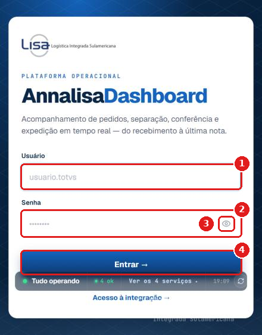

Os números em vermelho identificam cada item da tela. Nas tabelas a seguir, a coluna **Nº** indica o número correspondente.

| Nº | Campo | Descrição |
|---|---|---|
| 1 | **Usuário** | Login do usuário. |
| 2 | **Senha** | Senha do usuário. |
| 3 | **Olho** | Mostra a senha digitada, para conferir. |
| 4 | **Entrar** | Abre o AnnaLisa. |

---

### 3.2 Abrir a plataforma Tickets

Clique no quadro **LISA · PLATAFORMA**, no canto de cima à esquerda, e escolha **Tickets – Atendimento de T.I.**

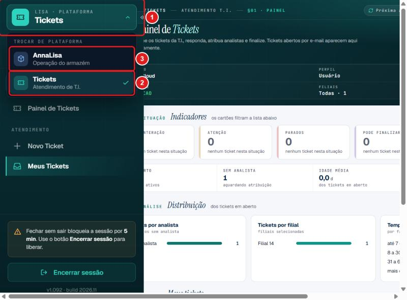

| Nº | Item | Descrição |
|---|---|---|
| 1 | **LISA · PLATAFORMA** | Abre a lista de plataformas. |
| 2 | **Tickets** | Abre o Painel de Tickets. |
| 3 | **AnnaLisa** | Volta para o AnnaLisa (Operação do armazém). |

### Validações

| Situação | O que fazer |
|---|---|
| Usuário ou senha incorretos | Conferir os dados. Esqueceu a senha: pedir a troca à T.I. |
| Não aparece a plataforma **Tickets** | O usuário não tem acesso. Pedir à T.I. pelo e-mail `ticket@lisalogsistema.com.br`. |
| Mensagem de acesso negado | Avisar a T.I. com o print da mensagem. |
| Sessão bloqueada | A sessão anterior foi fechada sem **Encerrar sessão**. Aguardar 5 minutos. |

---

### 3.3 Menu da plataforma

O menu fica na lateral esquerda. A seta **«** recolhe o menu (só ícones) e a **»** abre de novo.

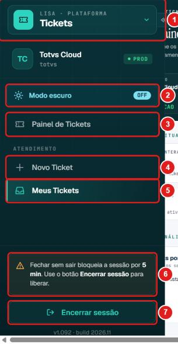

| Nº | Item | Descrição |
|---|---|---|
| 1 | **LISA · PLATAFORMA** | Troca de plataforma. |
| 2 | **Modo escuro** | Liga ou desliga o fundo escuro. |
| 3 | **Painel de Tickets** | Tela principal, com indicadores e lista. |
| 4 | **Novo Ticket** | Abre um ticket para a T.I. (item 3.5). |
| 5 | **Meus Tickets** | Lista só os tickets que o usuário abriu. |
| 6 | **Aviso da sessão** | Fechar o navegador sem sair bloqueia a sessão por 5 minutos. |
| 7 | **Encerrar sessão** | Sai do AnnaLisa. |

### Regra

> Sempre usar **Encerrar sessão** ao terminar. Fechar o navegador sem sair **bloqueia a sessão por 5 minutos**.

---

### 3.4 Painel de Tickets

Mostra os tickets **em aberto** do usuário: indicadores no alto e lista embaixo.

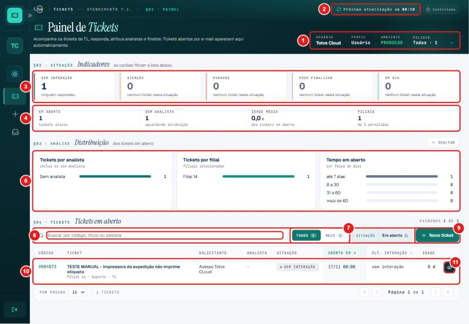

| Nº | Item | Descrição |
|---|---|---|
| 1 | **Dados do usuário** | Usuário, perfil, ambiente e filiais permitidas. |
| 2 | **Próxima atualização** | Contagem até a próxima atualização automática, feita a cada 10 minutos. |
| 3 | **Indicadores de situação** | Sem interação, Atenção, Parados, Pode finalizar e Em dia. Clicar no cartão filtra a lista. |
| 4 | **Resumo** | Em aberto, sem analista, idade média e filiais. |
| 5 | **Distribuição** | Tickets por analista, por filial e tempo em aberto. **Ocultar** esconde o quadro. |
| 6 | **Buscar** | Procura por número, título ou nome de pessoa. |
| 7 | **Todos / Meus** | Todos os tickets que o usuário pode ver ou só os que ele abriu. |
| 8 | **Situação: Em aberto** | Filtro fixo: a lista mostra só tickets em aberto. |
| 9 | **Novo ticket** | Abre um ticket para a T.I. |
| 10 | **Linha do ticket** | Número, título (filial · tipo · departamento), solicitante, analista, situação, abertura, última interação e idade. |
| 11 | **Olho** | Abre o ticket com o histórico. |

Embaixo da lista ficam a quantidade por página (15, 25 ou 50) e a troca de página.

### Situações

| Situação | Significado | O que o usuário faz |
|---|---|---|
| **Sem interação** | Ninguém da T.I. respondeu ainda. Todo ticket novo começa assim. | Aguarda a resposta. |
| **Em dia** | Teve mensagem há pouco tempo (menos de 4 dias). | Acompanha e responde o que for pedido. |
| **Atenção** | Alguns dias sem nenhuma mensagem. | Verifica se a T.I. espera alguma informação. |
| **Parados** | Muitos dias sem nenhuma mensagem. | Responde o ticket ou fala com a T.I. |
| **Pode finalizar** | O analista respondeu por último e o usuário não deu retorno há mais de 5 dias. | Responde. Sem retorno, a T.I. pode finalizar. |

### Regra

> Com **mais de 5 dias** sem retorno do usuário depois da resposta do analista, a T.I. pode **finalizar** o ticket por falta de retorno.

---

### 3.5 Abrir um novo ticket

Clique em **Novo Ticket** (menu) ou **Novo ticket** (acima da lista), preencha e clique em **Abrir ticket**.

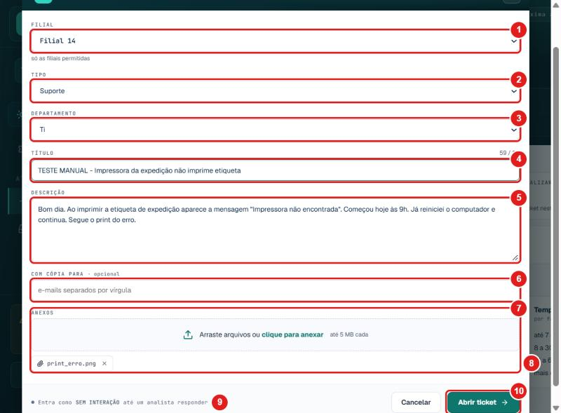

| Nº | Campo | Descrição |
|---|---|---|
| 1 | **Filial** | Só as filiais permitidas para o usuário. |
| 2 | **Tipo** | Suporte, Dúvida, Melhoria, Outros ou Integração. |
| 3 | **Departamento** | Área do pedido. |
| 4 | **Título** | Resumo em uma linha, até 80 caracteres. |
| 5 | **Descrição** | O que acontece, desde quando e em quais telas. Mensagem de erro, se houver. |
| 6 | **Com cópia para** | Opcional. E-mails de outras pessoas, separados por vírgula. |
| 7 | **Anexos** | Arrastar arquivos ou **clique para anexar**. Até 5 MB por arquivo. |
| 8 | **Arquivos escolhidos** | O **x** remove o arquivo antes de enviar. |
| 9 | **Lembrete** | O ticket entra como **Sem interação** até um analista responder. |
| 10 | **Abrir ticket** | Grava o ticket. **Cancelar** fecha sem gravar. |

O sistema mostra **Ticket #número aberto.** e o ticket entra na lista como **Sem interação**.

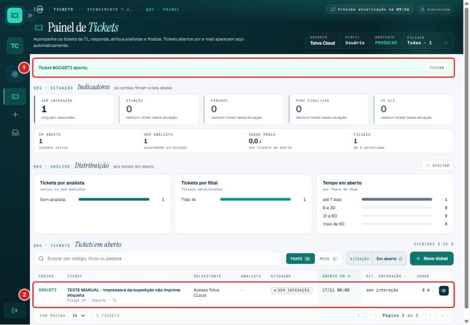

| Nº | Item | Descrição |
|---|---|---|
| 1 | **Confirmação** | Número do ticket aberto. **FECHAR** esconde a mensagem. |
| 2 | **Ticket na lista** | O ticket novo, já gravado. |

### Regra

> Quanto mais clara a descrição, mais rápido o atendimento. Sempre que possível, envie um **print** da tela com o erro.

| Evite | Prefira |
|---|---|
| "O sistema não funciona." | "Ao imprimir a etiqueta na Expedição, filial 14, aparece: Impressora não encontrada. Começou hoje às 9h." |
| "Preciso de acesso." | "Preciso de acesso à rotina Pedido de Venda para lançar os pedidos do cliente novo. Meu gestor está em cópia." |

---

### 3.6 Ver um ticket

Na lista, clique no **olho** do ticket.

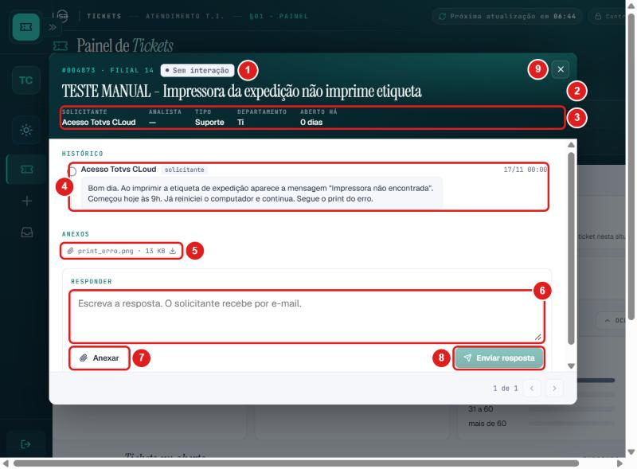

| Nº | Item | Descrição |
|---|---|---|
| 1 | **Número, filial e situação** | Identificação do ticket. |
| 2 | **Título** | Título do ticket. |
| 3 | **Resumo** | Solicitante, analista, tipo, departamento e dias em aberto. |
| 4 | **Histórico** | Conversa, da mensagem mais antiga para a mais nova. |
| 5 | **Anexos** | Clique no arquivo para baixar. |
| 6 | **Responder** | Campo da resposta (item 3.7). |
| 7 | **Anexar** | Escolhe arquivos para a resposta. |
| 8 | **Enviar resposta** | Grava a resposta no ticket. |
| 9 | **X** | Fecha o ticket. |

> As setas **‹ ›** no rodapé da janela passam para o ticket anterior ou o próximo da lista.

---

### 3.7 Responder e enviar arquivos

Escreva a mensagem, anexe os arquivos se precisar e clique em **Enviar resposta**.

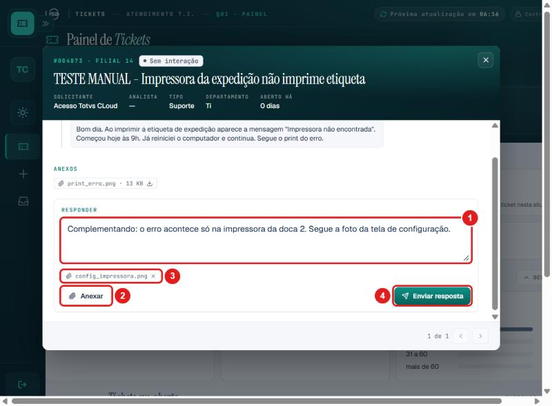

| Nº | Campo | Descrição |
|---|---|---|
| 1 | **Mensagem** | Só o que é novo; a conversa anterior já está gravada. |
| 2 | **Anexar** | Escolhe arquivos do computador. Até 5 MB por arquivo. |
| 3 | **Arquivo escolhido** | O **x** remove antes de enviar. |
| 4 | **Enviar resposta** | Grava a mensagem e os arquivos. |

Depois de enviar aparece **Resposta enviada.**, a mensagem entra no histórico e o arquivo aparece em **Anexos**.

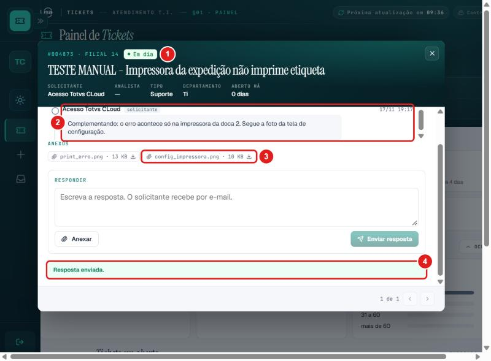

| Nº | Item | Descrição |
|---|---|---|
| 1 | **Situação** | Atualizada após a resposta. |
| 2 | **Histórico** | A mensagem enviada. |
| 3 | **Anexos** | O arquivo enviado. |
| 4 | **Confirmação** | Resposta enviada. |

---

### 3.8 Tickets finalizados

Quando a T.I. finaliza o ticket, ele sai da lista (que mostra só tickets em aberto) e o usuário recebe o e-mail **Ticket finalizado** com a descrição do atendimento.

### Regra

> Ticket finalizado **não recebe mais respostas**. Se o problema voltar, abra um **novo ticket** e cite o número do antigo.

---

## 4. Processo de atendimento por e-mail

### Fluxo

```text
E-mail para ticket@lisalogsistema.com.br
       ↓
Assunto com o código ###número|Filial###?
 ┌───┴───┐
Não     Sim → grava como interação no ticket
 ↓             ↓
Abre um ticket novo    Confirmação "Interação registrada"
 ↓
Confirmação "Ticket registrado" com o número
       ↓
A T.I. responde → aviso "Interação registrada"
       ↓
Usuário clica em Responder (sem mudar o assunto)
       ↓
A T.I. finaliza → aviso "Ticket finalizado"
```

---

### 4.1 Abrir um ticket por e-mail

Envie um e-mail para `ticket@lisalogsistema.com.br`. O assunto vira o título e o corpo vira a descrição.

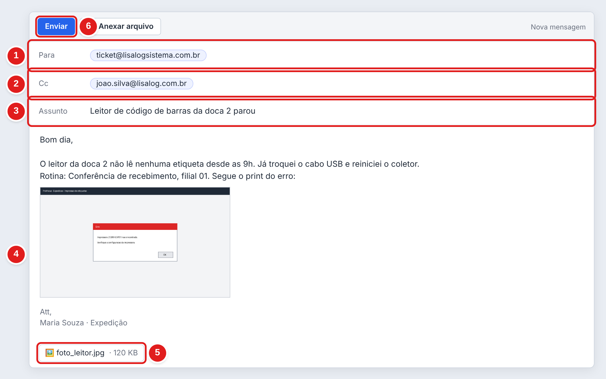

| Nº | Campo | Descrição |
|---|---|---|
| 1 | **Para** | `ticket@lisalogsistema.com.br` |
| 2 | **Cc** | Pessoas que também recebem a confirmação (opcional). |
| 3 | **Assunto** | Título do ticket. |
| 4 | **Corpo** | Descrição do problema. Pode ter prints colados. |
| 5 | **Anexos** | Arquivos enviados pelo clipe são gravados no ticket. |
| 6 | **Enviar** | Envia o e-mail. |

> Exemplo ilustrativo: o programa de e-mail de cada pessoa pode ter outra aparência.

Em poucos minutos chega a confirmação **Ticket registrado**, com o número, a descrição gravada e os anexos registrados.

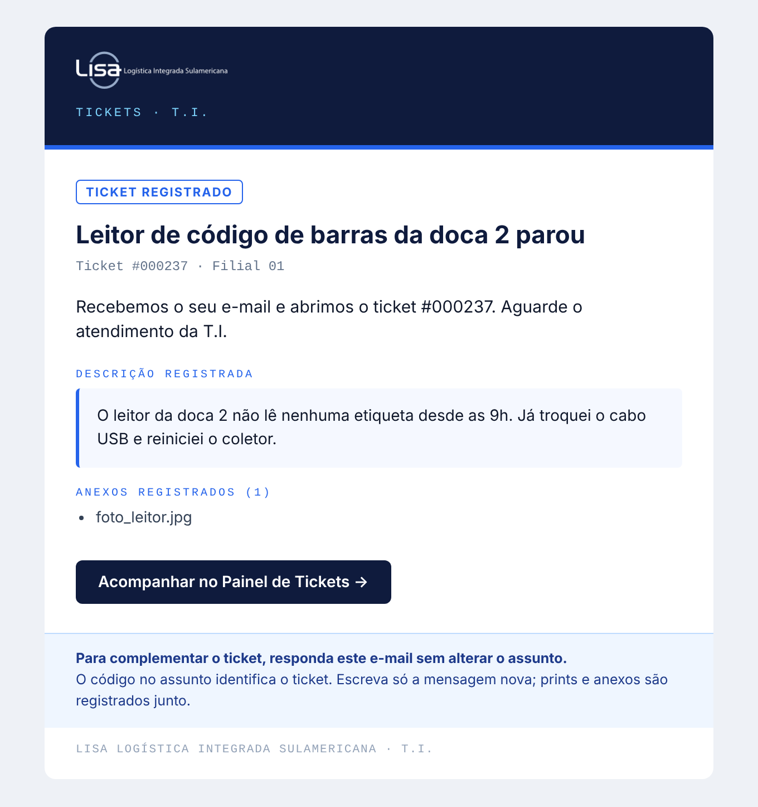

---

### 4.2 Responder um ticket por e-mail

Todo e-mail de ticket tem no assunto o número e um código como `###004873|Filial:14###`. É esse código que liga o e-mail ao ticket certo.

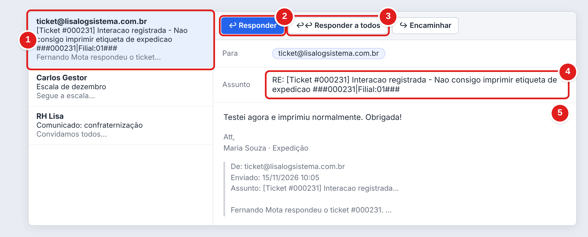

| Nº | Item | Descrição |
|---|---|---|
| 1 | **E-mail do ticket** | Aviso recebido, com o código `###` no assunto. |
| 2 | **Responder** | Responde para o ticket. |
| 3 | **Responder a todos** | Também funciona; as pessoas em cópia recebem a resposta. |
| 4 | **Assunto** | Deixar como veio, com o `RE:` e o código `###`. |
| 5 | **Mensagem** | Só o que é novo. O histórico de baixo não é gravado de novo. |

> Para pedir ajuda sobre um e-mail recebido de outra pessoa, **encaminhe** esse e-mail para `ticket@lisalogsistema.com.br` e escreva em cima o que precisa. Um ticket novo é aberto com o conteúdo.

---

### 4.3 Avisos por e-mail

| Aviso | Cor | Quando chega |
|---|---|---|
| **Ticket registrado** | Azul | Confirmação de que o e-mail abriu um ticket. Também chega para quem está em cópia de um ticket novo. |
| **Interação registrada** | Laranja | Quando o analista ou alguém em cópia escreve no ticket, e como confirmação da resposta enviada por e-mail. |
| **Ticket finalizado** | Verde | Quando a T.I. encerra o ticket, com a descrição do atendimento. |

O que o usuário faz pelo AnnaLisa não gera e-mail para ele mesmo: a tela já mostra na hora.

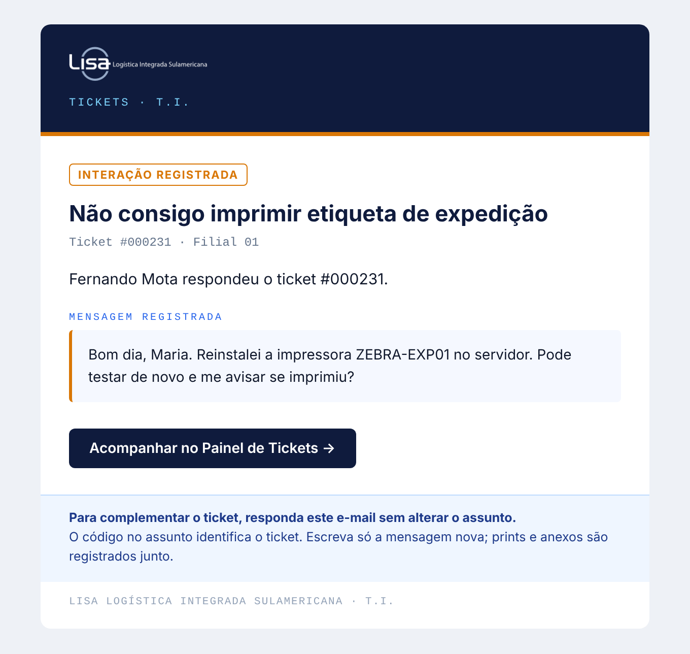

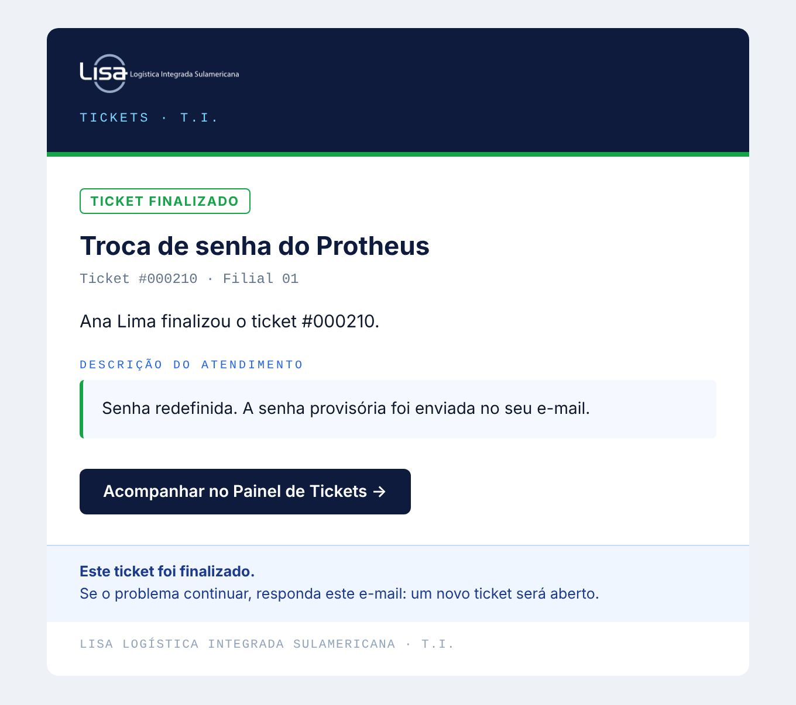

O botão **Acompanhar no Painel de Tickets** abre o painel (`https://lisatickets.netlify.app/`).

### Regra

> Responder um aviso de **ticket finalizado** abre um **ticket novo** com a mensagem. Faça isso só se o problema continuar.

---

## 5. Mensagens

| Mensagem | Causa |
|---|---|
| Ticket #número aberto. | Ticket aberto pelo AnnaLisa. |
| Resposta enviada. | Resposta gravada no ticket. |
| Fechar sem sair bloqueia a sessão por 5 min. | Aviso fixo do menu: usar **Encerrar sessão** ao terminar. |
| Ticket registrado (e-mail) | Ticket aberto por e-mail. |
| Interação registrada (e-mail) | Resposta gravada no ticket. |
| Ticket finalizado (e-mail) | Ticket encerrado pela T.I. |

---

## 6. Resumo das Regras

| Função / Campo | Finalidade |
|---|---|
| AnnaLisa › plataforma **Tickets** | Tela do usuário: painel, abertura, histórico e respostas. |
| `LISWS004` / `LISA.Tickets.*` | API: lista, abertura, interações, anexos e finalização. |
| `LISJB006` | Job que lê a caixa `ticket@`, abre tickets, grava interações e envia as confirmações. |
| `ZA5` | Cabeçalho do ticket. `ZA5_USRABE` = quem abriu; `ZA5_USRAT` = analista. |
| `ZA6` | Interações do ticket. |
| `ZA7` | Anexos do ticket. |
| AnnaLisa (`plataformas.chamados`) | Cadastro de acesso: perfil, permissões, filiais e tamanho de anexo. |
| `MV_XTKCSMT` / `MV_XTKCIMP` / `MV_XTKCUSR` / `MV_XTKCPAS` | Conta e servidores de e-mail dos tickets. |

---

## 7. Regras de Negócio – Resumo

1. O acesso é pelo AnnaLisa, plataforma **Tickets**, com o perfil cadastrado lá.
2. O usuário vê os tickets em aberto que pode acessar; **Meus** mostra só os que ele abriu.
3. Ticket aberto pelo AnnaLisa ou por e-mail fica gravado no Protheus e aparece nos dois lugares.
4. Todo ticket novo começa como **Sem interação** até um analista responder.
5. Com mais de 5 dias sem retorno do usuário depois da resposta do analista, o ticket fica **Pode finalizar** e pode ser finalizado.
6. Só a T.I. (analista ou administrador) finaliza ticket. Ticket finalizado sai da lista e não recebe resposta.
7. Arquivos até 5 MB por arquivo.
8. Fechar o navegador sem **Encerrar sessão** bloqueia a sessão por 5 minutos.
9. Por e-mail, a resposta precisa manter o código `###número|Filial###` no assunto; só a mensagem nova é gravada.
10. Imagens da assinatura do e-mail são ignoradas. Uma única imagem colada no corpo é tratada como assinatura: mande o print como anexo.
11. Respostas automáticas (férias, não entrega) são ignoradas e não abrem ticket.
12. Use o e-mail da empresa cadastrado no usuário do Protheus, para o ticket ficar no seu nome.
