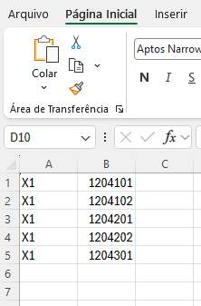
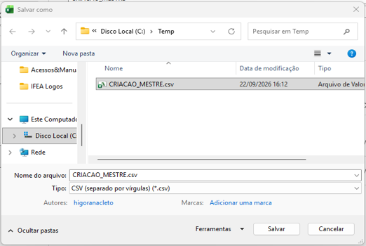
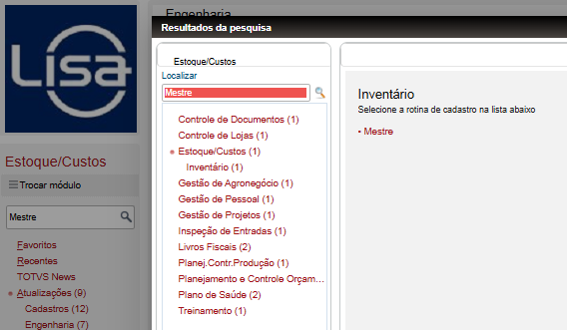
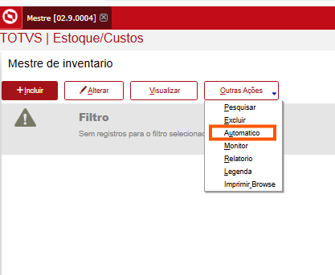
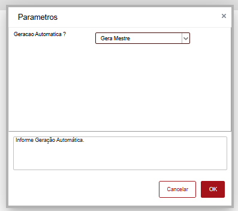
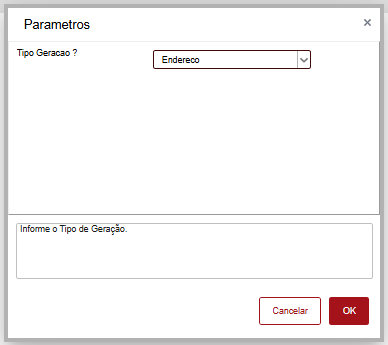
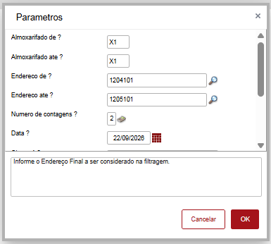
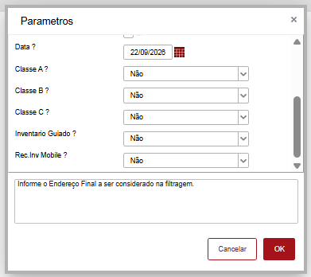
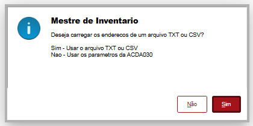
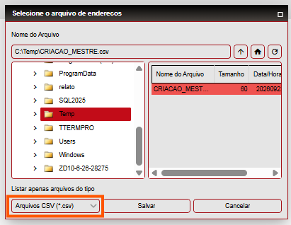

<!-- PADRAO-LISA -->

  

<h1 align="center">Criação de Mestre de Inventário por Arquivo</h1>

<b>Estoque</b> · Lisa Logística Integrada Sulamericana

[⬅ Voltar ao índice](../../README.md)

---

## Sumário

- [1. Gerando o arquivo para criação dos mestres](#1-gerando-o-arquivo-para-criação-dos-mestres)
- [2. Acessando a rotina](#2-acessando-a-rotina)
- [3. Criando os mestres](#3-criando-os-mestres)
- [4. Processando o arquivo CSV](#4-processando-o-arquivo-csv)
- [5. Resultado do processamento](#5-resultado-do-processamento)

---

## 1. Gerando o arquivo para criação dos mestres

1. Abra uma planilha no Excel.
2. Preencha:
   - **Primeira coluna:** o armazém.
   - **Segunda coluna:** os endereços.

   
  <b>Figura 1</b> — Planilha com armazém e endereços

3. Salve o arquivo do Excel como **.CSV** em uma pasta do computador (por exemplo, `C:\`).

   
  <b>Figura 2</b> — Salvando a planilha em CSV

---

## 2. Acessando a rotina

Pesquise por **Mestre** ou acesse:

**Estoque/Custos > Inventário > Mestre**

   
  <b>Figura 3</b> — Acesso à rotina Mestre de Inventário

---

## 3. Criando os mestres

Acesse **Outras Ações > Automático > Gera Mestre > Endereço**.

   
  <b>Figura 4</b> — Outras Ações › Automático › Gera Mestre

### 3.1 Parâmetros

Na tela de geração automática:

   
  <b>Figura 5</b> — Tela de geração automática

| Campo | O que informar |
|---|---|
| **Geração Automática** | Selecione a opção correspondente. |
| **Gera Mestre** | Selecione **Endereço**. |

   
  <b>Figura 6</b> — Gera Mestre por Endereço

Informe os parâmetros necessários:

   
  <b>Figura 7</b> — Parâmetros da geração

   
  <b>Figura 8</b> — Parâmetros da geração (continuação)

> ⚠️ **Ponto de atenção:** os endereços do arquivo CSV precisam estar dentro da faixa informada nos parâmetros **Endereço de?** e **Endereço até?**.

---

## 4. Processando o arquivo CSV

1. Clique em **Sim**.

   
  <b>Figura 9</b> — Mensagem de confirmação

2. Altere o tipo da busca para **CSV**.
3. Selecione o arquivo CSV.
4. Clique em **Salvar**.

   
  <b>Figura 10</b> — Selecionando o arquivo CSV

---

## 5. Resultado do processamento

Ao final do processamento é exibida uma mensagem informando:

- os endereços encontrados;
- os endereços criados com sucesso.

---

[⬅ Voltar ao índice](../../README.md)

   
  Lisa Logística Integrada Sulamericana · Tecnologia da Informação

