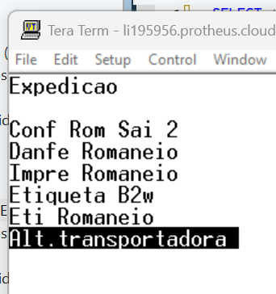
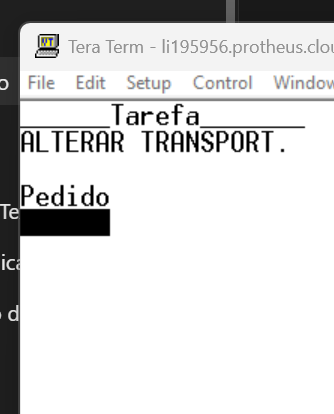
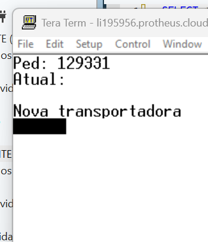
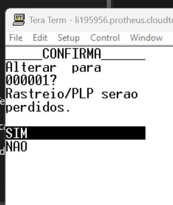
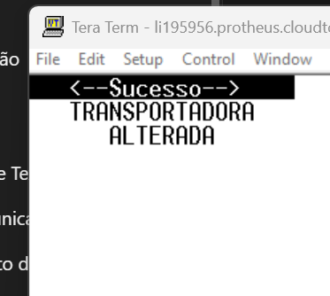

# Alteração de Transportadora – Coletor (ACD)

## 1. Objetivo

Esta rotina permite **alterar a transportadora de um pedido de venda pelo coletor**, sem precisar abrir o pedido no Protheus.

A troca só é permitida para pedido **não faturado** e **sem romaneio**. Ao trocar, o rastreio e a PLP do pedido são limpos e, se a nova transportadora for Correios, uma nova postagem é gerada no VIPP.

**Fonte:** `LISALTTR.prw` – função de usuário `U_LISALTTR`.

**Acesso:** Coletor (Tera Term) › **Expedição** › **Alt.transportadora**.

---

## 2. Parâmetros de Configuração

| Parâmetro | Conteúdo | Descrição |
|---|---|---|
| `ES_TRCORRE` | Códigos de transportadora | Transportadoras consideradas Correios, separadas por `\|`. Padrão: `000025\|001032` |

---

## 3. Processo de alteração

### Fluxo

```text
Informar pedido
       ↓
Pedido existe, não faturado e sem romaneio?
 ┌───┴───┐
Sim     Não → mensagem e volta para o pedido
 ↓
Informar nova transportadora
       ↓
Transportadora válida, ativa e diferente da atual?
 ┌───┴───┐
Sim     Não → mensagem e volta para o pedido
 ↓
Confirmação
 ┌───┴───┐
SIM     NAO → "NADA FOI ALTERADO"
 ↓
Grava a transportadora, limpa rastreio/PLP
 ↓
Correios? → gera nova postagem no VIPP
 ↓
Atualiza a transportadora no monitor (ZAH)
 ↓
Mensagem de sucesso e volta para o pedido
```

---

### 3.1 Acessar a rotina

No menu **Expedição** do coletor, selecione **Alt.transportadora**.



---

### 3.2 Informar o pedido

Informe o número do pedido de venda (`C5_NUM`).



### Validações

| Validação | Mensagem |
|---|---|
| Pedido existe na `SC5` | PEDIDO NAO ENCONTRADO |
| Pedido não faturado (`C5_NOTA` vazio) | PEDIDO JA FATURADO |
| Pedido sem romaneio na `SZ1` | PEDIDO JA POSSUI ROMANEIO |

> Pressione `ESC` nesta tela para sair da rotina.

---

### 3.3 Informar a nova transportadora

A tela mostra o pedido, o código da transportadora atual e o nome reduzido dela (`A4_NREDUZ`). Informe o código da nova transportadora (`A4_COD`).



Se o cadastro de transportadoras tiver o campo `A4_LOJA`, a tela também pede a **Loja**.

### Validações

| Validação | Mensagem |
|---|---|
| Transportadora (e loja, se informada) existe na `SA4` | TRANSPORTADORA INVALIDA |
| Transportadora não bloqueada (`A4_MSBLQL` diferente de `1`) | TRANSPORTADORA BLOQUEADA |
| Transportadora diferente da atual | PEDIDO JA ESTA COM ESTA TRANSPORTADORA |

> Pressione `ESC` nesta tela para voltar ao pedido sem alterar nada.

---

### 3.4 Confirmar a alteração

O sistema mostra a transportadora atual e a nova e avisa que o rastreio e a PLP serão perdidos.



- **SIM** — grava a alteração.
- **NAO** — não altera nada e exibe `NADA FOI ALTERADO`.

---

### 3.5 Gravação

Ao confirmar, o sistema:

1. Valida novamente se o pedido não foi faturado nem recebeu romaneio enquanto a tela estava aberta.
2. Grava a nova transportadora em `C5_TRANSP`.
3. Limpa a PLP (`C5_XPLP`) e o rastreio (`C5_XRASTRE`).
4. Se a nova transportadora estiver no parâmetro `ES_TRCORRE` e o cliente tiver as credenciais VIPP cadastradas (`A1_XUSRCOR`, `A1_XSNHCOR`, `A1_XCODADM`), gera uma nova postagem no VIPP e grava o novo rastreio em `C5_XRASTRE`.
5. Atualiza a transportadora do pedido nos monitores do AnnaLISA (`ZAH_TRANSP`), pela função `U_LISRT003`.
6. Registra no log do console o pedido, a transportadora anterior, a nova e o usuário.

Ao final, a rotina volta para a tela do pedido, para a próxima alteração.



### Regra

> Se a transportadora for Correios e o cliente não tiver as credenciais VIPP, a transportadora é alterada e o pedido fica sem rastreio.

---

## 4. Mensagens

| Mensagem | Causa |
|---|---|
| PEDIDO NAO ENCONTRADO | Pedido inexistente na `SC5` da filial. |
| PEDIDO JA FATURADO | Pedido com `C5_NOTA` preenchido. |
| PEDIDO JA POSSUI ROMANEIO | Pedido já vinculado a um romaneio na `SZ1`. |
| TRANSPORTADORA INVALIDA | Código (ou loja) inexistente na `SA4`. |
| TRANSPORTADORA BLOQUEADA | Transportadora com `A4_MSBLQL = 1`. |
| PEDIDO JA ESTA COM ESTA TRANSPORTADORA | Nova transportadora igual à atual. |
| NADA FOI ALTERADO | Usuário respondeu **NAO** na confirmação. |
| PEDIDO FATURADO OU COM ROMANEIO | O pedido foi faturado ou recebeu romaneio entre a consulta e a gravação. |
| PEDIDO EM USO POR OUTRO USUARIO | Pedido bloqueado por outro usuário no momento da gravação. |
| TRANSP. ALTERADA, MAS ERRO NA POSTAGEM: ... | Transportadora gravada, mas o VIPP retornou erro ao gerar a postagem (mensagem do VIPP em seguida). |
| ALTERADO. RASTREIO ... | Transportadora Correios gravada e nova postagem gerada (mostra o novo rastreio). |
| TRANSPORTADORA ALTERADA | Alteração concluída. |

---

## 5. Resumo das Regras

| Função / Campo | Finalidade |
|---|---|
| `U_LISALTTR` | Tela do coletor para alterar a transportadora do pedido. |
| `SC5` / `C5_TRANSP` | Transportadora do pedido. |
| `C5_XPLP` / `C5_XRASTRE` | PLP e rastreio, limpos na alteração. |
| `SZ1` | Romaneio: pedido com romaneio não pode ser alterado. |
| `SA4` | Cadastro de transportadoras (validação e nome). |
| `ES_TRCORRE` | Códigos de transportadora Correios. |
| `SA1` / `A1_XUSRCOR`, `A1_XSNHCOR`, `A1_XCODADM` | Credenciais VIPP do cliente para gerar a postagem. |
| `ZAH` / `ZAH_TRANSP` | Transportadora exibida nos monitores do AnnaLISA. |

---

## 6. Regras de Negócio – Resumo

1. Só é possível alterar pedido existente, não faturado e sem romaneio.
2. A nova transportadora deve existir na `SA4`, não estar bloqueada e ser diferente da atual.
3. A alteração só é gravada após a confirmação **SIM**.
4. Antes de gravar, o sistema valida de novo se o pedido não foi faturado nem recebeu romaneio.
5. A PLP e o rastreio do pedido são sempre limpos na alteração.
6. Para transportadora Correios com cliente com credenciais VIPP, uma nova postagem é gerada e o rastreio é regravado.
7. Erro na postagem VIPP não desfaz a troca da transportadora.
8. A transportadora do monitor do AnnaLISA (`ZAH_TRANSP`) é atualizada na troca.
9. Cada alteração fica registrada no log do console com o usuário.
