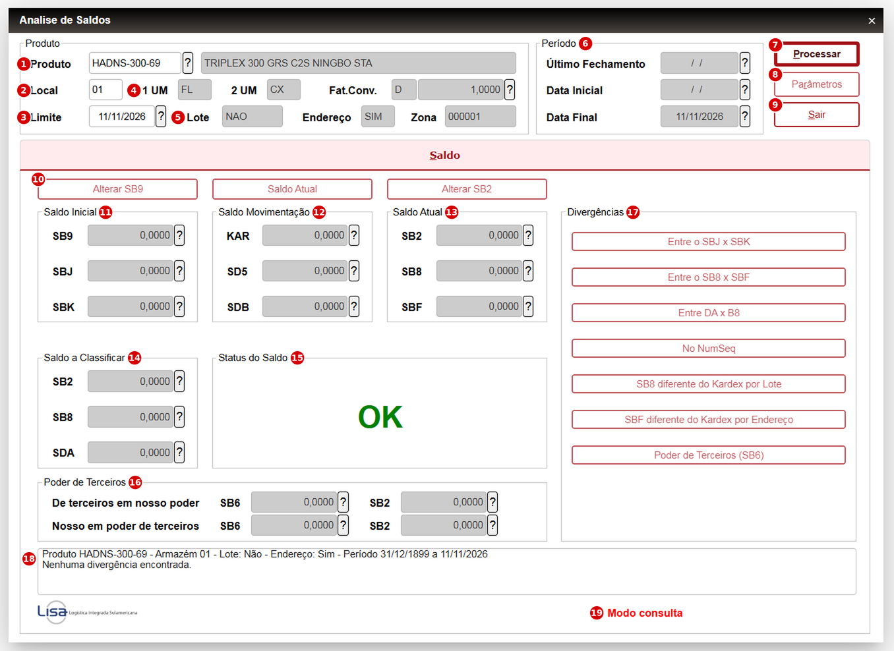

# Análise de Saldos – Estoque

## 1. Objetivo

Esta rotina **compara os saldos de estoque de um produto em um armazém** entre as tabelas de saldo e as tabelas de movimentação, e informa se eles estão coerentes entre si.

Ao final do processamento a tela mostra o status **OK** ou **DIVERGÊNCIA**, quais comparações não bateram e a diferença de cada uma. A análise inclui o controle de **poder de terceiros** (`SB6`).

O acesso depende do perfil do usuário:

| Perfil | O que acessa |
|---|---|
| Usuário comum | **Modo consulta**: informa produto e armazém, processa e visualiza saldos, status e divergências. Não altera nada na base. |
| Administrador (grupo `000000`) | Rotina completa: pastas de detalhe, parâmetros e botões de ajuste. |

Este documento descreve o **modo consulta**. O perfil administrador está resumido nas seções 2 e 5.

**Fonte:** `ANALISE.PRW` – função de usuário `U_ANALISE`.

**Acesso:** _(informar o caminho do menu)_ › **Análise de Saldos**.

---

## 2. Parâmetros de Configuração

| Parâmetro | Conteúdo | Descrição |
|---|---|---|
| `MV_LOTEUNI` | Lógico | Parâmetro padrão do sistema lido pela rotina. Quando `.T.`, o número do sub-lote não é utilizado nos ajustes. |

Os parâmetros abaixo ficam na própria tela, no botão **Parâmetros**, e só estão disponíveis para o administrador. Valem enquanto a rotina está aberta.

| Parâmetro | Padrão | Descrição |
|---|---|---|
| Gerar log (`ANALISE.LOG`) | Sim | Registra consultas e ajustes com data, hora, usuário e filial. |
| Permitir manutenção na base | Não | Habilita os botões de incluir, alterar e excluir. Sempre inicia desligado e pede confirmação ao ser ativado. |

---

## 3. Processo de consulta

### Fluxo

```text
Abrir a rotina
       ↓
Usuário é do grupo de Administradores?
 ┌───┴───┐
Não     Sim → rotina completa (todas as pastas e parâmetros)
 ↓
Modo consulta (somente a pasta Saldo)
       ↓
Informar produto, armazém e data limite
       ↓
Produto cadastrado?
 ┌───┴───┐
Sim     Não → "Produto não cadastrado !!!"
 ↓
Datas do período calculadas automaticamente
       ↓
Processar
       ↓
Saldos iguais em todas as comparações?
 ┌───┴───┐
Sim     Não → status DIVERGÊNCIA, botões de divergência habilitados
 ↓             e diferenças listadas no diagnóstico
Status OK
```

---

### 3.1 Tela de consulta

Ao abrir a rotina com um usuário comum é apresentada a tela abaixo, somente com a pasta **Saldo**.



Os números em vermelho identificam cada item da tela. Nas tabelas a seguir, a coluna **Nº** indica o número correspondente.

---

### 3.2 Informar o produto

Preencha o **Produto**, confira o **Local** e a data **Limite**.

| Nº | Campo | Descrição |
|---|---|---|
| 1 | **Produto** | Código do produto (`B1_COD`). Aceita a consulta padrão (F3). Ao sair do campo, a descrição, os demais campos do quadro e as datas do período são preenchidos automaticamente. |
| 2 | **Local** | Armazém a analisar. É sugerido o armazém padrão do produto (`B1_LOCPAD`) e pode ser alterado. |
| 3 | **Limite** | Data até a qual as movimentações são consideradas. É sugerida a data base do sistema. |
| 4 | **1 UM** / **2 UM** / **Fat.Conv.** | Unidades de medida do produto, tipo de conversão (**M** = multiplica, **D** = divide) e fator de conversão. Somente leitura. |
| 5 | **Lote** | Controle de rastreabilidade do produto (`B1_RASTRO`): **Lote**, **Sub-Lote** ou **Não**. Somente leitura. |
| 5 | **Endereço** | Controle de endereçamento do produto (`B1_LOCALIZ`): **Sim** ou **Não**. Somente leitura. |
| 5 | **Zona** | Zona de armazenagem do produto (`B5_CODZON`). Somente leitura. |

### Validações

| Validação | Mensagem |
|---|---|
| Produto existe na `SB1` | Produto não cadastrado !!! |

> Os campos **Lote** e **Endereço** definem quais comparações são feitas. Um produto que não controla lote não é validado contra os saldos por lote.

---

### 3.3 Período

O quadro **Período** (item **6**) é calculado pela rotina e é somente leitura.

| Nº | Campo | Descrição |
|---|---|---|
| 6 | **Último Fechamento** | Data do último fechamento de estoque do produto no armazém (`B9_DATA`), anterior à data Limite. |
| 6 | **Data Inicial** | Dia seguinte ao último fechamento. É a partir desta data que as movimentações são somadas. |
| 6 | **Data Final** | Igual à data Limite informada. |

### Regra

> Quando **Último Fechamento** e **Data Inicial** aparecem em branco, **não houve fechamento de estoque** para esse produto nesse armazém antes da data Limite. Não é erro. Nesse caso o quadro **Saldo Inicial** fica zerado, a rotina considera todas as movimentações do produto até a data Limite e, no texto de diagnóstico, o período aparece começando em **31/12/1899**, que é apenas a forma como o sistema representa "sem data inicial".

---

### 3.4 Processar

| Nº | Botão | Descrição |
|---|---|---|
| 7 | **Processar** | Executa a análise do produto e armazém informados e atualiza todos os quadros da pasta Saldo. |
| 8 | **Parâmetros** | Desabilitado no modo consulta. |
| 9 | **Sair** | Fecha a rotina. |
| 10 | **Alterar SB9** / **Saldo Atual** / **Alterar SB2** | Desabilitados no modo consulta. |

### Validações

| Validação | Mensagem |
|---|---|
| Produto informado e período calculado | Datas de Processamento Invalidas !!! |

---

### 3.5 Saldos apresentados

Todos os valores estão na 1ª unidade de medida do produto.

| Nº | Quadro | Campo | Descrição |
|---|---|---|---|
| 11 | **Saldo Inicial** | SB9 | Saldo inicial do produto no último fechamento (`B9_QINI`). |
| 11 | | SBJ | Soma dos saldos iniciais por lote (`BJ_QINI`). |
| 11 | | SBK | Soma dos saldos iniciais por endereço (`BK_QINI`). |
| 12 | **Saldo Movimentação** | KAR | Saldo pelo kardex: saldo inicial mais as entradas e saídas até a data Limite. |
| 12 | | SD5 | Saldo calculado pelas movimentações por lote. |
| 12 | | SDB | Saldo calculado pelas movimentações por endereço, somado ao saldo ainda a endereçar. |
| 13 | **Saldo Atual** | SB2 | Saldo atual do produto no armazém (`B2_QATU`). |
| 13 | | SB8 | Soma dos saldos por lote (`B8_SALDO`). |
| 13 | | SBF | Soma dos saldos por endereço (`BF_QUANT`), somada ao saldo ainda a endereçar. |
| 14 | **Saldo a Classificar** | SB2 | Saldo a classificar do produto (`B2_QACLASS`). |
| 14 | | SB8 | Soma do saldo a classificar dos lotes (`B8_QACLASS`). |
| 14 | | SDA | Soma dos saldos pendentes de endereçamento (`DA_SALDO`). |
| 16 | **Poder de Terceiros** | De terceiros em nosso poder | Coluna **SB6**: soma do saldo das remessas recebidas de terceiros. Coluna **SB2**: `B2_QTNP`. |
| 16 | | Nosso em poder de terceiros | Coluna **SB6**: soma do saldo das remessas enviadas a terceiros. Coluna **SB2**: `B2_QNPT`. |

### Regra

> No quadro Poder de Terceiros, a soma do `SB6` considera somente as remessas cujo tipo de entrada/saída atualiza estoque (`F4_ESTOQUE = S`). Em cada linha, as colunas **SB6** e **SB2** devem ser iguais.

---

### 3.6 Status do Saldo

O quadro **Status do Saldo** (item **15**) mostra o resultado geral.

- **OK** (verde) — os saldos do produto estão coerentes entre si.
- **DIVERGÊNCIA** (vermelho) — pelo menos uma comparação não bateu.

As comparações dependem do controle do produto:

| Controle do produto | Saldos que devem ser iguais |
|---|---|
| Sem lote e sem endereço | KAR e SB2 |
| Somente lote | KAR, SD5, SB8 e SB2; SB9 e SBJ |
| Somente endereço | KAR, SDB, SBF e SB2; SDA e SB2 a classificar |
| Lote e endereço | KAR, SD5, SDB, SB8, SBF e SB2; SB9 e SBJ; SDA, SB2 e SB8 a classificar |

Em todos os casos, o quadro Poder de Terceiros também precisa estar igual.

---

### 3.7 Divergências

No quadro **Divergências** (item **17**), cada botão corresponde a um tipo de divergência. O botão fica **habilitado** quando aquela divergência foi encontrada e **apagado** quando não há problema daquele tipo.

| Botão | Indica que |
|---|---|
| **Entre o SBJ x SBK** | O saldo inicial por lote é diferente do saldo inicial por endereço. |
| **Entre o SB8 x SBF** | O saldo de algum lote é diferente da soma dos endereços desse lote. |
| **Entre DA x B8** | O saldo a endereçar é diferente do saldo a classificar dos lotes. |
| **No NumSeq** | Existe movimento em que a quantidade do documento é diferente da quantidade movimentada por lote ou por endereço. |
| **SB8 diferente do Kardex por Lote** | O saldo de algum lote é diferente do calculado pelas suas movimentações. |
| **SBF diferente do Kardex por Endereço** | O saldo de algum endereço é diferente do calculado pelas suas movimentações. |
| **Poder de Terceiros (SB6)** | O `SB6` é diferente do `SB2`, ou o saldo de alguma remessa não bate com as suas devoluções. |

> No modo consulta, ao clicar em um botão habilitado é exibido um aviso de que o detalhe está disponível somente para administradores.

---

### 3.8 Diagnóstico

A caixa de texto abaixo dos quadros (item **18**) apresenta o resumo da análise:

1. A primeira linha identifica o produto, o armazém, o controle de lote e endereço e o período analisado.
2. As linhas seguintes listam cada comparação que não bateu, com os dois valores e a diferença, e indicam em qual pasta o administrador encontra o detalhe.
3. Quando está tudo certo, é exibido `Nenhuma divergência encontrada.`

No rodapé, à direita, é exibido **Modo consulta** (item **19**).

### Regra

> No modo consulta não é possível corrigir saldos. Ao encontrar **DIVERGÊNCIA**, anote o produto, o armazém e a data Limite, copie o texto do diagnóstico e abra um chamado para a T.I.

---

## 4. Mensagens

| Mensagem | Causa |
|---|---|
| Produto não cadastrado !!! | Código informado inexistente na `SB1`. |
| Datas de Processamento Invalidas !!! | Clicou em **Processar** sem informar o produto, então o período não foi calculado. |
| OK | Todas as comparações do produto bateram. |
| DIVERGÊNCIA | Pelo menos uma comparação não bateu. |
| Nenhuma divergência encontrada. | Texto do diagnóstico quando o status é OK. |
| SB6 diferente do SB2 (Poder de Terceiros) | A soma do `SB6` é diferente de `B2_QTNP` ou de `B2_QNPT`. |
| SB6: saldo da remessa diferente das devoluções | Em alguma remessa, quantidade original menos devoluções é diferente do `B6_SALDO`. |
| O detalhe desta divergência está disponível somente para os usuários do grupo de Administradores. | Usuário comum clicou em um botão do quadro Divergências. |
| Modo consulta | Texto do rodapé para usuário comum. |
| Manutenção na base está desativada. ... | Administrador acionou um botão de ajuste com o parâmetro de manutenção desligado. |
| Com a manutenção ativa os botões de Incluir/Alterar/Excluir gravam direto nas tabelas ... Confirma a ativação? | Administrador ligou o parâmetro de manutenção. |

---

## 5. Resumo das Regras

| Função / Campo | Finalidade |
|---|---|
| `U_ANALISE` | Tela de análise de saldos de estoque. |
| Grupo `000000` | Grupo de Administradores: define rotina completa ou modo consulta. |
| `SB1` / `B1_RASTRO`, `B1_LOCALIZ` | Controle de lote e de endereço do produto, que define as comparações. |
| `SB9` / `B9_QINI`, `B9_DATA` | Saldo inicial e data do último fechamento. |
| `SBJ` / `BJ_QINI` | Saldo inicial por lote. |
| `SBK` / `BK_QINI` | Saldo inicial por endereço. |
| `SB2` / `B2_QATU`, `B2_QACLASS` | Saldo atual e saldo a classificar do produto. |
| `SB2` / `B2_QTNP`, `B2_QNPT` | Quantidade de terceiros em nosso poder e nossa em poder de terceiros. |
| `SB8` / `B8_SALDO`, `B8_QACLASS` | Saldo e saldo a classificar por lote. |
| `SBF` / `BF_QUANT` | Saldo por endereço. |
| `SDA` / `DA_SALDO` | Saldo pendente de endereçamento. |
| `SD1`, `SD2`, `SD3` | Movimentações de entrada, saída e internas (kardex). |
| `SD5` | Movimentações por lote. |
| `SDB` | Movimentações por endereço. |
| `SB6` / `B6_SALDO`, `B6_PODER3`, `B6_TIPO`, `B6_IDENT` | Poder de terceiros: remessas (`R`), devoluções (`D`), tipo de/em terceiros e vínculo entre remessa e devolução. |
| `SF4` / `F4_ESTOQUE` | Define quais remessas do `SB6` entram na comparação com o `SB2`. |
| `ANALISE.LOG` | Log de consultas e ajustes. |
| `LISALOGO.PNG` | Logo exibido no rodapé, compilado no RPO. |

---

## 6. Regras de Negócio – Resumo

1. Usuário do grupo de Administradores abre a rotina completa; os demais abrem em modo consulta.
2. No modo consulta só existe a pasta Saldo, e os botões Parâmetros, Alterar SB9, Saldo Atual e Alterar SB2 ficam desabilitados.
3. Ao informar o produto, o armazém padrão e as datas do período são preenchidos automaticamente.
4. Último Fechamento em branco significa que o produto não teve fechamento no armazém; a análise considera todas as movimentações até a data Limite.
5. As comparações feitas dependem do controle de lote e de endereço do produto.
6. O poder de terceiros (`SB6` x `SB2`) sempre compõe o status, considerando somente remessas com TES que atualiza estoque.
7. O status é DIVERGÊNCIA quando pelo menos uma comparação não bate; o diagnóstico lista cada diferença.
8. A manutenção na base só existe para o administrador, sempre inicia desligada e pede confirmação ao ser ativada.
9. Os ajustes do administrador são gravados em transação e registrados no `ANALISE.LOG`.
10. A pasta de poder de terceiros é somente consulta, inclusive para o administrador.
