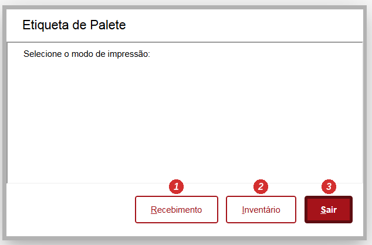
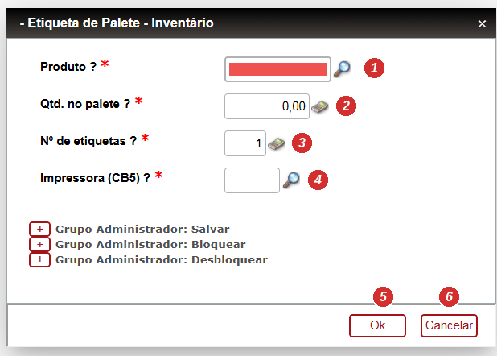
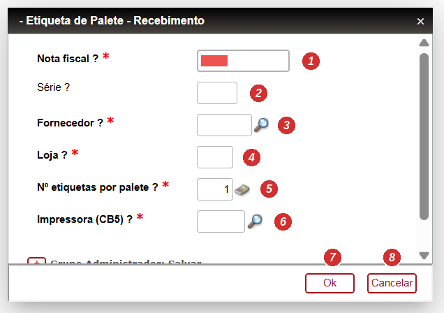
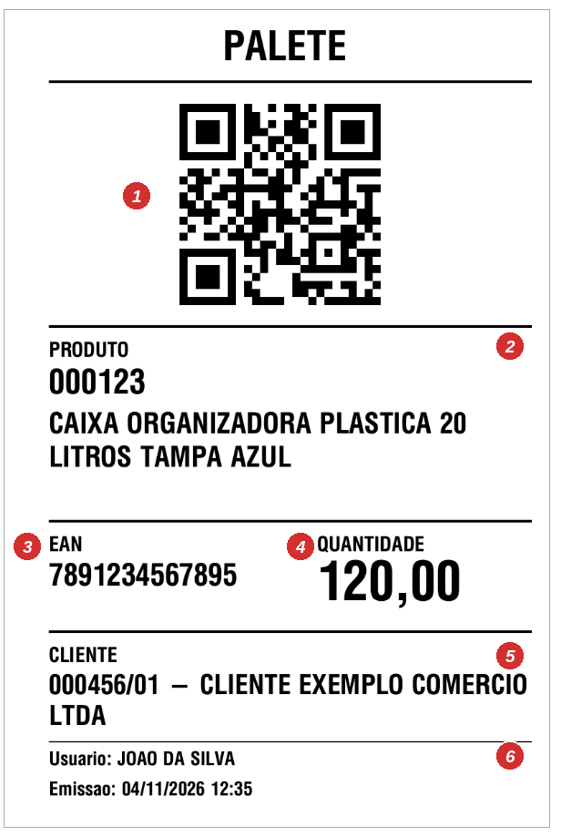
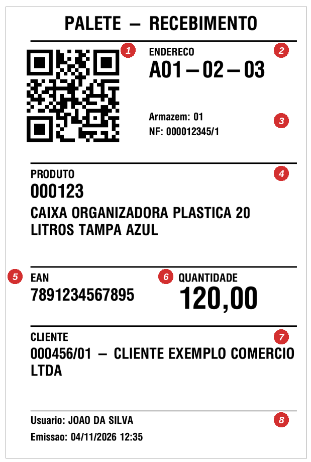

# Etiqueta de Palete (QR Code) – Impressão e Leitura no Inventário

## 1. Objetivo

Esta rotina define o comportamento do sistema para **impressão da etiqueta de palete com QR Code** e para a **leitura dessa etiqueta na contagem de inventário** pelo coletor (ACDV035).

O QR Code leva o **EAN do produto** e a **quantidade do palete**. Na contagem, uma única leitura identifica o produto e informa a quantidade, sem digitação.

**Fonte:** `XINVPLT` – função de usuário `U_XETQPLT` e pontos de entrada `CBINV01` e `V035ALTQTD`.

**Acesso:** Ambiente **42 – WMS** › Etiquetas › Outras Etiquetas › **Etiqueta QRCode**.

---

## 2. Modelo do QR Code

**Finalidade:**  
Identificar o palete na leitura do coletor, carregando o produto e a quantidade.

### Conteúdo

```text
PLT|<EAN>|<QUANTIDADE>
```

| Parte | Descrição |
|---|---|
| `PLT` | Prefixo fixo que identifica o QR Code como etiqueta de palete. |
| `EAN` | Código de barras do produto (`B1_CODBAR`). É o código que o padrão da ACDV035 já reconhece. |
| `QUANTIDADE` | Quantidade do palete, com ponto como separador decimal. |

### Exemplo

```text
PLT|7891234567895|120
```

### Regra

> O QR Code só é gerado para produto com `B1_CODBAR` preenchido.

---

## 3. Modos de Impressão

Ao abrir a rotina, o usuário escolhe o modo de impressão.



### Funcionamento

Após imprimir, a tela de parâmetros do modo escolhido é reaberta para a próxima impressão. **Cancelar** volta para a escolha do modo; **Sair** encerra a rotina. 

```text
Escolha do modo
       ↓
┌──────┴──────┐
Inventário   Recebimento
   ↓              ↓
Parâmetros    Parâmetros
   ↓              ↓
Impressão     Impressão
   ↓              ↓
Reabre a tela do modo
       ↓
Cancelar → volta para a escolha do modo
```

---

### 3.1 Modo Inventário

**Finalidade:**  
Imprimir a etiqueta de um palete informando o produto e a quantidade. 



### Parâmetros

| Campo | Descrição | Validação |
|---|---|---|
| Produto | Código do produto. | `ExistCpo('SB1')`, consulta `SB1` |
| Qtd. no palete | Quantidade do palete. | `Positivo()` |
| Nº de etiquetas | Número de cópias da etiqueta. | `Positivo()`, padrão 1 |
| Impressora (CB5) | Código da impressora do ACD. | `ExistCpo('CB5')`, consulta `CB5` |

### Funcionamento

O sistema busca o produto na `SB1`, monta o QR Code com o `B1_CODBAR` e a quantidade informada e envia a etiqueta para a impressora cadastrada na `CB5`.

Na reabertura da tela, **produto e quantidade são limpos**; **nº de etiquetas e impressora são mantidos**.

### Regra

> Produto inexistente ou sem `B1_CODBAR` não imprime e exibe mensagem.

---

### 3.2 Modo Recebimento

**Finalidade:**  
Imprimir as etiquetas de todos os paletes de uma nota fiscal de entrada já endereçada, com o endereço impresso.



### Parâmetros

| Campo | Descrição | Obrigatório |
|---|---|---|
| Nota fiscal | `F1_DOC` | Sim |
| Série | `F1_SERIE` | Não |
| Fornecedor | `F1_FORNECE`, consulta `SA2` | Sim |
| Loja | `F1_LOJA` | Sim |
| Nº etiquetas por palete | Cópias de cada etiqueta, padrão 1 | Sim |
| Impressora (CB5) | Código da impressora do ACD | Sim |

### Funcionamento

1. Valida se a NF existe na `SF1`.
2. Valida se a NF está **toda endereçada**: soma `DA_SALDO` na `SDA` (origem `SD1`).
3. Busca os endereçamentos da NF na `SDB` e gera **uma etiqueta por endereçamento**.
4. Exibe a quantidade de etiquetas e os produtos sem EAN, e pede confirmação.
5. Imprime as etiquetas.

### Filtro dos endereçamentos (SDB)

| Campo | Condição |
|---|---|
| `DB_DOC` / `DB_SERIE` / `DB_CLIFOR` / `DB_LOJA` | Dados da NF informada |
| `DB_ORIGEM` | `SD1` |
| `DB_ESTORNO` | Diferente de `S` |
| `DB_TM` | Menor ou igual a `500` |
| `DB_LOCALIZ` | Preenchido |

Ordem: `DB_LOCAL`, `DB_LOCALIZ`, `DB_PRODUTO`.

### Fluxo

```text
NF informada
     ↓
Existe na SF1?
 ┌───┴───┐
Sim     Não → "Nota fiscal não encontrada."
 ↓
Itens com controle de endereço na SDA?
 ┌───┴───┐
Sim     Não → "A NF não possui itens com controle de endereço."
 ↓
Saldo a endereçar (DA_SALDO) > 0?
 ┌───┴───┐
Não     Sim → "A NF ainda possui saldo a endereçar." (não imprime)
 ↓
Endereçamentos da NF na SDB
 ↓
Produto tem B1_CODBAR?
 ┌───┴───┐
Sim     Não → produto listado como "sem EAN" e não impresso
 ↓
Confirmação do usuário
 ↓
Uma etiqueta por endereçamento
```

### Regra

> Só imprime quando a NF estiver totalmente endereçada. Produtos sem EAN ficam de fora e são listados na confirmação.

---

## 4. Layout da Etiqueta

**Formato:** 10 x 15 cm (retrato), Zebra 203 dpi → 800 x 1200 dots, ZPL via `CB5`.

### 4.1 Etiqueta do modo Inventário



| N. | Informação | Origem |
|---:|---|---|
| 1 | QR Code | `PLT|B1_CODBAR|quantidade` |
| 2 | Produto e descrição | `B1_COD`, `B1_DESC` |
| 3 | EAN | `B1_CODBAR` |
| 4 | Quantidade | Informada na tela |
| 5 | Cliente | `B1_GRUPO` → `SZG` (`ZG_CLIENTE`/`ZG_LOJA`) → `SA1` (`A1_NOME`) |
| 6 | Usuário e emissão | Nome completo do usuário, `dDataBase` e hora |

### 4.2 Etiqueta do modo Recebimento



| N. | Informação | Origem |
|---:|---|---|
| 1 | QR Code | `PLT|B1_CODBAR|DB_QUANT` |
| 2 | Endereço | `DB_LOCALIZ` |
| 3 | Armazém e NF | `DB_LOCAL`, `F1_DOC`/`F1_SERIE` |
| 4 | Produto e descrição | `B1_COD`, `B1_DESC` |
| 5 | EAN | `B1_CODBAR` |
| 6 | Quantidade | `DB_QUANT` do endereçamento |
| 7 | Cliente | `B1_GRUPO` → `SZG` → `SA1` |
| 8 | Usuário e emissão | Nome completo do usuário, `dDataBase` e hora |

### Regra

> Quando não houver cliente vinculado ao grupo do produto, a etiqueta imprime `NAO INFORMADO`. Os caracteres `^` e `~` são removidos dos textos impressos para não quebrar o ZPL.

---

## 5. Leitura no Inventário (ACDV035)

**Finalidade:**  
Permitir que a contagem de inventário no coletor reconheça o QR Code do palete e assuma a quantidade da etiqueta.

### 5.1 CBINV01 – conversão do QR Code em EAN

Ponto de entrada chamado na leitura da etiqueta do produto.

### Funcionamento

Quando o conteúdo lido começa com `PLT|`, o sistema separa o EAN e a quantidade, devolve o **EAN** para o fluxo padrão da ACDV035 e guarda a **quantidade do palete**.

A quantidade só é guardada quando a chamada vem da leitura do produto (`VLDETIPRO`). Na localização do mestre (`VLDMETI`) o PE também é chamado e não pode deixar quantidade pendente para a próxima leitura.

### 5.2 V035ALTQTD – quantidade do palete

Ponto de entrada que ajusta a quantidade lida.

### Funcionamento

Se houver quantidade de palete guardada pela `CBINV01`, ela substitui a quantidade da etiqueta e é zerada em seguida.

### Fluxo

```text
Leitura no coletor
        ↓
Começa com "PLT|"?
   ┌────┴────┐
  Sim       Não
   ↓          ↓
QR válido?   Segue o padrão
(3 partes,   (EAN bipado direto)
EAN e qtd > 0)
 ┌───┴───┐
Sim     Não → devolve o conteúdo original
 ↓              → ACDV035 exibe "Leitura invalida"
Devolve o EAN para a ACDV035
 ↓
Chamada por VLDETIPRO?
 ┌───┴───┐
Sim     Não → não guarda quantidade
 ↓
Guarda a quantidade do palete
 ↓
V035ALTQTD assume a quantidade do palete
 ↓
Quantidade zerada para a próxima leitura
```

### Regra

> O EAN bipado diretamente continua funcionando no fluxo padrão da ACDV035, com a quantidade informada pelo usuário.

---

## 6. Pré-requisitos

| Item | Descrição |
|---|---|
| `CB5` | Impressora Zebra cadastrada no ACD. |
| `B1_CODBAR` | EAN preenchido no cadastro do produto. |
| `SZG` | Campo `ZG_GRUPO` ligado ao `B1_GRUPO`, com `ZG_CLIENTE`/`ZG_LOJA` do cliente. |
| Etiqueta | Etiqueta 10 x 15 cm na impressora. |

---

## 7. Mensagens

| Mensagem | Causa |
|---|---|
| Produto não encontrado. | Produto inexistente na `SB1`. |
| Produto sem EAN cadastrado (B1_CODBAR). | `B1_CODBAR` vazio. |
| Não foi possível abrir a impressora. | Impressora da `CB5` não disponível. |
| Nota fiscal não encontrada. | NF inexistente na `SF1`. |
| A NF não possui itens com controle de endereço. | Nenhum registro na `SDA` para a NF. |
| A NF ainda possui saldo a endereçar. | `DA_SALDO` maior que zero. |
| Nenhuma etiqueta a imprimir para esta NF. | Nenhum endereçamento válido ou todos os produtos sem EAN. |
| Leitura invalida (coletor) | QR Code `PLT|` fora do formato esperado. |

---

## 8. Resumo das Regras

| Função / Campo | Finalidade |
|---|---|
| `U_XETQPLT` | Impressão da etiqueta de palete nos modos Inventário e Recebimento. |
| `CBINV01` | Converte o QR Code do palete no EAN para a ACDV035. |
| `V035ALTQTD` | Assume a quantidade do palete na contagem. |
| `B1_CODBAR` | EAN do produto, usado no QR Code e na leitura. |
| `SDA` / `DA_SALDO` | Valida se a NF está toda endereçada. |
| `SDB` | Endereçamentos da NF (uma etiqueta por registro). |
| `SZG` / `SA1` | Cliente impresso na etiqueta a partir do `B1_GRUPO`. |
| `CB5` | Impressora utilizada na impressão. |

---

## 9. Regras de Negócio – Resumo

1. O QR Code segue o formato `PLT|<EAN>|<QUANTIDADE>`.
2. O EAN do QR Code é o `B1_CODBAR`; produto sem EAN não imprime.
3. No modo Inventário, o usuário informa produto, quantidade, nº de etiquetas e impressora.
4. No modo Recebimento, só imprime quando a NF estiver totalmente endereçada (sem `DA_SALDO`).
5. No Recebimento, é gerada uma etiqueta por endereçamento da `SDB`, com endereço, armazém e NF.
6. Produtos da NF sem EAN são listados na confirmação e não são impressos.
7. O cliente da etiqueta vem de `B1_GRUPO` → `SZG` → `SA1`; sem vínculo, imprime `NAO INFORMADO`.
8. Após imprimir, a tela do modo é reaberta mantendo nº de etiquetas e impressora.
9. Na ACDV035, a `CBINV01` devolve o EAN do QR Code para o fluxo padrão.
10. A quantidade do palete só é considerada na leitura do produto (`VLDETIPRO`).
11. A `V035ALTQTD` assume a quantidade do palete e a zera após o uso.
12. QR Code fora do formato é devolvido como lido e a ACDV035 exibe "Leitura invalida".
13. O EAN bipado diretamente continua funcionando no fluxo padrão.
