# Spool de Etiquetas por Filial – LISASPOOL

## 1. Objetivo

Esta rotina **abre o monitor de impressão de etiquetas do Protheus (`MSCBSPOOL`) já configurado para a filial, a fila e a impressora corretas da estação**.

O `MSCBSPOOL` padrão não tem ponto de entrada, mostra as filas de todas as filiais e precisa ser configurado à mão em cada máquina. O LISASPOOL faz o login, filtra as filiais do usuário e as filas da filial, grava a configuração na estação e chama o `MSCBSPOOL` padrão, que abre **já ativado**. Também permite **limpar o histórico e as etiquetas travadas** da fila.

| Situação | Telas |
|---|---|
| Primeiro acesso na máquina | Login › Filial › Fila e Impressora › Confirmação › Monitor |
| Uso do dia a dia | Login › Configuração desta Estação › **Abrir** › Monitor |
| Troca de posto | Login › Configuração desta Estação › **Alterar fila** › Fila e Impressora › Confirmação › Monitor |
| Limpeza da fila | Botão **Limpar fila** ou pergunta automática ao abrir |

**Fonte:** `LISASPOOL.prw` – função de usuário `U_LISASPOOL` (versão 3.0).

**Acesso:** WebApp › **Programa Inicial** `U_LISASPOOL` › Ambiente `CCFMH3_PROD`.

---

## 2. Parâmetros de Configuração

A rotina não usa parâmetros `MV_`. As configurações ficam no próprio fonte (`#Define`) e em dois arquivos na estação.

| Configuração | Conteúdo | Descrição |
|---|---|---|
| `SPOOL_BASE` | `\IMPTER\` | Raiz do spool no servidor. A fila fica em `\IMPTER\<modelo>\<fila>`. |
| `INI_FILE` | `C:\MSCBSPOOL\mscbspool.ini` | Arquivo de configuração do `MSCBSPOOL` na estação. |
| `LIS_FILE` | `C:\MSCBSPOOL\lisaspool.ini` | Filial padrão da estação, gravada pelo LISASPOOL. |
| `IMG_LOGO` / `IMG_IMPR` | `LISALOGO.PNG` / `LSPIMP.PNG` | Logo da Lisa e desenho da impressora, compilados no RPO. |
| `cEmp` | `03` | Empresa (sufixo de tabelas `030`). |
| `aDesat` | `04`, `10` | Filiais desativadas, que nunca aparecem. |

### Pré-requisitos da estação

| Item | Por quê |
|---|---|
| **WebAgent** instalado e em execução | Lê as impressoras do Windows e grava os arquivos em `C:\MSCBSPOOL`. |
| **Impressora Zebra** instalada no Windows | É a impressora que o monitor usa (porta). |
| Usuário do Protheus com acesso à filial | Login e filtro das filiais. |
| Local de impressão na `CB5` e pasta da fila no servidor | Sem pasta, a fila aparece como **(SEM PASTA)** e não pode ser usada. |

---

## 3. Processo de uso

### Fluxo

```text
Programa inicial U_LISASPOOL
       ↓
Conectando ao Protheus (empresa 03)
       ↓
Login (usuário e senha do Protheus)
       ↓
Usuário válido e não bloqueado?
 ┌───┴───┐
Sim     Não → mensagem e volta para o login
 ↓
Máquina já configurada (filial e fila salvas)?
 ┌───┴────────────┐
Não               Sim → Configuração desta Estação
 ↓                      ┌─────┼──────────┬─────────────┐
Escolher filial       Abrir  Alterar fila  Limpar fila   Cancelar
 ↓                      ↓        ↓             ↓
Entrando na filial      │   Fila e Impressora  Tela de limpeza
 ↓                      │        ↓
Fila e Impressora ──────┼──→ Confirmação
 ↓                      │        ↓
Confirmação             │   Grava fila/modelo/porta no mscbspool.ini
 ↓                      ↓
Fila tem histórico ou etiquetas travadas?
 ┌───┴───┐
Não     Sim → pergunta se deseja limpar antes de abrir
 ↓             ↓
MSCBSPOOL abre ativado na fila escolhida
```

---

### 3.1 Abrir o programa

No WebApp, informe o programa inicial e o ambiente de produção.

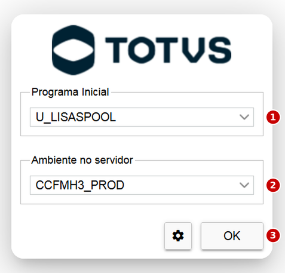

| Nº | Campo | Descrição |
|---|---|---|
| 1 | **Programa Inicial** | `U_LISASPOOL`. |
| 2 | **Ambiente no servidor** | `CCFMH3_PROD` (produção). |
| 3 | **OK** | Inicia o programa. Aparece **Conectando ao Protheus...** enquanto o acesso é preparado. |

---

### 3.2 Login

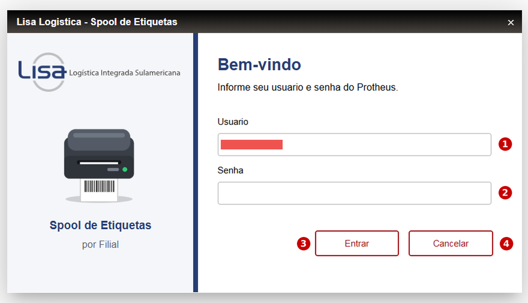

| Nº | Campo | Descrição |
|---|---|---|
| 1 | **Usuário** | Login do Protheus. |
| 2 | **Senha** | Senha do Protheus. |
| 3 | **Entrar** | Valida o usuário e segue para a próxima tela. |
| 4 | **Cancelar** | Fecha o programa sem abrir o monitor. |

### Validações

| Validação | Mensagem |
|---|---|
| Usuário e senha informados | Informe usuario e senha. |
| Usuário e senha conferem (`PswSeek` / `PswName`) | Usuario ou senha invalidos. |
| Usuário não bloqueado | Usuario bloqueado no Protheus. |
| Usuário com acesso a pelo menos uma filial | O usuario ... nao tem acesso a nenhuma filial da empresa 03. |

---

### 3.3 Escolher a filial (primeiro acesso)

Só aparece na primeira vez que a máquina é usada. A filial escolhida fica **salva na estação**.

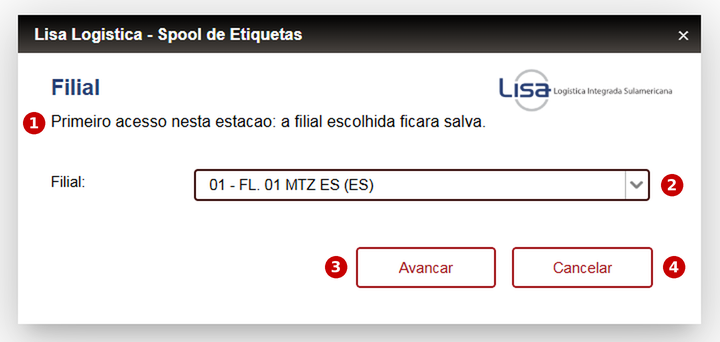

| Nº | Campo | Descrição |
|---|---|---|
| 1 | **Aviso** | Indica o primeiro acesso: a filial escolhida ficará salva. |
| 2 | **Filial** | Somente as filiais liberadas para o usuário, com código, nome e UF. |
| 3 | **Avançar** | Entra na filial (**Entrando na filial...**) e segue para a fila. |
| 4 | **Cancelar** | Fecha o programa. |

### Regra

> Se o usuário tiver acesso a uma única filial, esta tela é pulada. A pasta `C:\MSCBSPOOL` é criada automaticamente e a filial é gravada em `lisaspool.ini`.

---

### 3.4 Fila e Impressora

Lista **todas as filas da filial**. Ao trocar a fila, o tipo e o local são atualizados.

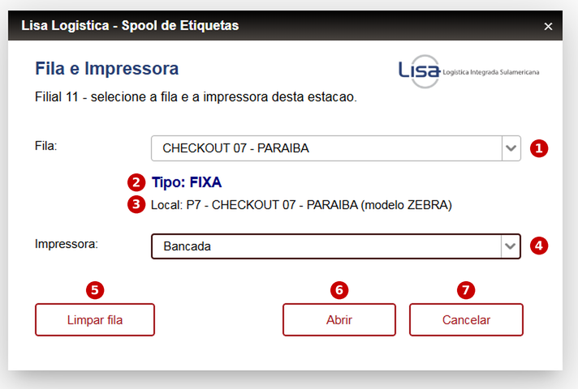

| Nº | Campo | Descrição |
|---|---|---|
| 1 | **Fila** | Filas da filial. Já vem marcada a última fila usada na estação. |
| 2 | **Tipo** | **FIXA** (azul), **PORTATIL** (vermelho) ou **T.I.** (azul). |
| 3 | **Local** | Local de impressão da `CB5` e modelo, ex.: `P7 - CHECKOUT 07 - PARAIBA (modelo ZEBRA)`. |
| 4 | **Impressora** | Impressoras instaladas no Windows da estação. |
| 5 | **Limpar fila** | Abre a limpeza da fila selecionada (item 3.9). |
| 6 | **Abrir** | Mostra a confirmação. |
| 7 | **Cancelar** | Fecha o programa. |

Fila de impressora portátil e fila de testes da T.I.:

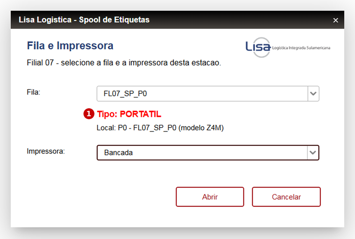

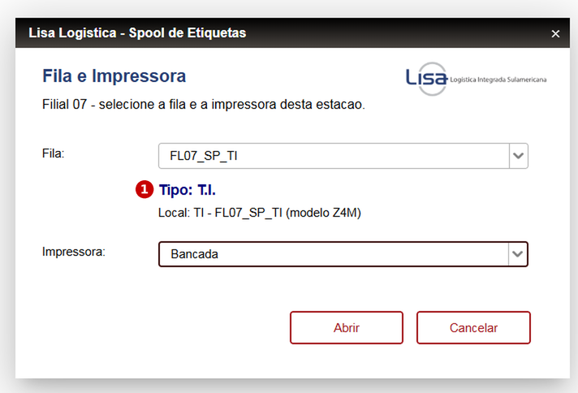

| Nº | Campo | Descrição |
|---|---|---|
| 1 | **Tipo** | **PORTATIL** em vermelho ou **T.I.**, para chamar atenção. |

### Regra

> Fila cadastrada sem pasta no servidor aparece no fim da lista com a marca **(SEM PASTA)** e não pode ser confirmada.

---

### 3.5 Confirmação

Ao clicar em **Abrir**, é exibido o resumo para conferência.

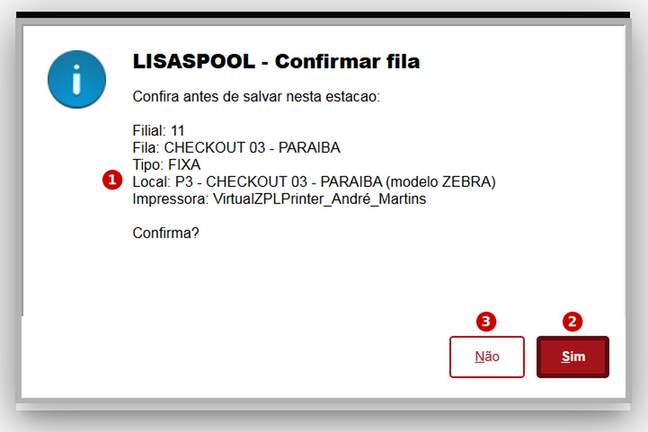

| Nº | Campo | Descrição |
|---|---|---|
| 1 | **Resumo** | Filial, fila, tipo, local e impressora que serão salvos. |
| 2 | **Sim** | Grava a configuração e abre o monitor. |
| 3 | **Não** | Volta para a tela de fila. |

Para fila **portátil** ou da **T.I.**, o resumo começa com um alerta:

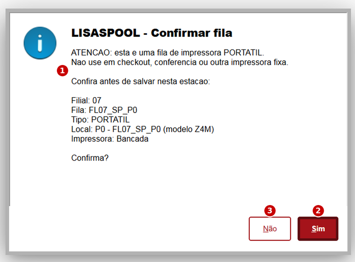

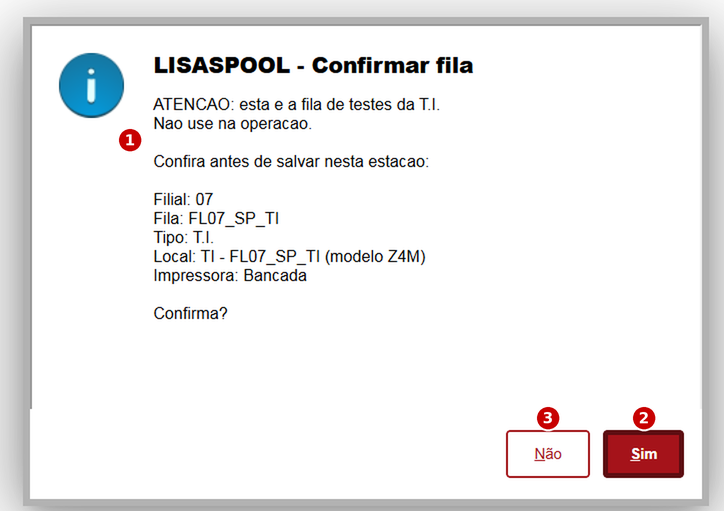

| Nº | Campo | Descrição |
|---|---|---|
| 1 | **Alerta** | Fila portátil (não usar em checkout ou impressora fixa) ou fila de testes da T.I. (não usar na operação). |
| 2 | **Sim** | Confirma mesmo assim. |
| 3 | **Não** | Volta para escolher outra fila. |

### Validações

| Validação | Mensagem |
|---|---|
| Fila com pasta no servidor | A fila ... esta cadastrada, mas a pasta dela nao foi encontrada no servidor. Caminho(s) testado(s): ... |

---

### 3.6 Monitor aberto e ativado

O `MSCBSPOOL` abre **já ativado** na fila e impressora gravadas. Não é preciso entrar em Parâmetros nem clicar em Ativar.

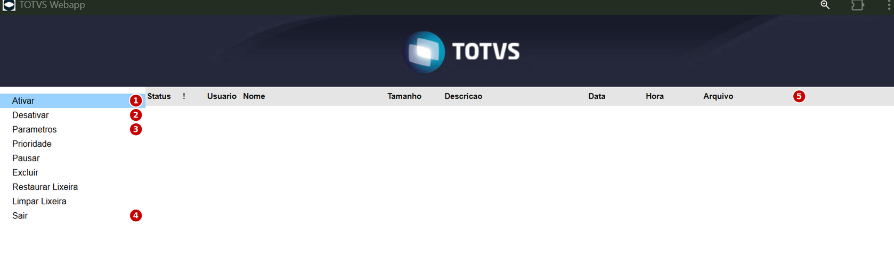

| Nº | Opção | Descrição |
|---|---|---|
| 1 | **Ativar** | Não é preciso clicar: já abre ativado. |
| 2 | **Desativar** | Para o monitoramento (as etiquetas ficam paradas). |
| 3 | **Parametros** | Não alterar: a configuração é feita pelo LISASPOOL. |
| 4 | **Sair** | Fecha o monitor. Usar só no fim do turno. |
| 5 | **Lista** | Etiquetas da fila: status, usuário, tamanho, data, hora e arquivo. |

### Regra

> O monitor deve ficar aberto durante todo o turno. Dentro do `MSCBSPOOL` a tela de parâmetros mostra todas as filas (tela padrão da TOTVS): a troca de fila deve ser feita sempre pelo LISASPOOL.

---

### 3.7 Configuração desta Estação (próximos acessos)

Depois do primeiro acesso, logo após o login aparece o resumo da estação.

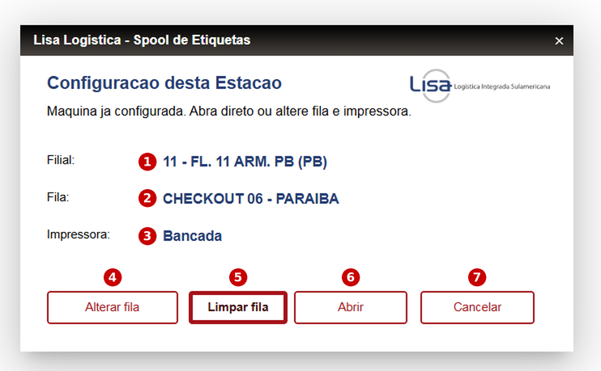

| Nº | Campo | Descrição |
|---|---|---|
| 1 | **Filial** | Filial salva na máquina. |
| 2 | **Fila** | Fila salva na máquina. |
| 3 | **Impressora** | Impressora do Windows salva na máquina. |
| 4 | **Alterar fila** | Vai para Fila e Impressora mantendo a mesma filial. Usar quando a máquina muda de posto. |
| 5 | **Limpar fila** | Abre a limpeza da fila salva (item 3.9). |
| 6 | **Abrir** | Abre o monitor direto, já ativado. |
| 7 | **Cancelar** | Fecha o programa. |

### Regra

> No **Abrir**, o programa confere se a fila salva ainda existe e se o modelo gravado no `.ini` está certo. Se a fila não existir mais, avisa e abre a tela de fila. A filial da máquina não muda pelo **Alterar fila**: para trocar, apagar o `C:\MSCBSPOOL\lisaspool.ini`.

---

### 3.8 Arquivos gravados na estação

| Arquivo | Chave | Gravado pelo LISASPOOL |
|---|---|---|
| `mscbspool.ini` | `fila` | Fila escolhida. |
| `mscbspool.ini` | `impressora` | Modelo da fila = subpasta do spool (`Z4M`, `ZEBRA`). |
| `mscbspool.ini` | `porta` / `drivewin` | Impressora do Windows / `Sim`. |
| `lisaspool.ini` | `filial` | Filial padrão da estação. |

As demais chaves do `mscbspool.ini` (`filtro`, `path`, `settings`, `limlixeira`) são mantidas como estão.

---

### 3.9 Limpar a fila

Cada fila guarda no servidor o **histórico** (etiquetas já impressas, na pasta `impresso`) e as **travadas** (etiquetas soltas na pasta da fila, ainda não impressas).

**Fila sem etiquetas** – a tela confirma a verificação e os botões ficam desabilitados:

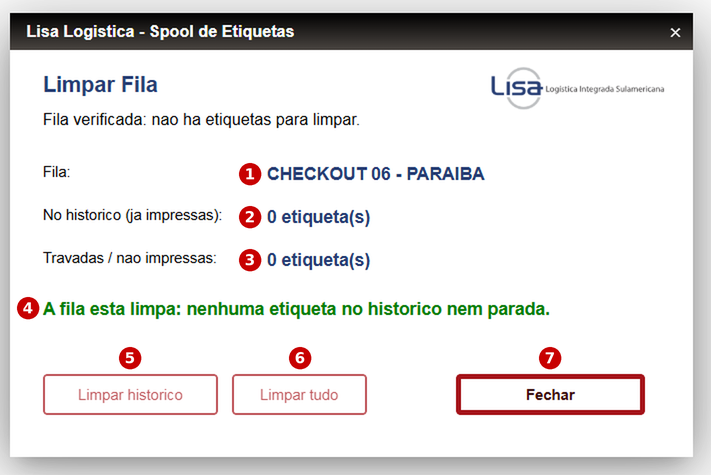

| Nº | Campo | Descrição |
|---|---|---|
| 1 | **Fila** | Fila verificada. |
| 2 | **No histórico** | Etiquetas já impressas. |
| 3 | **Travadas** | Etiquetas que ainda não saíram. |
| 4 | **Mensagem** | A fila está limpa. |
| 5 | **Limpar histórico** | Desabilitado. |
| 6 | **Limpar tudo** | Desabilitado. |
| 7 | **Fechar** | Volta para a tela anterior. |

**Fila com etiquetas travadas:**

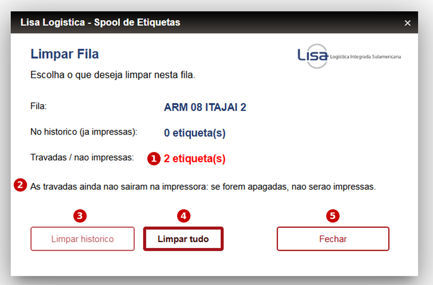

| Nº | Campo | Descrição |
|---|---|---|
| 1 | **Travadas** | Quantidade em vermelho. |
| 2 | **Aviso** | As travadas, se apagadas, não serão impressas. |
| 3 | **Limpar histórico** | Apaga só as já impressas. |
| 4 | **Limpar tudo** | Apaga histórico e travadas (pede confirmação). |
| 5 | **Fechar** | Volta sem limpar. |

**Ao abrir a fila** – se houver histórico ou travadas, a pergunta aparece antes do monitor:

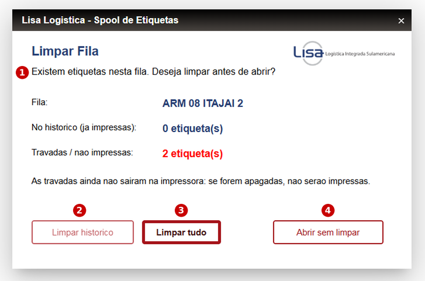

| Nº | Campo | Descrição |
|---|---|---|
| 1 | **Pergunta** | Existem etiquetas nesta fila. Deseja limpar antes de abrir? |
| 2 | **Limpar histórico** | Apaga as já impressas e abre o monitor. |
| 3 | **Limpar tudo** | Apaga histórico e travadas e abre o monitor. |
| 4 | **Abrir sem limpar** | Abre o monitor sem apagar nada. |

**Confirmação das travadas:**

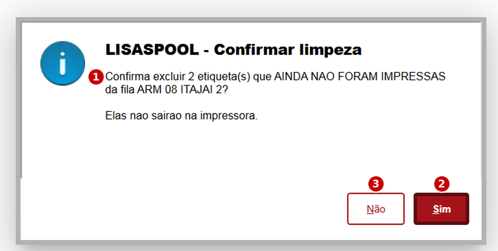

| Nº | Campo | Descrição |
|---|---|---|
| 1 | **Mensagem** | Quantidade de etiquetas não impressas que serão excluídas. |
| 2 | **Sim** | Exclui; elas não sairão na impressora. |
| 3 | **Não** | Cancela a limpeza. |

### Regra

> A limpeza apaga **somente arquivos de etiqueta** (`NNNNNNNN.0000`, `.0001`, `.end`). O `ctrl.seq` (controle de sequência da fila) e a pasta `impresso` nunca são apagados. Se a fila estiver limpa, a pergunta ao abrir não aparece.

---

## 4. Mensagens

| Mensagem | Causa |
|---|---|
| Nao foi possivel conectar na empresa 03. | Falha ao abrir o ambiente. |
| Informe usuario e senha. | Campos de login em branco. |
| Usuario ou senha invalidos. | Login ou senha não conferem. |
| Usuario bloqueado no Protheus. | Usuário bloqueado no cadastro. |
| O usuario ... nao tem acesso a nenhuma filial da empresa 03. | Nenhuma filial liberada para o usuário. |
| Nao foi possivel entrar na filial ... com o usuario ... | O `RpcSetEnv` recusou o acesso à filial. |
| Nao foi possivel salvar a filial desta estacao ... | Não gravou o `lisaspool.ini` (WebAgent parado). |
| Nenhuma fila encontrada para a filial ... | A filial não tem locais tipo Spool na `CB5` nem filas `FL` + filial na J3. |
| A fila ... esta cadastrada, mas a pasta dela nao foi encontrada no servidor. | Fila **(SEM PASTA)** selecionada; mostra os caminhos testados. |
| A fila salva nesta estacao (...) nao foi encontrada na filial ... | No **Abrir**, a fila salva não existe mais. |
| Nao foi possivel gravar a fila no arquivo ... | Não gravou o `mscbspool.ini` (WebAgent parado). |
| Existem etiquetas nesta fila. Deseja limpar antes de abrir? | A fila tem histórico ou etiquetas travadas. |
| A fila esta limpa: nenhuma etiqueta no historico nem parada. | Limpar fila acionado com a fila vazia. |
| Confirma excluir ... etiqueta(s) que AINDA NAO FORAM IMPRESSAS ...? | **Limpar tudo** com etiquetas travadas. |
| Limpeza concluida na fila ... | Resultado da limpeza; avisa se algum arquivo não pôde ser excluído. |
| Esta fila esta ativa em outra janela ou nao existe o local ... | Mensagem do `MSCBSPOOL`: fila aberta em outra estação. |

---

## 5. Resumo das Regras

| Função / Campo | Finalidade |
|---|---|
| `U_LISASPOOL` | Programa inicial: login, filial, fila, gravação, limpeza e chamada do `MSCBSPOOL`. |
| `MSCBSPOOL()` | Monitor de etiquetas padrão TOTVS, chamado sem alteração. |
| `SM0` / `M0_CODFIL`, `M0_FILIAL`, `M0_ESTENT` | Lista de filiais, nome e UF. |
| `PswRet` / `[2][6]` | Filiais liberadas ao usuário (`@@@@` = todas). |
| `CB5` / `CB5_TIPO` | Local de impressão; só entra o tipo `3` (Spool). |
| `CB5` / `CB5_FILA` | Chave da fila na J3. |
| `CB5` / `CB5_MODELO` | Modelo = subpasta da fila no servidor (`Z4M`, `ZEBRA`). |
| `CB5` / `CB5_DESCRI` | Local exibido na tela e base do tipo da fila. |
| `SX5` / tabela `J3` | Nome da fila (descrição) e reserva pelo padrão `FL` + filial. |
| `\IMPTER\<modelo>\<fila>` | Pasta da fila no servidor (`ctrl.seq`, etiquetas travadas e pasta `impresso`). |
| `C:\MSCBSPOOL\mscbspool.ini` | Fila, modelo e porta usados pelo `MSCBSPOOL`. |
| `C:\MSCBSPOOL\lisaspool.ini` | Filial padrão da estação. |
| `LISALOGO.PNG` / `LSPIMP.PNG` | Imagens das telas, compiladas no RPO. |

---

## 6. Regras de Negócio – Resumo

1. O acesso exige usuário e senha do Protheus; usuário bloqueado não entra.
2. Só aparecem as filiais liberadas ao usuário; as filiais 04 e 10 nunca aparecem.
3. A filial é escolhida só no primeiro acesso e fica salva na estação; o **Alterar fila** mantém a filial.
4. As filas vêm dos locais tipo Spool da `CB5` da filial; se não houver, das filas da J3 com nome `FL` + filial.
5. A pasta da fila é `\IMPTER\<CB5_MODELO>\<descrição da J3>`, validada com `ExistDir` (grafia original, maiúscula e minúscula).
6. Fila sem pasta no servidor aparece como **(SEM PASTA)** e não pode ser confirmada.
7. O tipo da fila é **PORTATIL** quando a sequência do nome começa com `P` ou o local contém PORTAT/COLET; **T.I.** quando começa com `TI`; os demais são **FIXA**.
8. Fila portátil ou da T.I. exige confirmação com alerta.
9. O programa grava fila, modelo, porta e `drivewin=Sim` no `mscbspool.ini`, mantendo as demais chaves, e cria a pasta `C:\MSCBSPOOL` quando não existe.
10. O `MSCBSPOOL` abre já ativado na fila gravada.
11. No **Abrir** direto, a fila salva é validada; se não existir mais, a tela de fila é aberta.
12. A limpeza apaga só arquivos de etiqueta; `ctrl.seq` e a pasta `impresso` são preservados.
13. **Limpar tudo** com etiquetas travadas pede confirmação extra, pois elas não serão impressas.
14. Ao abrir, a pergunta de limpeza só aparece quando há histórico ou etiquetas travadas.
