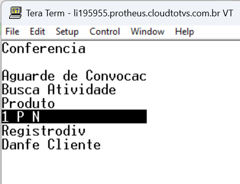
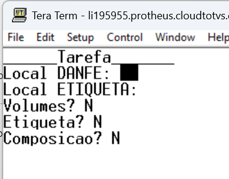
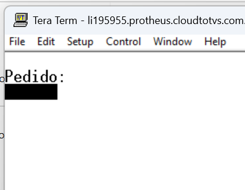
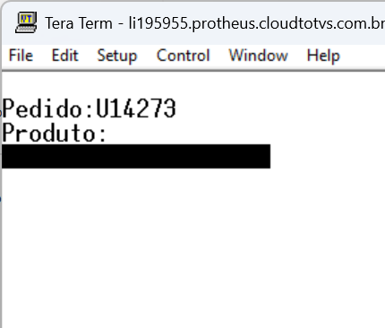
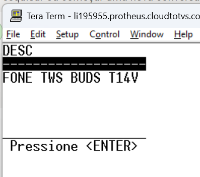
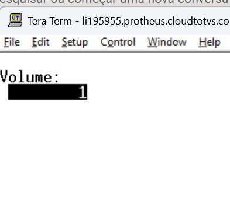
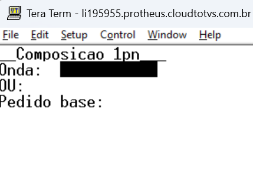
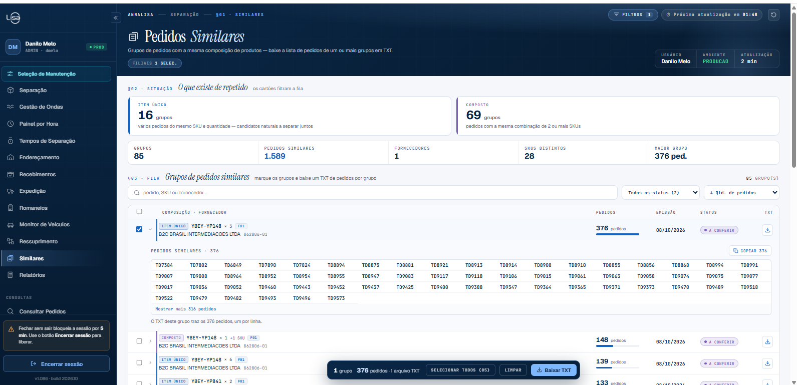
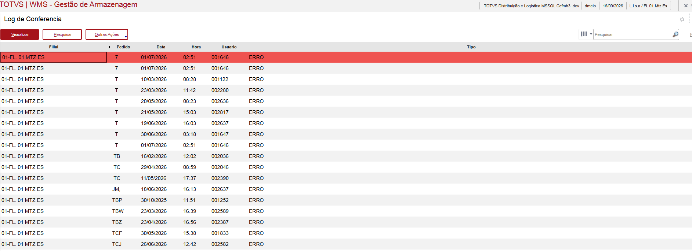
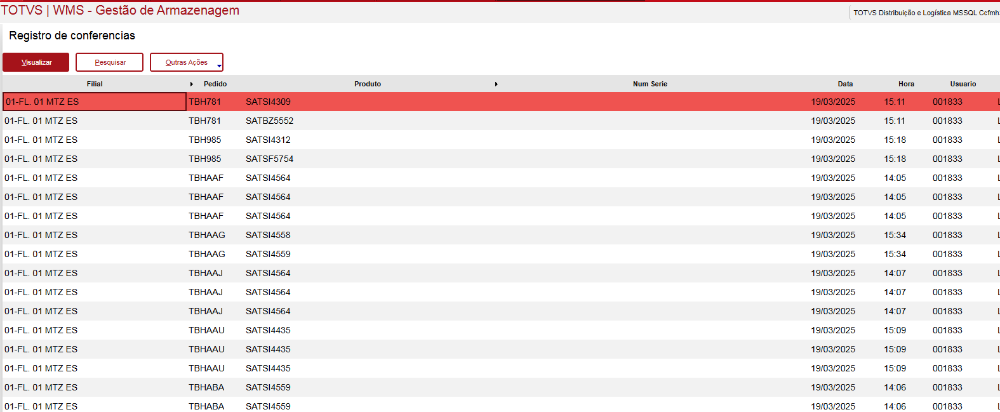

<!-- PADRAO-LISA -->
<p align="center">
  
</p>

<h1 align="center">Conferência 1PN</h1>
<p align="center"><b>WMS</b> · Lisa Logística Integrada Sulamericana</p>

[⬅ Voltar ao índice](../../README.md)

---

## Sumário

- [1. Objetivo](#1-objetivo)
- [2. Parâmetros de Configuração](#2-parâmetros-de-configuração)
- [3. Processo de conferência](#3-processo-de-conferência)
- [4. Informações adicionais](#4-informações-adicionais)

---

## 1. Objetivo

Realizar a conferência dos pedidos que possuem mais de uma unidade ou produto.

---

## 2. Parâmetros de Configuração

| Campo | Conteúdo | Descrição |
|---|---|---|
| `MV_XCHINSR` | Lógico | Indica se deve coletar número de série do produtos na conferência |
| `MV_XCHIQTD` | Lógico | Indica se deve informar a quantidade após informar o código de barras do produto |
| `MV_XCHCHVE` | Lógico | Indica se permite localiza o pedido pela Chave da NFe |
| `MV_XETDNFA` | Código do cliente e loja | Imprimir etiqueta danfe simplificada |
| `MV_XNAODNF` | Código do cliente e loja | Não deve imprimir danfe |
| `MV_XABCCLI` | Código do cliente e loja | Realiza integração com sistema Atom (Ambar-X) |
| `MV_XSNCLIA` | Código do cliente e loja | Não realiza coleta de série no apanhe, apenas na conferência |
| `MV_XCONDOC` | Lógico | Realiza a impressão de documentos registrados na Api Documentos |
| `MV_XCONVIP` | Código do cliente e loja | Realiza a impressão de etiquetas dos Correios pelo sistema Vipp |
| `MV_XCONTOT` | Código do cliente e loja | Realiza a impressão de etiquetas da Total Express pela integração Api Total |
| `MV_XIDCORR` | Código da transportadora | Lista de códigos dos correios para integração Vipp |
| `MV_XIDTOTA` | Código da transportadora | Lista de códigos da TotalExpress para integracao |
| `MV_XCLINFR` | Código do cliente e loja | Realiza integração com sistema Infracommerce |
| `MV_XAPINFR` | Caractere | Endereço do Server Api Infracommerce |
| `MV_XSNCVLD` | Código do cliente e loja | Realiza a validação do serial coletado com a entrada do produto | 
| `MV_XSNLD` | Lógico | Realiza a validação do serial coletado com a entrada do produto |
| `MV_X1PNESC` | Lógico | Permite finalizar a conferência apenas quando pressionado ESC |
| `MV_XMINCAR` | Numérico | Quantidade mínima de caracteres para leitura do número de série |
| `MV_XDIASSN` | Numérico | Quantidade de dias para validar permitir uma nova coleta do mesmo número de série já registrado para outro pedido (para os casos de produtos retornados ao armazém, como por exemplo devoluções) |
| `MV_XALTSER` | Lógico | Valida a quantidade de seriais coletados com a quantidade dos produtos conferidos |
| `MV_XDNF000` | Código do cliente e loja | Não completa com zeros a esquerda o número da NF para localizar o arquivo PDF DANFE |
| `MV_XBLQCONF` | Lógico | Realiza o bloqueio da conferência do pedido que registrou divergências ao tentar finalizar |
| `MV_X1PNBUS` | Lógico | Só deve realizar a busca do pedido para conferência após a quantidade total ser registrada |
| `MV_XUSREXC` | Código do usuário | Usuários que podem realizar o desbloqueio da conferência do pedido |

---

## 3. Processo de conferência

### Fluxo

```text
Informar pedido
       ↓
Informar produtos
       ↓
Informar quantidade total de volumes
```

Acesse a rotina **conf1pn** para iniciar a conferência do pedido:

<p align="center">
  <br>
  <sub><b>Figura 1</b></sub>
</p>

Preencher os campos conforme necessidade:

<p align="center">
  <br>
  <sub><b>Figura 2</b></sub>
</p>

- `Local DANFE` — Código da fila de impressão da DANFE;
- `lOCAL ETIQUETA` — Código da fila de impressão da etiqueta;
- `Volumes` — Se será realizado o processo de montagem e registros de volumes;
- `Etiqueta` — Se será realizado o processo de impressão de etiquetas por volume (picking list);
- `Composicao` — Se será realizada a busca do pedido para conferência através da onda ou composição dos pedidos;

Informar o pedido a ser conferido:

<p align="center">
  <br>
  <sub><b>Figura 3</b></sub>
</p>

Informar o código de barras do produto a ser conferido:

<p align="center">
  <br>
  <sub><b>Figura 4</b></sub>
</p>

Para consultar os produtos já conferidos pressione `Ctrl + C`

<p align="center">
  <br>
  <sub><b>Figura 5</b></sub>
</p>

Após a conferência realizada com sucesso informar a quantidade de volumes:

<p align="center">
  <br>
  <sub><b>Figura 6</b></sub>
</p>

#### Conferência por composição/onda

Ao acessear a rotina de conferência 1pn e informar o campo `Composicao` igual a S, será solicitado a onda ou o pedido base:

<p align="center">
  <br>
  <sub><b>Figura 7</b></sub>
</p>

Se localizado um pedido para a onda ou com a composição do pedido base informado, o sistema irá atribuir o pedido ao usuário logado e apresentá-lo para conferência na tela do usuário.

> ATENÇÃO → Serão atribuidos apenas pedidos no status A CONFERIR sem recurso humano atribuído ou com o recurso humano do usuário logado, a ordem para atribuição do pedido seguirá: Data do pedido, Prioridade (configurada no cadastro GrupoXCampanha), Campanha.

💡 Sugestão: Acessar o monitor `Similares` no Annalisa para obter a quantidade de pedidos e os pedidos de uma mesma composição.

Pedidos de mesma composição são pedidos com os mesmos produtos e quantidades.

<p align="center">
  <br>
  <sub><b>Figura 8</b></sub>
</p>

---

## 4. Informações adicionais

Todos os erros e mensagens apresentadas ao usuário no momento da conferência do pedido ficam registradas e estão disponíveis para consulta no Protheus através do cadastro `Log de conferencia`:

<p align="center">
  <br>
  <sub><b>Figura 9</b></sub>
</p>

As conferências registradas no momento da conferência ficam disponíveis para consulta no Protheus através do cadastro `Registro de conferencia`:

<p align="center">
  <br>
  <sub><b>Figura 10</b></sub>
</p>

---

[⬅ Voltar ao índice](../../README.md)

<p align="center">
  <br>
  <sub>Lisa Logística Integrada Sulamericana · Tecnologia da Informação</sub>
</p>
