<!-- PADRAO-LISA -->
<p align="center">
  
</p>

<h1 align="center">Conferência de embarque</h1>
<p align="center"><b>WMS</b> · Lisa Logística Integrada Sulamericana</p>

[⬅ Voltar ao índice](../../README.md)

---

## Sumário

- [1. Objetivo](#1-objetivo)
- [2. Configuração](#2-configuração)
- [3. Processo de conferência](#3-processo-de-conferência)
- [4. Informações adicionais](#4-informações-adicionais)

---

## 1. Objetivo

Realizar a conferência dos produtos embarcados do veículo no momento da expedição e enviar solicitação de faturamento com produtos conferidos e embarcados.

---

## 2. Configuração

| Cadastro | Campo | Conteúdo | Descrição |
|---|---|---|---|
|Config Cliente Wms| Email Sol Ft `ZCI_MAILFT` | E-mails | Destinatário de e-mail para recebimento da solicitação de faturamento (separar e-mails por um ponto e vírgula) |

---

## 3. Processo de conferência

### Fluxo

```text
Informa pedido
      ↓
Bipa produto
      ↓
Registra item embarcado
      ↓
Fecha o embarque
      ↓
Existem sobras?
   ↙          ↘
 Sim           Não
  ↓             ↓
Exibe sobras    ↓
  ↓             ↓
Solicita confirmação
      ↓
Confirma fechamento
      ↓
Envia e-mail para faturamento
```

Acesse a rotina **Conf Embarque** para iniciar a conferência do pedido:

<p align="center">
  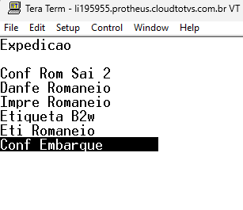<br>
  <sub><b>Figura 1</b></sub>
</p>

Informe o número do pedido:

<p align="center">
  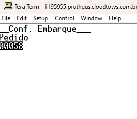<br>
  <sub><b>Figura 2</b></sub>
</p>

Informar o código de barras do produto a ser conferido:

<p align="center">
  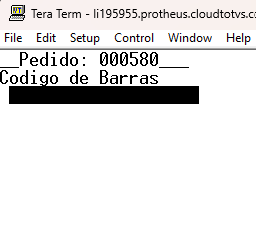<br>
  <sub><b>Figura 3</b></sub>
</p>

Para consultar os produtos já conferidos pressione `Ctrl + Q`

<p align="center">
  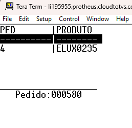<br>
  <sub><b>Figura 4</b></sub>
</p>

Após realizar a conferência de todos os produtos precione `Esc` para sair ou fechar a conferência:

<p align="center">
  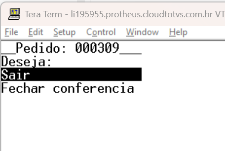<br>
  <sub><b>Figura 5</b></sub>
</p>

#### Registros de conferência do embarque

Acessar a opção `Conferencia Embarquei` no Protheus WMS:

<p align="center">
  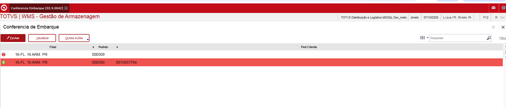<br>
  <sub><b>Figura 6</b></sub>
</p>

Acione a opcão visualisar para ter acesso ao registros de conferência.

<p align="center">
  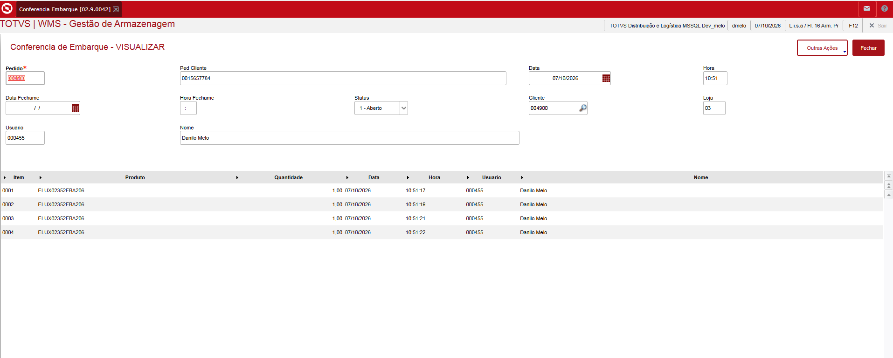<br>
  <sub><b>Figura 7</b></sub>
</p>

Acione a opcão em outras ações monitor verificar a relação de produtos conferidos e produtos no pedido de venda.

<p align="center">
  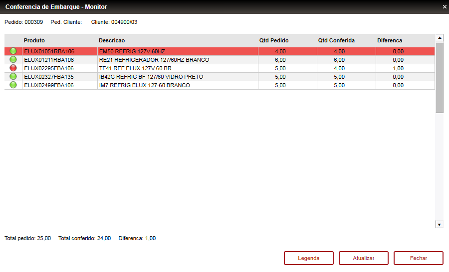<br>
  <sub><b>Figura 8</b></sub>
</p>

> ATENÇÃO → Precionando a tecla de atalho F12 a tela de monitor será apresentada para o pedido posicionado.

Para fechar a conferência de embarque do pedido acione a opção `fechar`.


<p align="center">
  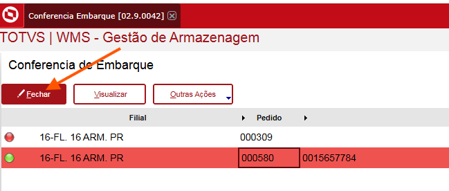<br>
  <sub><b>Figura 9</b></sub>
</p>

Para solicitar o faturamento do pedido e enviar o e-mail acione a opção `Solicitar faturamento`

<p align="center">
  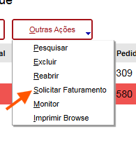<br>
  <sub><b>Figura 10</b></sub>
</p>

<p align="center">
  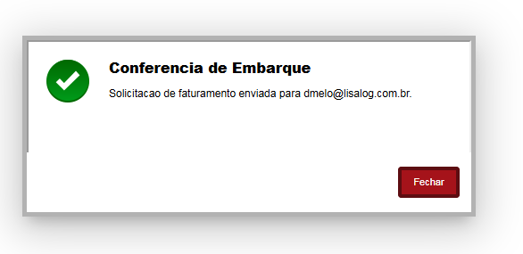<br>
  <sub><b>Figura 11</b></sub>
</p>

Caso necessário é possível reabrir uma conferência de um pedido através da opção `Reabrir`

<p align="center">
  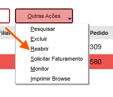<br>
  <sub><b>Figura 12</b></sub>
</p>

Modelo de e-mail enviado quando há sobras de embarque.

<p align="center">
  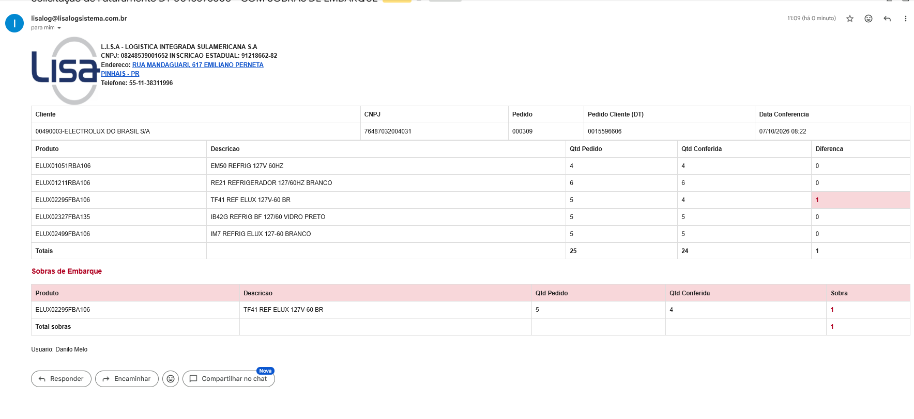<br>
  <sub><b>Figura 13</b></sub>
</p>

Modelo de e-mail enviado quando não há sobras de embarque.

<p align="center">
  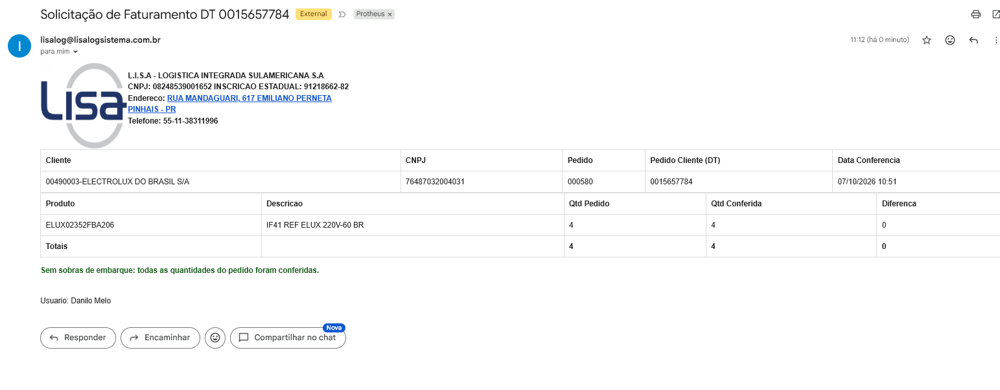<br>
  <sub><b>Figura 14</b></sub>
</p>

---

## 4. Informações adicionais

- Apenas pedidos no status `CONFERIDO` podem iniciar a conferência de embarque.
- E-mail de solicitação do fatumento só é enviado para conferência `Fechada`.
- Após o envio com sucesso do e-mail de solicitação de faturamento o campo `Enviado (ZAO_ENVIA)` é marcado como `S` identificando que já foi enviado e-mail do pedido.

---

[⬅ Voltar ao índice](../../README.md)

<p align="center">
  <br>
  <sub>Lisa Logística Integrada Sulamericana · Tecnologia da Informação</sub>
</p>
