# Pré-separação

## 1. Objetivo

Realizar a pré-separação de produtos para um endereço de destino, permitindo a geração de um pedido com os produtos previamente separados.

---

## 2. Configuração

| Parâmetro | Conteúdo | Descrição |
|---|---|---|
| `MV_XINITRA` | TR | Endereço de destino dos produtos pré-separados |
| `MV_XINIDOC` | DS | Doca de destino dos produtos na geração do pedido de venda |
| `MV_XCLIPRE` | Cliente+loja | Código do cliente + loja a ser sugerido na importação da DT (Documento de Transporte). |

---

## 3. Processo de pré-separação

### Fluxo

```text
Importar ou cadastrar pré-separação
      ↓
Realizar a pré-separação
      ↓
Gerar pedido de venda para a pré-separação
      ↓
Realizar a conferência do pedido de venda
```

### Importando a Pré-Separação

Acesse, no menu, a opção Pré-Separação.

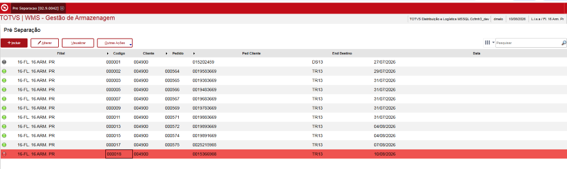

Figura 1 - Cadastro de pré-separação

Em Outras Ações, acesse Importar.

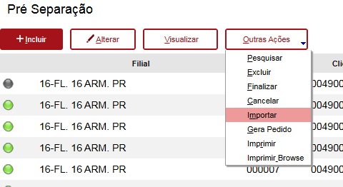

Figura 2 - Importar arquivo .csv de pré-separação

Selecione o arquivo da DT (.CSV) e aguarde o processamento.

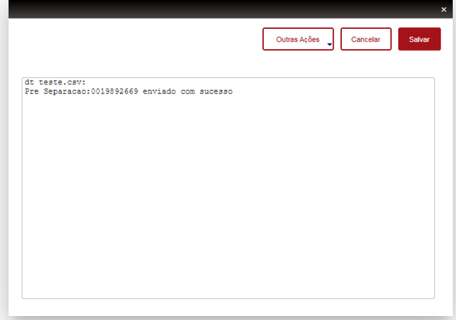

Figura 3 - Mensagem de sucesso ao importar arquivo

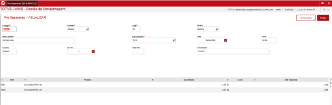

Figura 4 - Visualizando pré-separação

### Realizar a Pré-Separação

Acesse a opção Pré-Separação no coletor e informe o número do pedido
do cliente (DT).

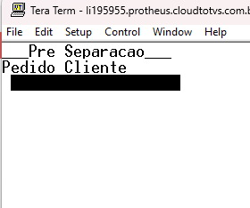

Figura 5 - Informando pedido para pré-separação

Selecione o item que deseja separar (navegue com o direcional para a
direita ou para baixo, caso queira visualizar mais informações sobre os
itens).

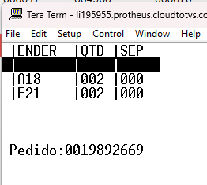

Figura 6 - Selecionando item para pré-separação

Confirme o endereço de retirada do produto (selecione o endereço
navegando com o direcional).

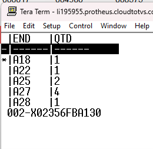

Figura 7 - Selecionando endereço de pré-separação

Confirme a quantidade e o endereço selecionados.

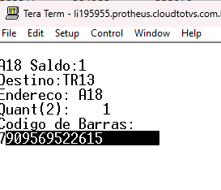

Figura 8 - Confirmando pré-separação

Aguarde a confirmação da transferência do saldo para o endereço de destino.

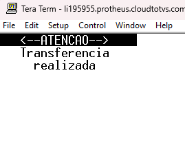

Figura 9 - Mensagem confirmando a transferência do item para o destino da
pré-separação

Realize a operação em todos os itens (sempre que um item for separado
por completo, ele ficará marcado com um asterisco '\*').

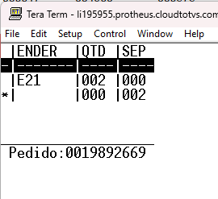

Figura 10 - Item marcado como separado

### Gerando o pedido para a pré-separação

Acesse o cadastro de Pré-Separação e acione a opção 'Finalizar' para
marcar a pré-separação como concluída.

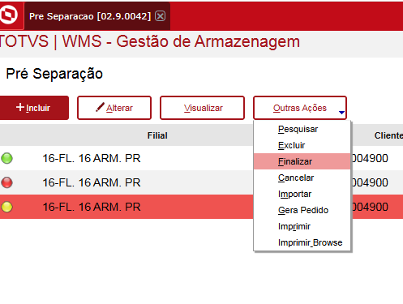

Figura 11 - Marcar pré-separação como finalizada

Acione a opção Gerar Pedido para a geração do pedido de venda.

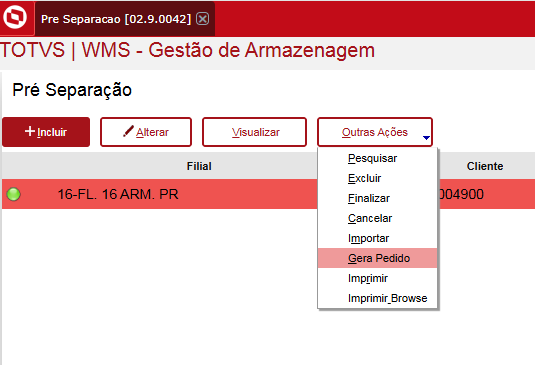

Figura 12 - Gerar pedido de venda para a pré-separação

Após o processamento, o pedido de venda será gerado sempre com a
quantidade separada (campo Qtd Separada).

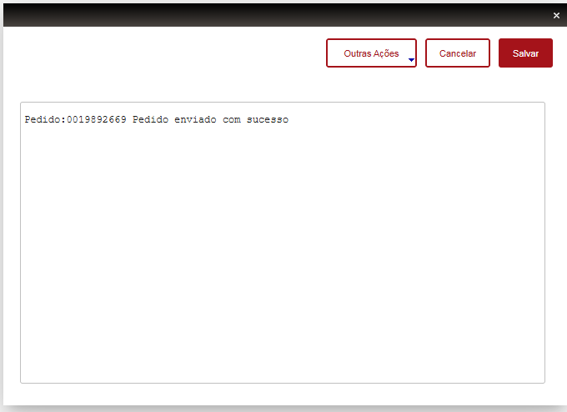

Figura 13 - Confirmação da geração do pedido de venda

Veja, no monitor de serviço, os itens com o apanhe finalizado no endereço
de destino da pré-separação.

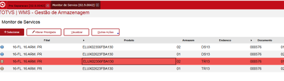

Figura 14 - Apanhe finalizado para o pedido pré-separado

### Impressão da Pré-Separação

Em Outras Ações, acesse a opção Imprimir, selecione uma pasta para
salvar o arquivo e visualize o arquivo .PDF gerado.

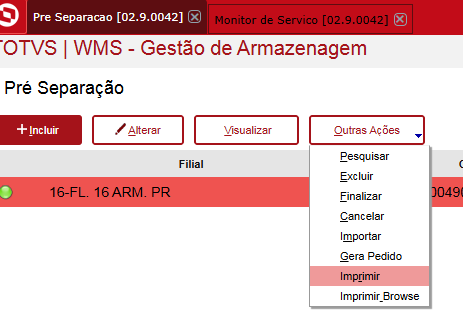

Figura 15 - Imprimindo pré-separação

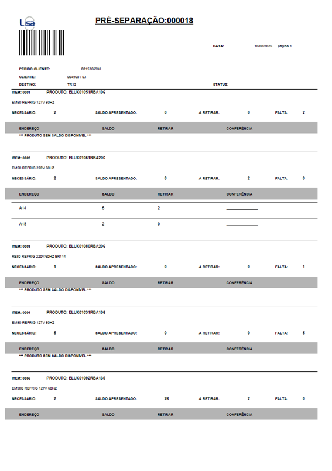

Figura 16 - Impressão gerada da pré-separação
