<!-- PADRAO-LISA -->
<p align="center">
  
</p>

<h1 align="center">Pré-separação</h1>
<p align="center"><b>WMS</b> · Lisa Logística Integrada Sulamericana</p>

[⬅ Voltar ao índice](../../README.md)

---

## Sumário

- [1. Objetivo](#1-objetivo)
- [2. Configuração](#2-configuração)
- [3. Processo de pré-separação](#3-processo-de-pré-separação)

---

## 1. Objetivo

Realizar a pré-separação de produtos para um endereço de destino, permitindo a geração de um pedido com os produtos previamente separados.

---

## 2. Configuração

| Parâmetro | Conteúdo | Descrição |
|---|---|---|
| `MV_XINITRA` | TR | Endereço de destino dos produtos pré-separados |
| `MV_XINIDOC` | DS | Doca de destino dos produtos na geração do pedido de venda |
| `MV_XCLIPRE` | Cliente+loja | Código do cliente + loja a ser sugerido na importação da DT (Documento de Transporte). |

---

## 3. Processo de pré-separação

### Fluxo

```text
Importar ou cadastrar pré-separação
      ↓
Realizar a pré-separação
      ↓
Gerar pedido de venda para a pré-separação
      ↓
Realizar a conferência do pedido de venda
```

### Importando a Pré-Separação

Acesse, no menu, a opção Pré-Separação.

<p align="center">
  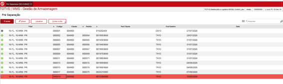<br>
  <sub><b>Figura 1</b> — Cadastro de pré-separação</sub>
</p>

Em Outras Ações, acesse Importar.

<p align="center">
  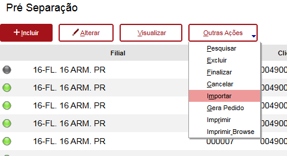<br>
  <sub><b>Figura 2</b> — Importar arquivo .csv de pré-separação</sub>
</p>

Selecione o arquivo da DT (.CSV) e aguarde o processamento.

<p align="center">
  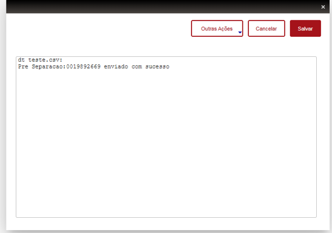<br>
  <sub><b>Figura 3</b> — Mensagem de sucesso ao importar arquivo</sub>
</p>

<p align="center">
  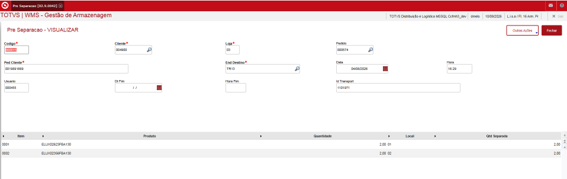<br>
  <sub><b>Figura 4</b> — Visualizando pré-separação</sub>
</p>

### Realizar a Pré-Separação

Acesse a opção Pré-Separação no coletor e informe o número do pedido
do cliente (DT).

<p align="center">
  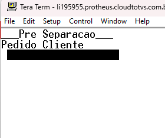<br>
  <sub><b>Figura 5</b> — Informando pedido para pré-separação</sub>
</p>

Selecione o item que deseja separar (navegue com o direcional para a
direita ou para baixo, caso queira visualizar mais informações sobre os
itens).

<p align="center">
  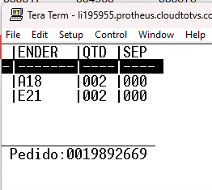<br>
  <sub><b>Figura 6</b> — Selecionando item para pré-separação</sub>
</p>

Confirme o endereço de retirada do produto (selecione o endereço
navegando com o direcional).

<p align="center">
  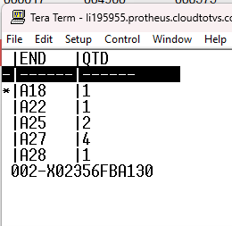<br>
  <sub><b>Figura 7</b> — Selecionando endereço de pré-separação</sub>
</p>

Confirme a quantidade e o endereço selecionados.

<p align="center">
  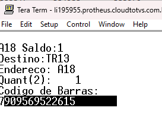<br>
  <sub><b>Figura 8</b> — Confirmando pré-separação</sub>
</p>

Aguarde a confirmação da transferência do saldo para o endereço de destino.

<p align="center">
  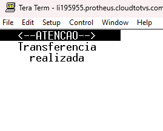<br>
  <sub><b>Figura 9</b> — Mensagem confirmando a transferência do item para o destino da</sub>
</p>
pré-separação

Realize a operação em todos os itens (sempre que um item for separado
por completo, ele ficará marcado com um asterisco '\*').

<p align="center">
  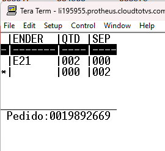<br>
  <sub><b>Figura 10</b> — Item marcado como separado</sub>
</p>

### Gerando o pedido para a pré-separação

Acesse o cadastro de Pré-Separação e acione a opção 'Finalizar' para
marcar a pré-separação como concluída.

<p align="center">
  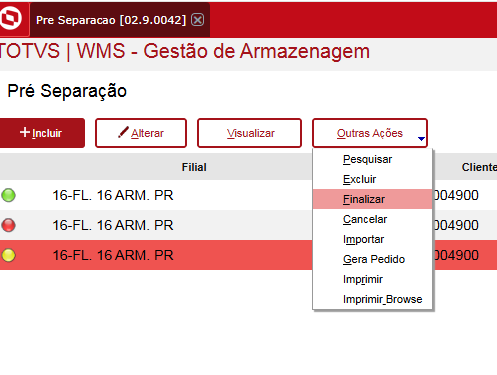<br>
  <sub><b>Figura 11</b> — Marcar pré-separação como finalizada</sub>
</p>

Acione a opção Gerar Pedido para a geração do pedido de venda.

<p align="center">
  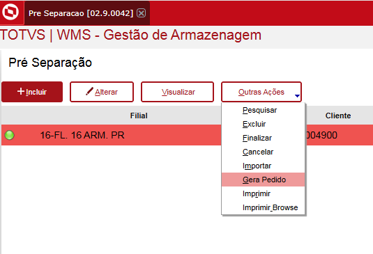<br>
  <sub><b>Figura 12</b> — Gerar pedido de venda para a pré-separação</sub>
</p>

Após o processamento, o pedido de venda será gerado sempre com a
quantidade separada (campo Qtd Separada).

<p align="center">
  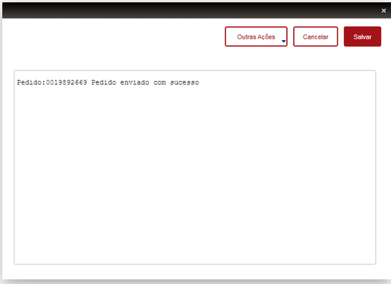<br>
  <sub><b>Figura 13</b> — Confirmação da geração do pedido de venda</sub>
</p>

Veja, no monitor de serviço, os itens com o apanhe finalizado no endereço
de destino da pré-separação.

<p align="center">
  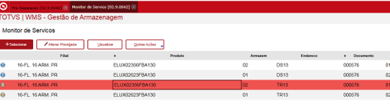<br>
  <sub><b>Figura 14</b> — Apanhe finalizado para o pedido pré-separado</sub>
</p>

### Impressão da Pré-Separação

Em Outras Ações, acesse a opção Imprimir, selecione uma pasta para
salvar o arquivo e visualize o arquivo .PDF gerado.

<p align="center">
  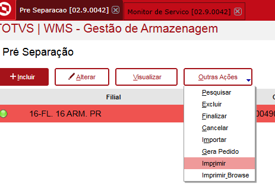<br>
  <sub><b>Figura 15</b> — Imprimindo pré-separação</sub>
</p>

<p align="center">
  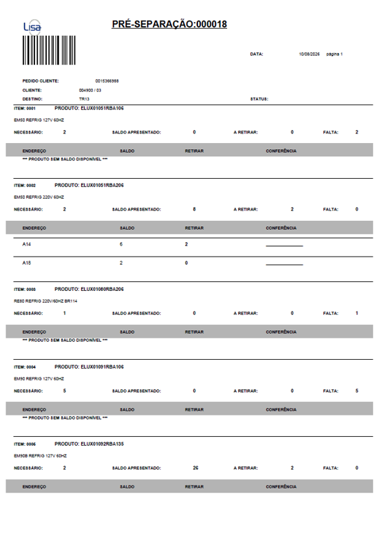<br>
  <sub><b>Figura 16</b> — Impressão gerada da pré-separação</sub>
</p>

---

[⬅ Voltar ao índice](../../README.md)

<p align="center">
  <br>
  <sub>Lisa Logística Integrada Sulamericana · Tecnologia da Informação</sub>
</p>
